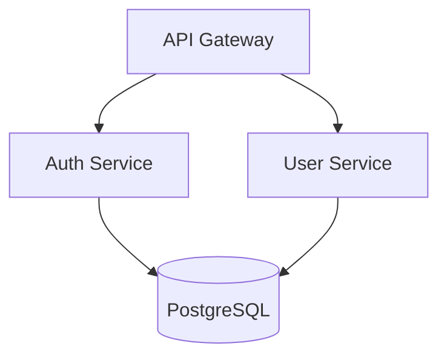

# Senior Architect

Architecture design and analysis tools for making informed technical decisions. Generate diagrams from project structure, analyze dependencies for coupling and cycles, assess architecture patterns, and drive database, pattern, and monolith-vs-microservices decisions with structured workflows.

## Quick Start

```bash
# Generate architecture diagram from project
python scripts/architecture_diagram_generator.py ./my-project --format mermaid

# Analyze dependencies for issues
python scripts/dependency_analyzer.py ./my-project --output json

# Get architecture assessment
python scripts/project_architect.py ./my-project --verbose
```

Example output (Mermaid diagram from `architecture_diagram_generator.py`):



The three scripts cover the core workflow: `architecture_diagram_generator.py` (component, layer, deployment diagrams in Mermaid/PlantUML/ASCII), `dependency_analyzer.py` (dependency tree, circular deps, coupling score), and `project_architect.py` (pattern detection, code smells, layer violations).

## Diagram ownership

senior-architect is the engineering owner of architecture and process diagrams. `md-document` is the provisional entry point that renders them as an HTML artifact. Diagram Design and Archify are unqualified challengers. The frozen comparison briefs are in `markdown-html/skills/md-document/evals/ab-cases.json`. CDN availability, semantic rendering and final selection need the blocked measured trial.

## References

- [Tools overview](references/tools-overview.md) - Diagram generator, dependency analyzer, project architect
- [Decision workflows](references/decision-workflows.md) - Database, pattern, monolith-vs-microservices
- [Tech stack and commands](references/tech-stack-and-commands.md) - Coverage matrix and common commands
- [Architecture patterns](references/architecture_patterns.md) - 9 patterns with trade-offs and examples
- [System design workflows](references/system_design_workflows.md) - 6 step-by-step design workflows
- [Tech decision guide](references/tech_decision_guide.md) - Decision matrices for technology choices
