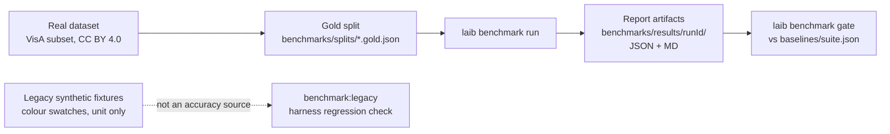

# Skill: Interpret Benchmark Results

## When to use this skill

Use after running a benchmark to understand what the numbers mean, whether quality has
improved or regressed, and what action to take next.

**Two harnesses exist — never mix them up:**

| Harness | How to run it | What its numbers mean |
| ------- | ------------- | ---------------------- |
| **Real-data benchmark (spec 003)** | `laib benchmark run` | The only product accuracy source. Artifacts land in `benchmarks/results/<runId>/` (JSON + Markdown) and are gated against `benchmarks/baselines/<suite>.json`. |
| **Legacy synthetic harness (unit fixture)** | `npx tsx scripts/benchmark-legacy.ts` (package script `benchmark:legacy`) | A regression check over synthetic colour-swatch fixtures. It proves the harness still runs — it says nothing about product accuracy. |

Per ADR-008 (`docs/adr/008-evidence-policy.md`), the real-data benchmark is the **only**
accuracy source. Synthetic fixtures remain unit-test inputs only; every accuracy claim in
the repo must point at the spec-003 artifacts (`benchmarks/results/<runId>/`,
`benchmarks/baselines/<suite>.json`, `benchmarks/splits/*.gold.json`, `datasets/registry.json`).



---

## Steps

### Step 1 — Locate the report files

Real-data run (spec 003):

```bash
ls benchmarks/results/
# → <runId>/report.json   <runId>/report.md
```

Legacy synthetic harness (unit fixture only):

```bash
ls reports/benchmark/
# → openai.json   anthropic.json   google.json
```

Legacy baseline: `packages/core/tests/fixtures/benchmark/baseline.json`.
Real-data baselines: `benchmarks/baselines/<suite>.json`.

### Step 2 — Read the key metrics

Real-data report (`benchmarks/results/<runId>/report.json`) carries the reproduction tuple
(dataset snapshot, split fingerprint, model version, config fingerprint, env capture) plus
per-class precision/recall/F1, macro F1, balanced accuracy, the confusion matrix,
calibration ECE (10 bins) with reliability data, latency percentiles (p50/p95),
cost per image and accuracy@budget.

Legacy synthetic report (NOT an accuracy source):

```json
{
  "provider": "openai",
  "model": "gpt-4o",
  "runAt": "2025-01-15T14:32:00Z",
  "metrics": {
    "precision": 0.87,
    "recall": 0.83,
    "unknownRate": 0.04,
    "costPer30Images": 0.021,
    "p95LatencyMs": 3200
  },
  "perCategory": {
    "water_damage": { "precision": 0.91, "recall": 0.78 },
    "..."
  }
}
```

**Definitions:**

- **Precision** — of images the model labelled as category X, what fraction actually are X (avoids false positives)
- **Recall** — of images that truly are category X, what fraction did the model label correctly (avoids false negatives)
- **Unknown rate** — fraction of images returned as `unknown` (goal: < 10%)
- **Cost per 30 images** — USD cost extrapolated from the fixture set
- **P95 latency** — 95th percentile of per-image API round-trip time in milliseconds

### Step 3 — Compare against baseline

Real-data gate (spec 003) — the gate CI enforces:

```bash
laib benchmark gate --suite <suite> --model-id <model>
# exit 0 = PASS, exit 1 = REGRESSION (per-class deltas attached)
# --model-id is REQUIRED: the root CLI already owns --model (the LLM model of
# the batch run) and Commander lets the parent consume it, so the benchmark
# subcommand uses --model-id to stay unambiguous.
```

Legacy synthetic harness only (unit fixture):

```bash
npx tsx scripts/benchmark-legacy.ts --provider openai --check-regression
# exit 0 = PASS, exit 1 = REGRESSION
```

### Step 4 — Interpret the results

| Signal                | Meaning                                         | Action                            |
| --------------------- | ----------------------------------------------- | --------------------------------- |
| Precision drops > 5%  | Model now makes more mistakes (false positives) | See Step 5 — improve prompts      |
| Recall drops > 5%     | Model now misses more true positives            | See Step 5 — check descriptions   |
| Unknown rate > 10%    | Model is unsure; categories may be too similar  | See Step 6 — redesign taxonomy    |
| Unknown rate < 2%     | Model is overconfident; may be hallucinating    | Check per-category precision      |
| Cost up > 20%         | Model token usage increased                     | Check if prompt grew unexpectedly |
| P95 latency > 8000 ms | Network or provider degradation                 | Retry benchmark later             |

For the real-data harness the comparable signal is the macro-F1 delta against
`benchmarks/baselines/<suite>.json` (tolerance −0.02 by default); the gate names every
regressed class.

### Step 5 — Diagnose per-category failures

Look at the per-class rows of the report for the lowest precision/recall categories
(real data: `benchmarks/results/<runId>/report.json`; legacy unit fixture:
`reports/benchmark/<provider>.json`):

```bash
node -e "
const r = JSON.parse(require('fs').readFileSync('reports/benchmark/openai.json','utf8'));
const cats = Object.entries(r.perCategory)
  .sort((a,b) => (a[1].precision + a[1].recall) - (b[1].precision + b[1].recall));
cats.slice(0, 3).forEach(([name, m]) =>
  console.log(name, '| precision:', m.precision?.toFixed(2), '| recall:', m.recall?.toFixed(2))
);
"
```

For the worst-performing categories:

1. Check if their `description` in `categories.json` is visually specific enough
2. Check if they are visually similar to another category (confusion matrix)
3. Use the **tune-prompt** skill to improve `buildBatchPrompt()` for these categories

### Step 6 — Decide: update baseline or file a bug

**Update baseline when:**

- All metrics improved by ≥ 1%
- Unknown rate decreased
- You intentionally changed the categories.json or model

Real-data baseline (spec 003) — an explicit, reviewed action with a dated header:

```bash
laib benchmark gate --suite <suite> --model-id <model> --update-baseline
```

Legacy synthetic baseline (unit fixture only):

```bash
npx tsx scripts/benchmark-legacy.ts --provider openai --update-baseline
git add packages/core/tests/fixtures/benchmark/baseline.json
git commit -m "chore: update legacy synthetic benchmark baseline for openai"
```

**File a bug (regression) when:**

- Any metric dropped > 5% vs baseline
- The drop is reproducible (run benchmark twice to confirm)
- No intentional change was made

### Step 7 — Cross-provider comparison

Real-data runs emit one section per model per provider inside the run artifact, so compare
those sections directly. The legacy harness, when run with `--provider all`:

```bash
node -e "
['openai','anthropic','google'].forEach(p => {
  try {
    const r = JSON.parse(require('fs').readFileSync('reports/benchmark/' + p + '.json','utf8'));
    const m = r.metrics;
    console.log(p.padEnd(12), 'P:', m.precision.toFixed(2), 'R:', m.recall.toFixed(2), 'U:', m.unknownRate.toFixed(2), '$:', m.costPer30Images.toFixed(3));
  } catch { console.log(p, '— no report'); }
});
"
```

Use this to recommend the default provider for a given domain:

- Highest recall → best for high-stakes (don't miss anything)
- Lowest cost → best for high-volume batches
- Lowest unknown rate → best for domains where `unknown` must be rare

Reminder: a recommendation published from the legacy synthetic harness is a harness
observation. Quote real-data numbers from `benchmarks/results/<runId>/` when making an
accuracy claim.
