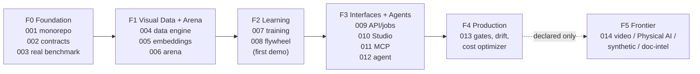

# Roadmap — Vision Lens

> **Last updated:** November 2026  
> **Status key:** 🟢 Shipped · 🔵 Planned · ⏸ Deferred · ❌ Removed · 🏗 Building (spec in progress)
>
> **North star:** a Visual Intelligence Engineering Workbench — the local-first engineering
> layer connecting visual data, specialized models and measured operational outcomes.
> Decisions: ADR-005 (pivot), ADR-006 (monorepo), ADR-007 (local-first), ADR-008 (evidence
> policy), ADR-009 (agent safety), ADR-010 (spec governance). Detailed plan lives in local
> spec-kit specs 001–014 (untracked, ADR-010); this file is the tracked mirror.

---

## Phase map (Vision Lens)

| Phase | Focus | Specs | Outcome | Status |
|---|---|---|---|---|
| F0 | Foundation | 001 monorepo · 002 domain/contracts · 003 real benchmark | rebirth scaffold, entity store · VisA ground truth + runner (003, shipped) | 🏗 001 🟢 · 002 🟢 (domain contracts + entity store + legacy importer) · 003 🟢 (real VisA baseline: macro F1 0.9795 / balanced accuracy 0.9700, gpt-4o over 700 gold images) |
| F1 | Visual Data + Arena | 004 data engine · 005 embeddings/search · 006 model arena | trustworthy datasets + calibrated model comparison | 🔵 |
| F2 | Learning | 007 training · 008 active-learning flywheel | specialized models + measured data loop — **first demo** | 🔵 |
| F3 | Interfaces + Agents | 009 API/jobs · 010 Studio · 011 MCP · 012 agent runtime | four equivalent surfaces + safe investigations | 🔵 |
| F4 | Production | 013 release gates, observability, drift, cost optimizer | promotion gates, incident primitives, cost control | 🔵 |
| F5 | Frontier | 014 declarations | video / Physical AI / synthetic / doc-intel reserved | ⏸ (declared) |

**First demo (closes F2):** import VisA subset → audit quality → embedding baseline probe →
arena (VLM vs local) → review hard cases (Studio) → AL batch → retrain → holdout delta
report (quality × cost × latency) → same investigation via agent over MCP.

---

## Historical record — v2.0 (legacy `ai-image-labeling` CLI)

Feature-complete and shipped (2024-01 → 2026-08). Preserved as `packages/core`/`cli`/`sdk`
(spec 001). Highlights: H1 cost & reliability (async batches, prompt caching, structured
output) · H2 data richness (lean schema, linking, SQLite) · H3 platform (hybrid routing,
self-critique, `--learn`, SDK, plugins) · H4–H5 hardening & breadth (Azure batch, atomic
writes) · H6 intelligence (suggest-categories, active-learn queue, calibration table) ·
H7 architecture gate (ports/adapters: Reporter, FileRepository; readonly data; provider
split) · H8 enterprise (S3/GCS/Azure outputs, webhooks, Bedrock/Vertex, TypeDoc) ·
H9 semantic retrieval (text embeddings + hybrid search) · H11 workflow intelligence
(sessions, consensus, diff).

Superseded by Vision Lens decisions:

| Was | Now |
|---|---|
| "No GUI / no HTTP server" (ROADMAP 2026-05: "What we are not building") | Superseded by ADR-005 — Studio, API and MCP are core surfaces (specs 009–011) |
| H12 COCO/YOLO/Label-Studio exports (YOLO = artificial full-image boxes, H12.2) | Spec 004: Ultralytics **classification** layout (per-class/split dirs); detection exports only with real geometry; Label-Studio flow → 010 review + 008 queue |
| H13 FTS5 / quantization / RRF; H15 HNSW/sharding | Superseded by spec 005 (LanceDB + real visual encoders); text search remains available |
| H14 CLIP-via-Ollama, query expansion, rerank | Absorbed into spec 005 encoder registry (SigLIP 2 / CLIP / DINOv2 on MPS) |
| H16 integrity items (readonly partial cache, maxAttempts rename, dep classification, index schema versioning, fs/sdk docs) | Spec 001/002 hygiene tasks — per-item status in the H16 table below |
| "Video out of scope" | F5 frontier track (spec 014) |
| Multi-user/SaaS exclusion | Still excluded for the product; SaaS exploration was a separate unmerged track |

### H16 integrity carryovers — status (spec 001)

| Item | Status | Note |
|---|---|---|
| H16.1 readonly partial cache | ✅ | all `PartialAnalysisCache` fields `readonly`; type-level test asserts mutation fails typecheck (`packages/core/tests/types.test.ts`) |
| H16.2 maxAttempts rename | ✅ | shipped earlier in 8da7a28 |
| H16.3 dependency classification | ✅ | `better-sqlite3` in `packages/core` optionalDependencies; guarded dynamic import with actionable error + missing-module test (`packages/core/tests/reporter/sqlite-missing.test.ts`) |
| H16.4 FileRepository in run paths | ✅ | shipped with H7 ports/adapters |
| H16.5 index schema versioning | 🔵 | superseded by 002 fingerprint v2 — full-config fingerprints replace the name-only hash |
| H16.6 fs/sdk docs rows | ✅ | AGENTS.md boundary table carries `packages/core/src/fs/` + `packages/sdk/` rows |

---

## Vision Lens phases in detail

### F0 — Foundation (specs 001–003)

- Monorepo (pnpm + Turborepo), `vision-lens` CLI + `ai-image-labeling` compat alias, CI fast gate,
  AGENTS boundary table for package layout — **zero behavior change, 361 tests green
  throughout** (001).
- Domain model + `packages/contracts` (14 entities, Zod, OpenAPI), SQLite store,
  fingerprint v2 fixing `src/index.ts:77` name-only hash (002).
- Shipped in 002: 14 versioned Zod entities with Prediction≠Annotation enforced structurally,
  the generated OpenAPI 3.1 seed, the SQLite entity store with migrations, repositories and
  the lineage walk, and the idempotent `vision-lens import-run` legacy importer.
- Real benchmark, **shipped under 003**: VisA subset (CC BY 4.0, license registry), seeded
  gold splits, metrics runner (per-class F1, ECE calibration, latency, cost), regression
  baselines. The dataset is fetched and checksum-pinned (`datasets/registry.json`), the
  committed gold manifest holds 700 real images (`benchmarks/splits/visa-subset.gold.json`), and
  the first real run scored `gpt-4o` at **macro F1 0.9795** / **balanced accuracy 0.9700** over
  all 700 of them. The tracked evidence is the gold set, the raw predictions and the baseline
  (`benchmarks/splits/visa-subset.gold.json`, `benchmarks/predictions/visa-subset.gpt-4o.json`,
  `benchmarks/baselines/visa-subset.json`); the run report (`benchmarks/results/<runId>/`) is a
  local artifact that the documented command reproduces. Every number comes from the 003
  artifacts (`benchmarks/baselines/<suite>.json`, `benchmarks/splits/*.gold.json`,
  `datasets/registry.json`) produced by `vision-lens benchmark run|gate|report`.
  It is a **regression baseline, not a product claim**: one model, one dataset subset, one day,
  and the split carries no held-out set — the upstream release has no session information, so
  all 700 items land in `train` and the benchmark scores the whole set.
- Synthetic accuracy claims retired: the legacy colour-swatch harness (package script
  `benchmark:legacy`, formerly the default accuracy runner) stays only as a unit-test
  fixture; it is not an accuracy source (ADR-008).

### F1 — Visual Data + Arena (004–006)

- Ingestion (hashing, EXIF sanitize, thumbnails, bomb guards), immutable snapshots,
  data-quality lab (dup/near-dup, leakage, imbalance), corrected exports (004).
- Python vision service (SigLIP 2 / CLIP / DINOv2 on MPS, memory admission), LanceDB,
  hybrid visual/text search, clustering (005).
- Model Arena: suites across VLM providers × encoder-probe × trained models; temperature
  scaling calibration; consensus v2 (agreement, not declared confidence — fixes
  `src/analyzer/consensus.ts:53`); Pareto reports (006).

### F2 — Learning (007–008) — first demo

- Training engine: linear probe → staged/full fine-tune, MPS backoff, MLflow local,
  checkpoints/resume, model registry v0 + model cards with license lineage (007).
- Flywheel: uncertainty×diversity selection, review queue, budget-aware cascade
  (local → specialized → VLM → human), holdout-proven delta reports (008). `--learn`
  stays as prompt aid during its deprecation window, superseded by real training.

### F3 — Interfaces + Agents (009–012)

- Fastify API + OpenAPI from contracts + SQLite job queue (resumable, idempotent, SSE)
  (009).
- Studio: dataset explorer, annotation review with provenance (AI-suggested ≠
  human-approved), experiment compare, A/B arena. **Visual design arrives from an external
  uxpilot.ai prototype** — spec 010 defines structure/flows and the integration point
  (tokens + skin layer), not the visual language (010).
- MCP server: tiered tools (read → analyze → propose → gated → approval-required), untrusted
  visual content as data, no fs/exec surface (011, ADR-009).
- Agent runtime: LangGraph investigator, budgets, checkpoints, approval gates,
  artifact-cited reports, evaluation harness with golden tasks (012).

### F4 — Production (013)

Release gates (macro-F1 floor, critical-class recall floor, calibration drift bound,
latency/cost budgets) · promotion/rollback via registry pin · inference service with
content-hash caching · OpenTelemetry traces + cost ledger · drift monitors (embedding PSI,
label distribution, calibration decay) → incident primitives ("time travel") ·
total-expected-cost optimizer reports (inference + review + FP + FN).

### F5 — Frontier (014, declared only)

Video intelligence · Physical AI sensors (Calibration, SynchronizedSequence reserved in 002)
· synthetic data factory (real-holdout-validated) · document intelligence ·
open-vocabulary concepts · SAM-family GPU workers (optional adapters, ADR-007).
Activation requires a new ADR + spec per track.

---

## What we are not building (current)

| Item | Reason |
|---|---|
| Owned foundation models | Adapt, evaluate and operate existing ones (constitution governance) |
| Multi-user / SaaS / RBAC | Single-user local-first; revisit with validated demand (vision monetization hypotheses) |
| Distributed/multi-GPU training | One MPS device; CUDA only via optional adapters (ADR-007) |
| Medical imaging vertical | Validation/regulatory burden out of scope for now |
| Spec-kit material in git | ADR-010 — planning stays local; ADRs + this roadmap are the tracked record |

## Metrics that matter (Vision Lens additions)

| Area | Metric | Target |
|---|---|---|
| Evidence | Benchmark on real data only (VisA subset) | enforced (003) |
| Calibration | ECE per model on the gold split | reported every arena run (006) |
| Reproducibility | Same config+snapshot+seed+env → val macro-F1 Δ | ≤ 0.02 (007) |
| Flywheel | AL batch → holdout macro-F1 delta vs random batch | measured, reported per round (008) |
| Cost | Cost per correctly-processed image (cascade vs single-model) | Pareto-reported (006/013) |
| Review | Human review minutes per accepted model improvement | ledger-tracked (008/013) |
| Integration | CLI = API = Studio = MCP parity table | green in CI (009/011) |
| Ops | p95 list endpoints @10k samples | < 50 ms (009) |

(Legacy CLI metrics — cache hit rate, unknown rate, hybrid cost split — remain tracked in
`packages/core`.)
