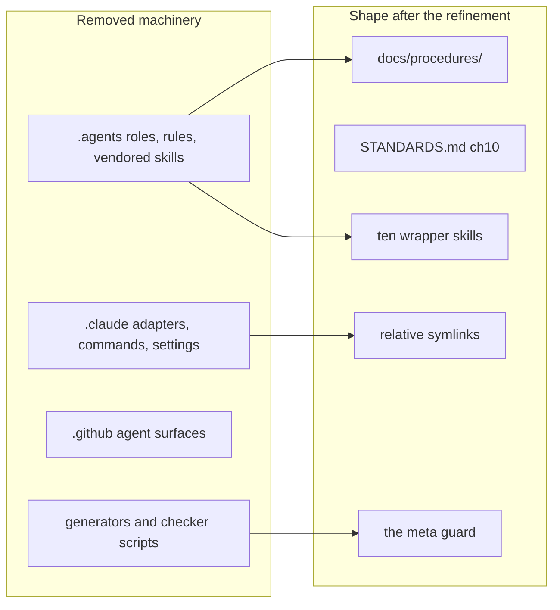

# ADR 020 - The repository is harness-agnostic

| Field    | Value      |
| -------- | ---------- |
| Status   | Accepted   |
| Date     | 2026-11-12 |
| Deciders | @erikunha  |

## Context

ADR-019 (2026-11-11) made the repository own its agent surface: canonical skills under
`.agents/skills/`, one symlink adapter per runtime, generated rule adapters, and gate scripts
holding the layout in place. Three facts argue for removing that surface rather than
maintaining it:

- 86 percent of the `.agents/` volume is personal method skills; only ten carry project knowledge.
- The surface needs generators, adapters and check scripts whose only job is keeping the
  packaging honest: maintenance cost, no product value.
- ADR-019 itself is the only tracked file still naming a developer's personal paths; the
  history is recorded there and needs no successor.

## Decision

**The repository is agnostic to any developer's agent harness.** This supersedes ADR-019 and
ADR-010.

1. No vendored method skills, no generated provider adapters, no surface generators or gates,
   no session hooks. Nothing tracked assumes a particular coding agent or harness.
2. Project knowledge lives in plain docs: procedures in `docs/procedures/`, per-module
   boundary checklists in `STANDARDS.md`, the boundary table and conventions in `AGENTS.md`,
   decisions in `docs/adr/`.
3. Review and contribution guidance live in `REVIEW.md` and `CONTRIBUTING.md`, the same
   contract for a human and for an agent.
4. Each developer's own tooling applies on top, outside git: never a prerequisite, never a
   second source of truth about this codebase.

## Consequences

**Positive:**

- Migration map: the ten project skills moved to `docs/procedures/` (the skill-format
  meta-procedure became `contributing-procedures.md`); the twelve path-scoped rules became the
  per-module checklists in `STANDARDS.md`, documents a stranger reads without knowing any harness.
- The `agents:*` gates, generated adapters and symlink trees are removed together with the
  directories they guarded (`.agents/`, `.claude/`, the agent surfaces under `.github/`); their
  maintenance cost and their failure modes leave with them.

**Negative:**

- A developer who relied on the packaged skills now points their own tooling at `docs/procedures/`.

**Guard.** A meta test refuses personal-harness leakage back into tracked files (harness
directories, generated-adapter markers, personal paths), modeled on the ai-config guard test
the maintainer's `portfolio` repository runs over its AI configuration.

## Reversibility

The knowledge migration is direction-neutral: plain docs serve any future harness too.
Deleting the machinery is reversible by revert; re-vendoring would be deliberate new work.

## Refinement (2026-11-12)

The maintainer refined decision 1: the repository keeps a minimal project-owned skill surface
next to the plain docs, and nothing more.

- Ten thin wrappers under `.agents/skills/`, one per procedure, each a `SKILL.md` whose body only
  points at its `docs/procedures/<name>.md`. The procedure file stays the single source of truth;
  the wrapper duplicates nothing.
- Static relative symlinks under `.claude/skills/` serve as generic runtime adapters. There are no
  generators, no checker scripts, no role agents and no rules adapters: the rules live in
  `STANDARDS.md` chapter 10.
- The surface is project property only, and the no-cross-reference invariant holds in both
  directions: tracked files never name any developer's personal harness, and a personal harness
  never hardcodes this repository.

The guard test now enforces the refined shape instead of a blanket ban: wrapper and adapter
integrity are proven on the tracked set, and every other path under the harness directories
stays forbidden.
