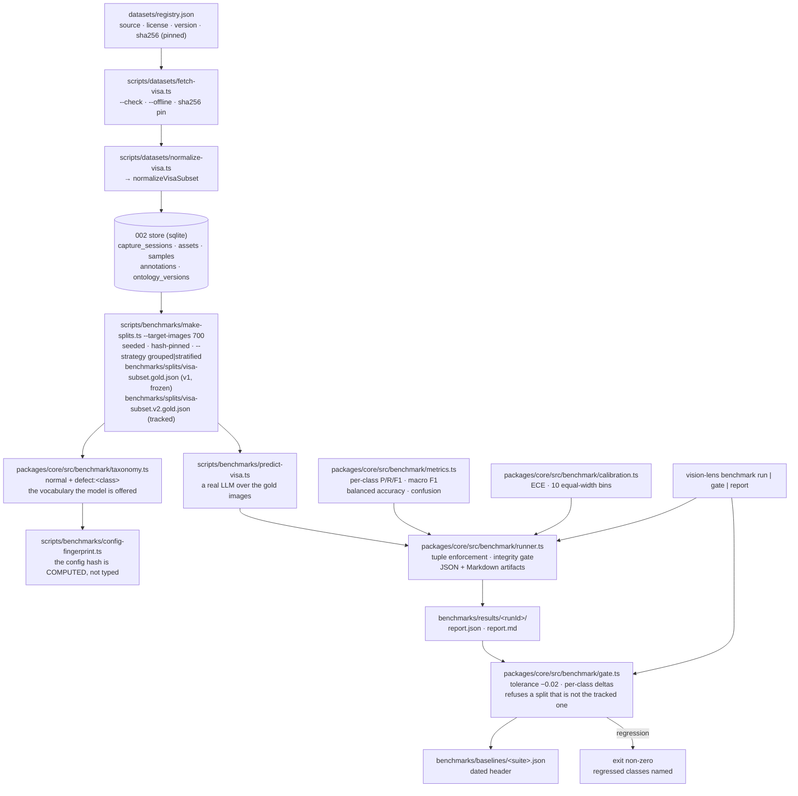
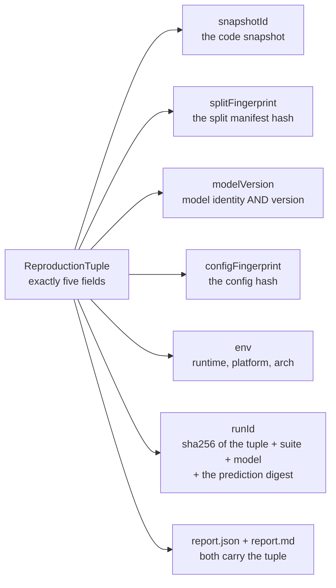

# Benchmark ground truth — architecture

> Status: **implemented, dataset fetched and checksum-pinned, split replaced (VLN-007)** ·
> Spec: `specs/003-benchmark-ground-truth`
> (US1–US4) · Measured at snapshot `4afc0d8`
>
> This document is the map of the benchmark pipeline. The operator's guide for
> the dataset itself lives in [`docs/datasets/visa.md`](../datasets/visa.md).
>
> The first real measurement was taken on a **degenerate all-train split** and is
> **retired**: with no held-out set it is a measured artifact, not a model-performance
> figure. The tracked split is now a real 60/20/20 partition (§9.5).

## 1. What this pipeline is for

Before spec 003, the only "benchmark" in this repository was a synthetic
colour-swatch fixture set, and it was the source of the project's accuracy
claims. `docs/adr/008-evidence-policy.md` forbids that. This pipeline replaces
it with a real, licensed, checksum-verified ground truth and with a single
runner that every later spec must use.

Three properties matter more than the numbers themselves:

1. **Attribution** — no report without the code snapshot, the split
   fingerprint, the model version, the config fingerprint and the environment.
2. **Reproducibility** — the same seed produces the same split, byte for byte.
3. **Honesty about absence** — a missing dataset is a skip with an explicit
   marker, never a failure and never a fabricated number.



## 2. The modules

| Module | Responsibility | Purity |
|---|---|---|
| `benchmark/registry.ts` | Typed dataset registry; the license gate. A missing or empty license is a hard error. | pure |
| `benchmark/normalize.ts` | VisA parts → 002-store Samples, CaptureSessions and ontology keys. | pure + I/O at the edge |
| `benchmark/dataset-availability.ts` | `datasetAvailable()` — the `dataset=absent` marker. | pure |
| `benchmark/splits.ts` | Seeded, hash-pinned gold split generator, with two strategies (`grouped`, `stratified`). | pure |
| `benchmark/taxonomy.ts` | The vocabulary a gold split is scored in, derived from the manifest. | pure |
| `benchmark/config-fingerprint.ts` | The config hash: manifest + model + data version + preprocessing. | pure |
| `benchmark/metrics.ts` | Per-class P/R/F1, macro F1, balanced accuracy, confusion, latency, cost, budget. | pure |
| `benchmark/calibration.ts` | ECE over 10 equal-width bins + reliability data. | pure |
| `benchmark/runner.ts` | Tuple enforcement, integrity gate, artifact emission. | I/O |
| `benchmark/gate.ts` | Baseline comparison, tolerance, per-class deltas, and the split identity check. | I/O |

Specs 006 (arena) and 007 (training) are required by their own specs to import
`@vision-lens/core/benchmark` and call these functions, so the platform has a
single metric path. (The legacy synthetic harness in `scripts/benchmark-legacy.ts`
computes its own precision/recall for its own unit fixtures — it is a harness
self-check, not a product metric, and its numbers are never a product claim.)

## 3. Pinned conventions

Two metric numbers are only comparable when the conventions behind them are
identical. These are the conventions this repository fixes — once, and in the
docblock of the function that applies each one.

| Convention | Rule | Where |
|---|---|---|
| Zero division | Precision/recall/F1 of an empty denominator is `0`, never `NaN`. | `metrics.ts` |
| Unseen predicted label | An error: counted wrong, given its own confusion column, listed in `unseenPredictedLabels`, never dropped. | `metrics.ts` |
| Missing prediction | A false negative for its class; the row sum is the support minus the missing count. | `metrics.ts` |
| Percentiles | Linear interpolation between the two closest ranks (type 7 / NumPy default). | `metrics.ts` |
| ECE | `Σ (n_b/N)·|acc_b − conf_b|` over 10 equal-width bins; the last bin is closed at 1.0. | `calibration.ts` |
| Invalid probability | Rejected with a `RangeError` naming the item — never clamped. | `calibration.ts` |
| Budget | Total-USD ceiling; items ordered by cost ascending, ties by id ascending, spent greedily. | `metrics.ts` |
| `minSamples` | The RUNNER's default is 30 (the spec's rule). `scoreMetrics` itself defaults to **1** (no exclusion) so a library caller decides explicitly. A class below the threshold is excluded from the per-class metrics, the macro F1 and the balanced accuracy — loudly, in `excludedClasses` AND in the caveats. | `runner.ts` (`DEFAULT_MIN_SAMPLES`), `metrics.ts` |
| PRNG | mulberry32 (32-bit state, only `Math.imul` and `>>>`). `Math.random` is never used. | `splits.ts` |
| Split quotas | Ratios × 1000 as **integer weights** (so `15 × 0.6` can never land one ULP below an integer), then largest-remainder rounding, ties in the order train > val > test. | `splits.ts` |
| Capture grouping | A capture group is the atom of the assignment and is never split across train/val/test. A group larger than every remaining quota is still assigned wholly, and the deviation is recorded as a `capture-group-overflow:` note. | `splits.ts` |
| Capture-group fallback | When the annotation CSV carries **no** `session` column, the capture group of an item is its **object class** (`make-splits.ts`, `enumerateSubset`). The upstream VisA release has no session column, so this is the path the real run takes. | `make-splits.ts` |
| Split strategy | `grouped` (the default): the capture group is the atom of the assignment. `stratified`: the partition is **item-level** (the capture groups are NOT enforced) and the items are dealt to the three splits inside every stratum (class x anomaly) in that stratum's own quota. The strategy is recorded in the manifest, and the `groupBasis` states in plain words whether the partition is capture-group-safe. | `splits.ts` |
| Benchmark vocabulary | The benchmark scores the **coarse** vocabulary: `normal` plus one `defect:<object class>` per class. `labelKeyOf()` derives it from the manifest. The store's ontology is a **different, finer** key space (`defect:<defect type>`, 18 keys) and is **not** what the benchmark scores. | `taxonomy.ts` |
| Manifest hash | `manifestHash` = sha256 over the contracts' `canonicalJson` of the manifest **without** the hash field. A version 1 manifest does not carry the new fields, and they are left out of the hashed payload, so the frozen `visa-subset.gold.json` keeps verifying. | `splits.ts` |
| Partition fingerprint | `partitionFingerprint` = sha256 over the contracts' `canonicalJson` of the sorted `id -> split` pairs. It identifies the **partition** alone, independently of the rest of the manifest. It is NOT the identity the reproduction tuple carries: the tuple's `splitFingerprint` is the split **file**'s `manifestHash`, and the gate compares the two by their own roles. | `splits.ts` |
| Manifest timestamps | None. A timestamp would change the bytes on every run and break byte-stability. | `splits.ts` |
| Gate tolerance | −0.02 on the macro F1. Exactly at the tolerance passes; beyond it fails. The comparison carries a `1e-9` slack so a mathematically exact −0.02 is not failed by float noise. | `gate.ts` |
| Gate split check | The gate is told which split is tracked (`currentSplitPath`) and which directory holds the tracked splits (`splitsDir`). It FAILS when the tracked split has **no held-out partition**, when the **run** under evaluation was measured against **another split** or carries no split attribution at all, when the tracked baseline was measured against **another split**, and when the tracked baseline carries no split fingerprint. The run's split is read from the artifact's reproduction tuple (`splitFingerprint`, the manifest hash of the split it was scored against). The failure names both split ids. | `gate.ts` (`evaluateGate`) |
| Retired baselines | A baseline entry with `status: "retired"` is evidence, not a comparison: the gate skips it and reports the recorded `retiredReason`. A number measured on a split the platform no longer tracks must never bless a run. A retired entry is **never removed and never overwritten**: writing a new baseline for the same key supersedes it and keeps both. | `gate.ts` |
| Gate comparison | Over the **union** of the baseline's and the current run's class sets, with a class missing from one side counted as `0`. Two runs rarely score the same classes, and the plain macro F1 of each is then not comparable: dropping a badly-scored class RAISES the mean, so a collapsed class could make the gate PASS. | `gate.ts` (`compareMacroF1`) |
| Gate scope | The artifact's suite AND model must match the requested ones, and the baseline is keyed by the **(suite, model, model version)** triple. `gpt-4o` and `gpt-4o-2025-11` are different models: comparing their macro F1 would be a comparison of two different things, so a baseline of another version is not reused. | `commands/benchmark.ts`, `gate.ts` |
| Partial runs | A partial run is skipped by the gate — never compared, never failed. The artifact's own `partial` flag is honoured, not only a CLI flag. A gate that flaps on an outage trains its readers to ignore it. | `gate.ts` |
| Baseline rewrite | A change larger than 0.05 requires an explicit `--force`; the baseline carries a dated header. | `gate.ts` |
| Non-finite inputs | A non-finite latency or cost is REJECTED with a `RangeError` naming the item — never reported. A `NaN` metric serialises as `null` and prints as "NaN ms", and neither reads as "no data". | `metrics.ts` |
| Budget float | The budget comparison carries a `1e-6 USD` slack, so a 0.3 USD budget admits a 0.1 + 0.2 pair whose sum is `0.30000000000000004` in binary floating point. | `metrics.ts` |
| Image bytes | The runner compares the sha256 of the actual bytes with the manifest's — for every item a hash was supplied for. Items without a hash are counted and reported as a caveat: an integrity gate that silently skips the check it could not perform is worse than no gate. | `runner.ts` |

## 4. The reproduction tuple



`runBenchmark` validates the tuple **before it touches the filesystem**: an
incomplete tuple throws an error naming every missing field, and nothing is
written. The same function refuses to score an image set whose hashes diverge
from the split manifest, and refuses to score a tampered manifest.

The `runId` is derived from the tuple **and** the digest of the prediction set.
Two consequences, both intended: re-running the same evaluation reproduces the
same artifact directory, and two different prediction sets can never overwrite
each other's evidence.

## 5. The CLI

```
vision-lens benchmark run   --suite <name> --model-id <name>
                      --config-fingerprint <hash>
                      --model-version <version>
                      [--split <file>] [--gold <file>] [--predictions <file>]
                      [--out <dir>] [--min-samples <n>] [--partial]
                      [--snapshot-id <id>] [--split-fingerprint <hash>]

vision-lens benchmark gate  --suite <name> --model-id <name>
                      [--metrics <file>] [--baseline <file>] [--tolerance <n>]
                      [--update-baseline] [--force] [--partial]

vision-lens benchmark report --run <runId> [--dir <dir>]

vision-lens benchmark scorecard --suite <name> --model-id <name>
                      --config-fingerprint <hash>
                      --model-version <version>
                      [--split <file>] [--predictions <file>]
                      [--calibration-partition <name>] [--device <name>]
                      [--min-support <n>] [--out <dir>] [--pointer-dir <dir>]
                      [--snapshot-id <id>] [--split-fingerprint <hash>] [--partial]
```

`--metrics` has no fixed default path: `run` writes to
`benchmarks/results/<runId>/` and the run id is a hash, so the gate picks the
**most recent artifact belonging to the suite** instead. Pass `--metrics`
explicitly to gate a specific run.

Defaults worth knowing: `--out` is `benchmarks/results`, `--dir` is
`benchmarks/results`, `--min-samples` is `30` and `--tolerance` is `-0.02`.

`--config-fingerprint` and `--model-version` are **required**: a report without
them is not attributed (ADR-008), so the runner refuses it rather than emitting
an empty field. The model version is the model identity AND its version (the
constitutional `model:<id>@<version>` form) — a bare model id is not a version.
The environment capture is filled by the CLI (`captureEnv()` — runtime, platform,
arch); no secret ever reaches an artifact.

> **Why `--model-id` and not `--model`:** the root command already owns
> `--model` (the LLM model of the batch run), and Commander lets the PARENT
> consume an option that appears after a subcommand name — the benchmark
> subcommand would never see it. `--model-id` avoids the collision.

Exit codes: the gate exits `1` when it fails; a skipped gate (missing dataset,
partial run) exits `0` and prints its marker.

## 6. What CI does

The `benchmark-gate` workflow proves two things on every push:

1. **The real-data gate runs when a dataset is available** (`VISION_LENS_DATASETS_DIR`).
   Without one it prints `dataset=absent` and passes. CI never downloads a
   dataset.
2. **The fixture-scale end-to-end always runs**: the synthetic 30-image
   fixture is split, scored, gated and baselined — and then the same pipeline
   runs again with a planted regression (10% of the predictions flipped to a
   wrong label, drawn from a second PRNG stream so the delta is controlled),
   which the gate MUST catch. The assertion checks the gate's OUTPUT — a
   non-zero exit AND the `gate failed` message AND the named regressed
   classes — because a gate that crashes for an unrelated reason also exits
   non-zero, and reading that as "the regression was caught" would be a false
   pass. If the planted regression is not caught, the job fails: a gate that
   does not catch a regression is not a gate.

The fixture-scale run is a **plumbing** check. It is not an accuracy source;
`scripts/benchmark-legacy.ts` (the synthetic colour-swatch harness) is likewise
a unit fixture, and every accuracy claim in the docs points at the spec-003
artifacts instead.

## 7. Status of the real dataset

| | |
|---|---|
| Source | `https://amazon-visual-anomaly.s3.us-west-2.amazonaws.com/VisA_20220922.tar` |
| Size | 1,929,840,640 bytes (≈ 1.93 GB) |
| License | CC BY 4.0 — recorded in `datasets/registry.json` before the first byte is fetched |
| Checksum | `sha256 2eb8690c803ab37de0324772964100169ec8ba1fa3f7e94291c9ca673f40f362`, **pinned** on 2026-11-11 (`sha256PinnedAt` / `fetchedAt` = `2026-11-11T11:04:36.707Z`). The object is a **multipart** upload (ETag `…-113`), so the ETag is provenance only, never a checksum — the digest above was computed from the received bytes. |
| Downloaded | **Yes** — 2026-11-11. Four parts (`candle`, `capsules`, `fryum`, `pcb1`), 3910 files staged. |
| Real split manifest | `benchmarks/splits/visa-subset.gold.json`: **committed**, 700 assignments, 8 strata, `manifestHash 76dee597ea8d42bdba657f37c357cdfc4afc3d3e1de617d90ced7b77e485a0b2`. **Frozen** (the v1 split, all 700 assignments in `train`): the evidence of the degenerate split, never rewritten. The generator now emits the v2 schema, so this artifact is reproducible only at the commit that created it (`64a72d1`); its `manifestHash` is still validated on every read. |
| Tracked split (v2) | `benchmarks/splits/visa-subset.v2.gold.json`: **committed**, 700 assignments, 8 strata, strategy `stratified`, **420 train / 140 val / 140 test**, `manifestHash 503c568463739a1522d675a474a219aecc918553315e0ec4e2800c2b10b21bb5`, `partitionFingerprint 4ac0940380d0283a4ac52bda0884449bc8778ea2605b27c7ef2f26f666b9c963`. It is the tracked split of the suite `visa-subset.v2`. |
| First real measurement | **macro F1 0.9795**, balanced accuracy 0.9700, ECE 0.0479 over all 700 items, **on the v1 split, which has no held-out set**. It is a measured artifact with a caveat, and it is **not** a model-performance figure. The tracked evidence is the gold set, the raw predictions (`benchmarks/predictions/visa-subset.gpt-4o.json`) and the baseline (`benchmarks/baselines/visa-subset.json`, which carries the snapshot, the split fingerprint and the config fingerprint of the run it was recorded from, plus the recorded reason the entry is **retired**). The run report under `benchmarks/results/<runId>/` is **local**: it is gitignored, and the documented command reproduces it from the tracked files. |

The flow, as it was actually run on 2026-11-11:

```bash
pnpm datasets:fetch-visa        # 1.93 GB — needs the maintainer's authorization
pnpm datasets:normalize-visa    # VisA parts → 002 store

pnpm exec tsx scripts/benchmarks/make-splits.ts \
  --dataset visa-subset --root datasets/visa-subset --seed 42 \
  --target-images 700 \
  --out benchmarks/splits/visa-subset.gold.json

pnpm exec tsx packages/cli/src/index.ts benchmark run \
  --suite visa-subset --model-id gpt-4o \
  --model-version 'model:gpt-4o@2024-11-20' \
  --config-fingerprint fp2:3883e2f9a01107f8 \
  --split benchmarks/splits/visa-subset.gold.json \
  --predictions benchmarks/predictions/visa-subset.gpt-4o.json \
  --out benchmarks/results --min-samples 30

pnpm benchmark:gate --suite visa-subset --model-id gpt-4o
```

That sequence is the **historical** one, and it is kept because it is the record of
the first real run. The tracked split is now the v2 one, which is built with the
`stratified` strategy and belongs to its own suite:

```bash
pnpm exec tsx scripts/benchmarks/make-splits.ts \
  --dataset visa-subset --root datasets/visa-subset --seed 42 \
  --target-images 700 \
  --strategy stratified \
  --id visa-subset.v2.gold \
  --out benchmarks/splits/visa-subset.v2.gold.json
```

The predictions and the baseline of that suite are `visa-subset.v2.gpt-4o.json` and
`benchmarks/baselines/visa-subset.v2.json`. The v2 predictions were run on
2026-11-12 (700 images, 35 calls, 0.543793 USD, capped by `--max-usd-micro`),
scored at macro F1 0.9734 and recorded as the suite's first baseline; the gate
now enforces it. See §9.3 and §9.5.

The prediction run is the one step that spends real money, and it can be capped:
`predict-visa.ts` takes an optional `--max-usd-micro <n>` ceiling in micro-USD
(`750000` caps a run at 0.75 USD). Given the ceiling, the run refuses before the
first provider call when its pinned cost estimate already exceeds it, and aborts
when the observed spend of the answered calls crosses it mid-run; both failures
throw a typed `BudgetExceededError` naming the estimate or the partial spend, the
ceiling and the provider, and neither writes a prediction file, because a partial
prediction set is never published. Mid-run tracking, like `costUsd`, needs the
run's model to be pinned in `PROVIDER_PRICING`: an unlisted model still passes
the pre-flight gate, but its estimate is priced at the provider's pinned default
model and its observed spend cannot be tracked, so its ceiling is pre-flight
only. A ceiling of `0` means no paid calls. Without
the flag no ceiling is enforced, exactly as before.

The pnpm package scripts (`pnpm benchmark:splits`, `pnpm benchmark:run`,
`pnpm benchmark:gate`) take their flags **directly** — no `--` separator. This
pnpm version forwards a literal `--` to the script, and both `node:util parseArgs`
and Commander then treat the flags after it as positional arguments, so the
separator silently produces "required option '--suite <name>' not specified".
The CLI flags themselves are listed in §5; the full command sequence, including
the prediction run, is in [`docs/datasets/visa.md` §7](../datasets/visa.md).

---

## 8. The config fingerprint is computed, not typed

`--config-fingerprint` is a required flag, but the operator does not invent its
value. `scripts/benchmarks/config-fingerprint.ts` computes it from the inputs the
run actually had:

```bash
pnpm exec tsx scripts/benchmarks/config-fingerprint.ts \
  --split benchmarks/splits/visa-subset.gold.json \
  --provider openai --model gpt-4o --model-version model:gpt-4o@2024-11-20
# → fp2:3883e2f9a01107f8   (stdout, one line; the components go to stderr)
```

The hashed components are: the model, the prompt template, **the taxonomy derived
from the manifest**, the preprocessing (resize 768 px, JPEG quality 80, detail
`low`, batch size 20), the data version (`visa-subset@20220922`) and the contracts
version.

**Why not a free-text flag.** ADR-008 forbids unattributed reports. A hand-typed
fingerprint is an attribution the operator can get wrong: the same string for two
different taxonomies would make two different experiments look identical, and a
stale string would attribute a run to a vocabulary it never used. Deriving it from
the manifest, the model and the dataset version means the fingerprint cannot claim
a vocabulary the run never saw — and the prediction run and the fingerprint script
import the **same** `buildTaxonomy()`, so the two cannot drift apart.

---

## 9. The first real run, and what it does and does not say

### 9.1 What was measured

> **This is the historical run, and the number is not a performance figure.** It was
> scored on the **v1** split, whose 700 assignments are all in `train`: there was no
> held-out set, so nothing was measured on unseen images. It is kept as the record of
> the first real run, and the baseline entry that carries it is **retired**
> (`status: "retired"`, with the reason recorded next to it in
> `benchmarks/baselines/visa-subset.json`). Do not quote it as the accuracy of a model.
> The tracked split is now the v2 one (§9.5); the first number recorded against it:
> macro F1 0.9734 over the 700 items, measured 2026-11-12 (whole-set, not a
> held-out scorecard; baseline at `benchmarks/baselines/visa-subset.v2.json`).

| | |
|---|---|
| Model | `gpt-4o`, version `model:gpt-4o@2024-11-20` |
| Items scored | **700** (the whole gold manifest) · 685 correct |
| LLM calls | **35** (20 images per call) |
| Cost | **0.535723 USD** total · **0.000765 USD** per image |
| Latency (per batch call) | p50 **7482.84 ms** · p95 **10159.64 ms** |
| Run id | derived from the tuple (the report directory name) |

Reproduction tuple: the snapshot of the commit the run was scored at, split
fingerprint `76dee597ea8d42bdba657f37c357cdfc4afc3d3e1de617d90ced7b77e485a0b2`,
model version `model:gpt-4o@2024-11-20`, config fingerprint `fp2:3883e2f9a01107f8`,
environment node v24.22.1 / darwin / arm64. The run carried **no caveats** about the
image bytes, which were verified against the manifest; what it did not have was a
held-out set.

| Metric | Value |
|---|---|
| **Macro F1** | **0.9795** |
| **Balanced accuracy** | **0.9700** |
| **ECE (10 bins)** | **0.0479** |
| Accuracy | 0.9786 |

| Class | Support | Precision | Recall | F1 |
|---|---|---|---|---|
| `defect:candle` | 100 | 1.0000 | 0.9400 | 0.9691 |
| `defect:capsules` | 100 | 1.0000 | 1.0000 | 1.0000 |
| `defect:fryum` | 100 | 1.0000 | 1.0000 | 1.0000 |
| `defect:pcb1` | 100 | 1.0000 | 0.9100 | 0.9529 |
| `normal` | 300 | 0.9524 | 1.0000 | 0.9756 |

**All 15 errors are anomalies the model called `normal`** (6 candle, 9 pcb1).
There was not a single false defect alarm.

The baseline was recorded with `benchmark gate --update-baseline` into
`benchmarks/baselines/visa-subset.json` (macro F1 0.9795, balanced accuracy 0.97,
the per-class F1s above). A second gate run passed at the time: *"macro F1 moved by
0.0000, within the tolerance of -0.0200"*. **Today the same gate run fails**, because
the tracked split is no longer the split the number was measured against (§9.5).

### 9.2 The vocabulary the benchmark scores

The benchmark scores the **coarse** vocabulary — `normal` plus one class per object
class:

```
normal · defect:candle · defect:capsules · defect:fryum · defect:pcb1
```

`labelKeyOf()` derives it from the manifest, and `buildTaxonomy()` turns it into
the `categories.json` the model is offered (the normalised name `defect_candle` and
the gold label key `defect:candle` are two spellings of one category).

The **store's** ontology is a different, finer key space: `normal` plus **18**
defect-type keys (`defect:bubble`, `defect:melt`, `defect:chunk-of-wax-missing`, …).
Both are true. The benchmark scores the coarse one; it does **not** score the
fine-grained defect-type vocabulary.

### 9.3 The v1 split degenerated, and the benchmark says so

The upstream release carries **no session information**. Each object class therefore
collapses into **one** capture group, and a 100-item group fits no 60/20/20 quota.
The generator assigns such a group wholly to `train` and records a
`capture-group-overflow:` note.

The committed v1 manifest holds **8** such notes (one per class and anomaly kind),
and **every one of its 700 assignments is `split: "train"`**; `val` and `test` are
empty. Consequences, stated plainly:

* **This is not a 60/20/20 split.** The ratios in the manifest are the requested
  ones; the capture-group rule overrode them.
* **The benchmark scores all 700 gold items.** There is no held-out test set.
* The upstream release does not carry the session data that would make one. The
  generator does not invent it.

The v1 manifest is **frozen**: it is the evidence of this defect and it is never
rewritten. The fix is a second strategy, not a re-roll of the first one.

**The scoring scope does not change with the strategy.** `benchmark run` scores
every gold item of the manifest it is given, whichever strategy produced that
manifest. The `stratified` strategy in §9.5 therefore changes **which partition
an item is assigned to**, not **which items are scored**. A number measured
against the v2 split is computed over the same 700 items as a number measured
against the v1 split, and it carries the same caveat: it is a whole-set
benchmark figure, not a held-out performance figure.
### 9.4 The limitations — read these before quoting the number

1. **The split is 100 % `train` (no held-out set)** — see §9.3. The notes in the
   manifest record it.
2. **One model, one dataset subset, one day.** This is a baseline to regress
   against, not "the product's accuracy". It is not a generalisation claim.
3. **The coarse vocabulary only** — see §9.2. The defect **type** is known to the
   store and is not scored.
4. **The dataset binaries are not in git.** Only the registry entry, the gold
   manifest, the predictions and the baseline are tracked; `datasets/*/` and
   `benchmarks/results/` are git-ignored.
5. **An answer outside the gold vocabulary is scored as the miss it is.** A model
   answer such as `unknown` is recorded verbatim and never mapped onto a gold
   class. In this run `unseenPredictedLabels` was **empty** — every answer was one
   of the five gold classes.
6. **The metric is a whole-set benchmark figure, not a held-out performance
   figure.** This holds against the v2 split too: the scorer scores all 700 gold
   items (§9.3) and the v2 partition is locked for future selection rather than
   applied as a filter (§9.5). A number measured over the whole set may be quoted
   as a regression baseline. It may not be quoted as "accuracy on unseen data".

### 9.5 The v2 split, and the gate that protects it

`benchmarks/splits/visa-subset.v2.gold.json` is the tracked split of the suite
`visa-subset.v2`. It holds the **same 700 images** in a real partition, produced by
the `stratified` strategy:

| | train | val | test | total |
|---|---|---|---|---|
| all items | 420 | 140 | 140 | 700 |
| each of the four classes | 105 | 35 | 35 | 175 |
| `anomalous` | 240 | 80 | 80 | 400 |
| `normal` | 180 | 60 | 60 | 300 |

| field | value |
|---|---|
| `manifestHash` | `503c568463739a1522d675a474a219aecc918553315e0ec4e2800c2b10b21bb5` |
| `partitionFingerprint` | `4ac0940380d0283a4ac52bda0884449bc8778ea2605b27c7ef2f26f666b9c963` |
| `groupBasis.captureGroupsEnforced` | `false` |
| `groupBasis.oversizedCaptureGroupCount` | `4` (one per class) |

**What it gives up.** The capture-group property is not enforced: the capture group
of an item is its object class, and a class of 175 images cannot be kept whole in
three partitions. The v2 partition is **item-level**: two images of the same class
may sit in `train` and in `test`. The manifest states that in `groupBasis` and in a
`notes[]` entry, and such a partition cannot prove acquisition-level independence.
**What it gives.** A held-out set with every class and both anomaly labels in the
expected proportion.

**What it does not give.** A held-out *number* from the **whole-set** runner. The
scorer still scores the whole 700-item set (§9.3), so that metric is **locked for
future selection and evaluation**, not applied as a filter to today's metric. The
held-out number is the **scorecard** (§10), which consumes the locked `test`
partition; the whole-set figure stays the **regression reference** and the two are
never quoted interchangeably. A whole-set number is a **benchmark figure** and must
not be published as model performance.

**What the gate now decides.** The gate is told which split is currently tracked
(`currentSplitPath`, plus the directory of the tracked splits) and refuses to
compare a number that belongs to another partition:

| gate run | verdict |
|---|---|
| the tracked split has no held-out partition | **FAILS**: *"the split currently tracked for '<suite>' ('<split id>') has no held-out partition"* |
| the **run** under evaluation was measured against another split | **FAILS** and names both fingerprints and both split ids: *"the run under evaluation was measured against the split '<recorded id>' (manifest hash '<hash>'), but the split currently tracked for '<suite>' is '<current id>' (manifest hash '<hash>')"* |
| the **run** carries no split attribution at all | **FAILS**: *"the run under evaluation cannot be attributed to a split: it carries no split fingerprint"* |
| the tracked baseline was measured against another split | **FAILS** and names both: *"the tracked baseline of '<suite>/<model>' was recorded against the split '<recorded id>', but the split currently tracked for this suite is '<current id>'"* |
| the tracked baseline carries no split fingerprint | **FAILS**: *"the tracked baseline of '<suite>/<model>' carries no split fingerprint, so it cannot be attributed to the split currently tracked for this suite"* |
| the tracked baseline was measured against the tracked split | the ordinary macro F1 comparison runs |
| the tracked baseline entry is retired | **SKIPS**: a retired entry is evidence, not a comparison |

The rule is symmetric on purpose: a number is only comparable when the **run** and
the **baseline** both name the split that is tracked now, and both can be named.
A run that cannot be attributed, or a baseline that cannot be attributed, is not
compared at all. The check also guards the write path: `--update-baseline`
refuses to record a baseline from a run that was measured against another split.

The recorded split is found by the `splitFingerprint` of the baseline entry, which
is the manifest hash of the split the run was scored against.

Against the tracked artifacts, that means the historical baseline now fails against
the v2 split and fails against the v1 split (no held-out partition), and the tracked
baseline as committed skips, because its entry is retired with the reason recorded
in the file. The predictions have not been re-run against the v2 split yet (a
provider key and a paid run are needed), so the suite `visa-subset.v2` has no
baseline yet and the gate skips instead of blessing the old number.

## 10. The scorecard (the held-out figure)

The scorecard is the **held-out** number: it measures the `test` partition of a
tracked split and nothing else. The whole-set figure of §9 stays the
**regression reference**, and the two are never quoted interchangeably.

### 10.1 The command

```sh
vision-lens benchmark scorecard \
  --suite visa-subset.v2 --model-id gpt-4o \
  --config-fingerprint <hash> --model-version <version> \
  --predictions benchmarks/predictions/visa-subset.v2.gpt-4o.json \
  [--split <file>] [--calibration-partition <name>] [--device <name>] \
  [--min-support <n>] [--out <dir>] [--pointer-dir <dir>] [--partial]
```

`--model-version` and `--config-fingerprint` are **required**, exactly as in
`run`: a scorecard without them is not attributed, so it is refused rather
than emitted with an empty field.

When the tracked split is absent the command prints `dataset=absent` and exits
`0`: a missing dataset is a skip, not a failure. When the scorecard is
**refused** it prints its typed error code, exits non-zero and writes
**nothing**: a refusal is not a zero-valued scorecard.

### 10.2 The artifact

`packages/core/src/benchmark/scorecard.ts` owns one implementation; the CLI and
any future surface share it. The SDK does not export the benchmark surface
today, so it is not named here.

| what | the rule |
|---|---|
| the protocol version | `protocolVersion` and `schemaVersion`, bumped on any breaking change; the scorecard is a **new** artifact beside `report.json`, never a re-stamping of it |
| the metric regime | `regime`, the vocabulary the gate compares (§10.6) |
| every metric | an object carrying `value`, `n` (the sample count) and `partition`. The schema offers **no** bare numeric accuracy field, so a percentage without a count and a subset is not representable |
| the support rule | explicit and recorded; a class below it is excluded from the per-class rows and from the macro F1, and is named with its support in the limitations |
| the limitations | what the number does not say: a missing prediction counted as a failure, a class with no support, an item-level partition, a self-declared confidence |
| the reproduction tuple | the snapshot, the split digests, the model version, the config fingerprint and the environment; no secret ever reaches the artifact |
| the id | derived from the **content** (protocol version, split digests, model version, config fingerprint, prediction digest, calibration partition, bootstrap parameters), never from the clock. The clock value lives in its own field, so a byte-stability comparison can exclude it |

### 10.3 The partition selection

The evaluated partition is **not a choice**: it is the `test` partition of the
split the command is given, and no `train` or `val` item enters the metric
computation. An empty selection is the typed refusal `test-partition-empty`;
a missing partition is `test-partition-missing`. Neither writes a file and
neither returns a zero-valued metric.

### 10.4 The calibration rule

The ECE is computed on a partition that is **not** the evaluated one. Naming
the `test` partition as the calibration source is refused with
`calibration-partition-is-test`: an ECE computed on the partition the score is
measured on is not a calibration number. The calibration block records the
ECE, the reliability bins, the calibration partition's name, its item count and
its digest, and the probability source (`raw_declared` or `calibrated`).

### 10.5 The interval and its method

The confidence intervals come from a **bootstrap** whose method, resample
count, unit and seed derivation are recorded in every interval:

| method | when | what it resamples |
|---|---|---|
| `group-aware-bootstrap` | the split enforces capture groups | the capture groups, and the number of groups is recorded |
| `stratified-item-bootstrap` | otherwise (the tracked split) | the items, stratified by class |

The bootstrap uses the repository's own deterministic PRNG, never
`Math.random`, so two scorecards over the same inputs are byte-identical
apart from their own clock field.

### 10.6 The regime rule

A scorecard is a **test-partition** number; a baseline recorded by the
whole-set runner is a **whole-set** number. The two can share a split
fingerprint, so the split-identity checks alone cannot tell them apart. When a
run carries a scorecard, the gate routes the comparison through the scorecard's
own guard **before** any number is compared:

| the gate run | verdict |
|---|---|
| a test-partition scorecard against a whole-set baseline | **FAILS** and names both regimes: `baseline-regime-mismatch` |
| a whole-set run against a scorecard baseline | **not refused**: the regime guard only runs when the run itself carries a scorecard (`GateOptions.scorecard`), so a whole-set run is compared numerically, exactly as before |
| a partial scorecard against any baseline | **FAILS**: the comparison would measure the outage, not the model |
| a retired baseline entry | **FAILS** with its recorded reason: a retired entry is evidence, never a comparison |
| a baseline of another split | **FAILS** and names both digests: `manifest-digest-mismatch` |

### 10.7 The pointer contract

The per-sample artifact and the scorecard are written under the **gitignored**
`benchmarks/results/<scorecardId>/`. What is tracked is the **pointer**, at
`benchmarks/scorecards/<suite>.<model>.json`: it records, for each artifact,
its relative path, its sha256, its byte count and its row count, plus the
scorecard digest, the split digests, the regime and the command that
reproduces the artifacts. The pointer directory is **not** gitignored (only
`benchmarks/results/` is).

The pointer is the published claim over artifacts that are not in the
repository. A digest that does not match is a **failure**, never a warning,
and the verification is out of band: the artifacts are recomputed from the
committed fixture and re-hashed from disk
(`scripts/benchmarks/verify-scorecard-pointer.ts`).

The full contract, what it proves and what it does not, are in
`benchmarks/scorecards/README.md`.

### 10.8 The pointers published today

Two pointers are committed:

| pointer | what it is |
|---|---|
| `benchmarks/scorecards/scorecard-oracle.oracle-model.json` | the **oracle** pointer: a synthetic fixture of the **mechanism**, built from the committed oracle fixture, not a measurement of a model. Its numbers are the oracle's own, computed by an enumeration that shares no code with the metric modules and recomputed by brute force in the oracle suite, so a reader can check them (`packages/core/tests/benchmark/scorecard-oracle.test.ts`). Its clock and its snapshot are pinned, so its digests are recomputable and the out-of-band verification runs over it |
| `benchmarks/scorecards/visa-subset.v2.gpt-4o.json` | the **held-out figure** of the VisA suite: the 140 `test` items of the tracked v2 split, measured from the tracked prediction set. Its artifacts are gitignored, so the pointer carries the digests and the attribution, and the numbers live in the artifact (`docs/datasets/visa.md` §9.3) |

The oracle pointer is the one CI can verify on every run: it is rebuilt from
the committed fixture and its digests are asserted against the committed
pointer. The committed VisA pointer is never asserted against its artifacts:
the real-data step writes a fresh pointer under `/tmp` with its own config
fingerprint and checks its shape, not the committed digests. The reason is
the clock: `generatedAt` sits inside the hashed bytes, so the scorecard
artifact of a re-run never has the digest the committed pointer records. The
per-sample artifact and the scorecard id ARE stable, and the oracle pointer
proves that.
