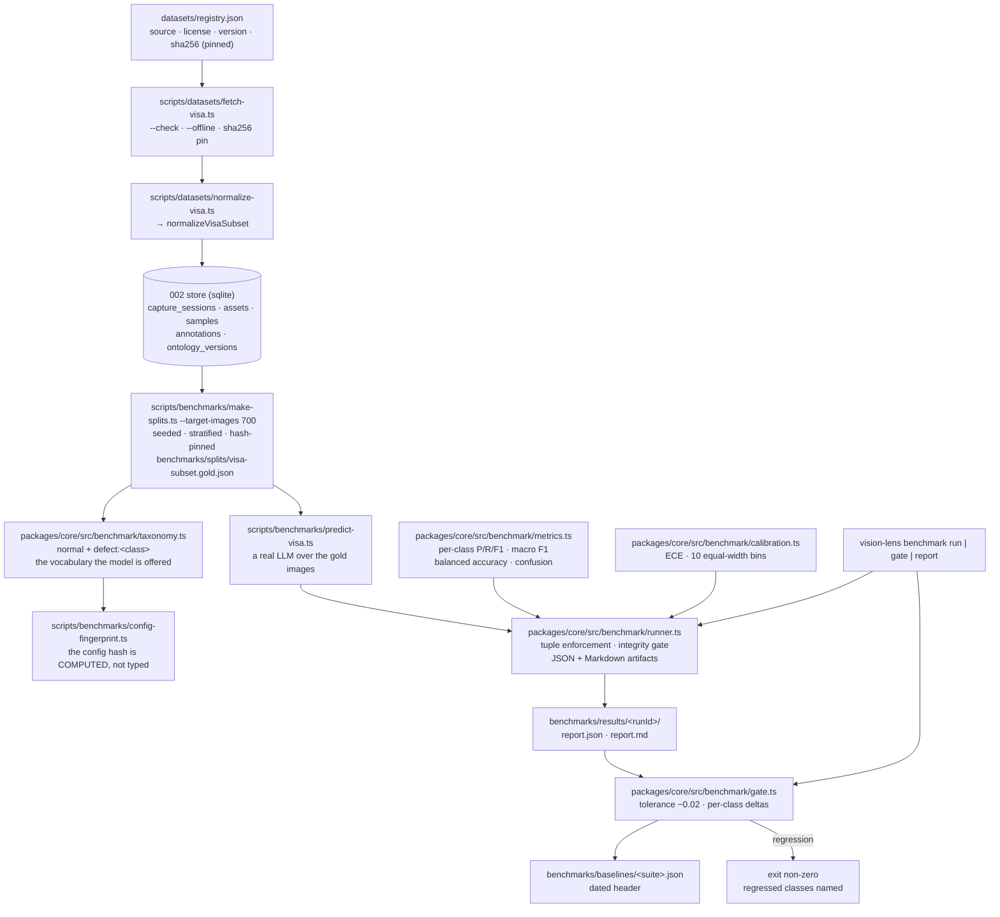
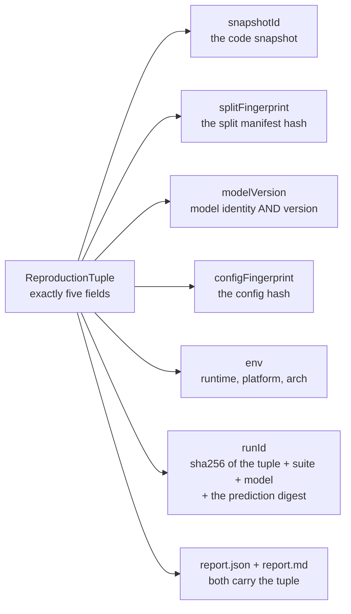

# Benchmark ground truth — architecture

> Status: **implemented, dataset fetched and checksum-pinned, first real measurement recorded** ·
> Spec: `specs/003-benchmark-ground-truth`
> (US1–US4) · Measured at snapshot `4afc0d8`
>
> This document is the map of the benchmark pipeline. The operator's guide for
> the dataset itself lives in [`docs/datasets/visa.md`](../datasets/visa.md).

## 1. What this pipeline is for

Before spec 003, the only "benchmark" in this repository was a synthetic
colour-swatch fixture set, and it was the source of the project's accuracy
claims. `docs/adr/008-evidence-policy.md` forbids that. This pipeline replaces
it with a real, licensed, checksum-verified ground truth and with a single
runner that every later spec must use.

Three properties matter more than the numbers themselves:

1. **Attribution** — no report without the code snapshot, the split
   fingerprint, the model version, the config fingerprint and the environment.
2. **Reproducibility** — the same seed produces the same split, byte for byte.
3. **Honesty about absence** — a missing dataset is a skip with an explicit
   marker, never a failure and never a fabricated number.



## 2. The modules

| Module | Responsibility | Purity |
|---|---|---|
| `benchmark/registry.ts` | Typed dataset registry; the license gate. A missing or empty license is a hard error. | pure |
| `benchmark/normalize.ts` | VisA parts → 002-store Samples, CaptureSessions and ontology keys. | pure + I/O at the edge |
| `benchmark/dataset-availability.ts` | `datasetAvailable()` — the `dataset=absent` marker. | pure |
| `benchmark/splits.ts` | Seeded, stratified, hash-pinned gold split generator. | pure |
| `benchmark/taxonomy.ts` | The vocabulary a gold split is scored in, derived from the manifest. | pure |
| `benchmark/config-fingerprint.ts` | The config hash: manifest + model + data version + preprocessing. | pure |
| `benchmark/metrics.ts` | Per-class P/R/F1, macro F1, balanced accuracy, confusion, latency, cost, budget. | pure |
| `benchmark/calibration.ts` | ECE over 10 equal-width bins + reliability data. | pure |
| `benchmark/runner.ts` | Tuple enforcement, integrity gate, artifact emission. | I/O |
| `benchmark/gate.ts` | Baseline comparison, tolerance, per-class deltas. | I/O |

Specs 006 (arena) and 007 (training) are required by their own specs to import
`@vision-lens/core/benchmark` and call these functions, so the platform has a
single metric path. (The legacy synthetic harness in `scripts/benchmark-legacy.ts`
computes its own precision/recall for its own unit fixtures — it is a harness
self-check, not a product metric, and its numbers are never a product claim.)

## 3. Pinned conventions

Two metric numbers are only comparable when the conventions behind them are
identical. These are the conventions this repository fixes — once, and in the
docblock of the function that applies each one.

| Convention | Rule | Where |
|---|---|---|
| Zero division | Precision/recall/F1 of an empty denominator is `0`, never `NaN`. | `metrics.ts` |
| Unseen predicted label | An error: counted wrong, given its own confusion column, listed in `unseenPredictedLabels`, never dropped. | `metrics.ts` |
| Missing prediction | A false negative for its class; the row sum is the support minus the missing count. | `metrics.ts` |
| Percentiles | Linear interpolation between the two closest ranks (type 7 / NumPy default). | `metrics.ts` |
| ECE | `Σ (n_b/N)·|acc_b − conf_b|` over 10 equal-width bins; the last bin is closed at 1.0. | `calibration.ts` |
| Invalid probability | Rejected with a `RangeError` naming the item — never clamped. | `calibration.ts` |
| Budget | Total-USD ceiling; items ordered by cost ascending, ties by id ascending, spent greedily. | `metrics.ts` |
| `minSamples` | The RUNNER's default is 30 (the spec's rule). `scoreMetrics` itself defaults to **1** (no exclusion) so a library caller decides explicitly. A class below the threshold is excluded from the per-class metrics, the macro F1 and the balanced accuracy — loudly, in `excludedClasses` AND in the caveats. | `runner.ts` (`DEFAULT_MIN_SAMPLES`), `metrics.ts` |
| PRNG | mulberry32 (32-bit state, only `Math.imul` and `>>>`). `Math.random` is never used. | `splits.ts` |
| Split quotas | Ratios × 1000 as **integer weights** (so `15 × 0.6` can never land one ULP below an integer), then largest-remainder rounding, ties in the order train > val > test. | `splits.ts` |
| Capture grouping | A capture group is the atom of the assignment and is never split across train/val/test. A group larger than every remaining quota is still assigned wholly, and the deviation is recorded as a `capture-group-overflow:` note. | `splits.ts` |
| Capture-group fallback | When the annotation CSV carries **no** `session` column, the capture group of an item is its **object class** (`make-splits.ts`, `enumerateSubset`). The upstream VisA release has no session column, so this is the path the real run takes. | `make-splits.ts` |
| Benchmark vocabulary | The benchmark scores the **coarse** vocabulary: `normal` plus one `defect:<object class>` per class. `labelKeyOf()` derives it from the manifest. The store's ontology is a **different, finer** key space (`defect:<defect type>`, 18 keys) and is **not** what the benchmark scores. | `taxonomy.ts` |
| Manifest hash | `manifestHash` = sha256 over the contracts' `canonicalJson` of the manifest **without** the hash field. | `splits.ts` |
| Manifest timestamps | None. A timestamp would change the bytes on every run and break byte-stability. | `splits.ts` |
| Gate tolerance | −0.02 on the macro F1. Exactly at the tolerance passes; beyond it fails. The comparison carries a `1e-9` slack so a mathematically exact −0.02 is not failed by float noise. | `gate.ts` |
| Gate comparison | Over the **union** of the baseline's and the current run's class sets, with a class missing from one side counted as `0`. Two runs rarely score the same classes, and the plain macro F1 of each is then not comparable: dropping a badly-scored class RAISES the mean, so a collapsed class could make the gate PASS. | `gate.ts` (`compareMacroF1`) |
| Gate scope | The artifact's suite AND model must match the requested ones, and the baseline is keyed by the **(suite, model, model version)** triple. `gpt-4o` and `gpt-4o-2025-11` are different models: comparing their macro F1 would be a comparison of two different things, so a baseline of another version is not reused. | `commands/benchmark.ts`, `gate.ts` |
| Partial runs | A partial run is skipped by the gate — never compared, never failed. The artifact's own `partial` flag is honoured, not only a CLI flag. A gate that flaps on an outage trains its readers to ignore it. | `gate.ts` |
| Baseline rewrite | A change larger than 0.05 requires an explicit `--force`; the baseline carries a dated header. | `gate.ts` |
| Non-finite inputs | A non-finite latency or cost is REJECTED with a `RangeError` naming the item — never reported. A `NaN` metric serialises as `null` and prints as "NaN ms", and neither reads as "no data". | `metrics.ts` |
| Budget float | The budget comparison carries a `1e-6 USD` slack, so a 0.3 USD budget admits a 0.1 + 0.2 pair whose sum is `0.30000000000000004` in binary floating point. | `metrics.ts` |
| Image bytes | The runner compares the sha256 of the actual bytes with the manifest's — for every item a hash was supplied for. Items without a hash are counted and reported as a caveat: an integrity gate that silently skips the check it could not perform is worse than no gate. | `runner.ts` |

## 4. The reproduction tuple



`runBenchmark` validates the tuple **before it touches the filesystem**: an
incomplete tuple throws an error naming every missing field, and nothing is
written. The same function refuses to score an image set whose hashes diverge
from the split manifest, and refuses to score a tampered manifest.

The `runId` is derived from the tuple **and** the digest of the prediction set.
Two consequences, both intended: re-running the same evaluation reproduces the
same artifact directory, and two different prediction sets can never overwrite
each other's evidence.

## 5. The CLI

```
vision-lens benchmark run   --suite <name> --model-id <name>
                      --config-fingerprint <hash>
                      --model-version <version>
                      [--split <file>] [--gold <file>] [--predictions <file>]
                      [--out <dir>] [--min-samples <n>] [--partial]
                      [--snapshot-id <id>] [--split-fingerprint <hash>]

vision-lens benchmark gate  --suite <name> --model-id <name>
                      [--metrics <file>] [--baseline <file>] [--tolerance <n>]
                      [--update-baseline] [--force] [--partial]

vision-lens benchmark report --run <runId> [--dir <dir>]
```

`--metrics` has no fixed default path: `run` writes to
`benchmarks/results/<runId>/` and the run id is a hash, so the gate picks the
**most recent artifact belonging to the suite** instead. Pass `--metrics`
explicitly to gate a specific run.

Defaults worth knowing: `--out` is `benchmarks/results`, `--dir` is
`benchmarks/results`, `--min-samples` is `30` and `--tolerance` is `-0.02`.

`--config-fingerprint` and `--model-version` are **required**: a report without
them is not attributed (ADR-008), so the runner refuses it rather than emitting
an empty field. The model version is the model identity AND its version (the
constitutional `model:<id>@<version>` form) — a bare model id is not a version.
The environment capture is filled by the CLI (`captureEnv()` — runtime, platform,
arch); no secret ever reaches an artifact.

> **Why `--model-id` and not `--model`:** the root command already owns
> `--model` (the LLM model of the batch run), and Commander lets the PARENT
> consume an option that appears after a subcommand name — the benchmark
> subcommand would never see it. `--model-id` avoids the collision.

Exit codes: the gate exits `1` when it fails; a skipped gate (missing dataset,
partial run) exits `0` and prints its marker.

## 6. What CI does

The `benchmark-gate` workflow proves two things on every push:

1. **The real-data gate runs when a dataset is available** (`VISION_LENS_DATASETS_DIR`).
   Without one it prints `dataset=absent` and passes. CI never downloads a
   dataset.
2. **The fixture-scale end-to-end always runs**: the synthetic 30-image
   fixture is split, scored, gated and baselined — and then the same pipeline
   runs again with a planted regression (10% of the predictions flipped to a
   wrong label, drawn from a second PRNG stream so the delta is controlled),
   which the gate MUST catch. The assertion checks the gate's OUTPUT — a
   non-zero exit AND the `gate failed` message AND the named regressed
   classes — because a gate that crashes for an unrelated reason also exits
   non-zero, and reading that as "the regression was caught" would be a false
   pass. If the planted regression is not caught, the job fails: a gate that
   does not catch a regression is not a gate.

The fixture-scale run is a **plumbing** check. It is not an accuracy source;
`scripts/benchmark-legacy.ts` (the synthetic colour-swatch harness) is likewise
a unit fixture, and every accuracy claim in the docs points at the spec-003
artifacts instead.

## 7. Status of the real dataset

| | |
|---|---|
| Source | `https://amazon-visual-anomaly.s3.us-west-2.amazonaws.com/VisA_20220922.tar` |
| Size | 1,929,840,640 bytes (≈ 1.93 GB) |
| License | CC BY 4.0 — recorded in `datasets/registry.json` before the first byte is fetched |
| Checksum | `sha256 2eb8690c803ab37de0324772964100169ec8ba1fa3f7e94291c9ca673f40f362`, **pinned** on 2026-11-11 (`sha256PinnedAt` / `fetchedAt` = `2026-11-11T11:04:36.707Z`). The object is a **multipart** upload (ETag `…-113`), so the ETag is provenance only, never a checksum — the digest above was computed from the received bytes. |
| Downloaded | **Yes** — 2026-11-11. Four parts (`candle`, `capsules`, `fryum`, `pcb1`), 3910 files staged. |
| Real split manifest | `benchmarks/splits/visa-subset.gold.json` — **committed**: 700 assignments, 8 strata, `manifestHash 76dee597ea8d42bdba657f37c357cdfc4afc3d3e1de617d90ced7b77e485a0b2`. Regeneration is byte-identical. |
| First real measurement | **macro F1 0.9795**, balanced accuracy 0.9700, ECE 0.0479 over all 700 items, no caveats. The tracked evidence is the gold set, the raw predictions (`benchmarks/predictions/visa-subset.gpt-4o.json`) and the baseline (`benchmarks/baselines/visa-subset.json`, which carries the snapshot, the split fingerprint and the config fingerprint of the run it was recorded from). The run report under `benchmarks/results/<runId>/` is **local** — it is gitignored, and the documented command reproduces it from the tracked files. |

The flow, as it was actually run on 2026-11-11:

```bash
pnpm datasets:fetch-visa        # 1.93 GB — needs the maintainer's authorization
pnpm datasets:normalize-visa    # VisA parts → 002 store

pnpm exec tsx scripts/benchmarks/make-splits.ts \
  --dataset visa-subset --root datasets/visa-subset --seed 42 \
  --target-images 700 \
  --out benchmarks/splits/visa-subset.gold.json

pnpm exec tsx packages/cli/src/index.ts benchmark run \
  --suite visa-subset --model-id gpt-4o \
  --model-version 'model:gpt-4o@2024-11-20' \
  --config-fingerprint fp2:3883e2f9a01107f8 \
  --split benchmarks/splits/visa-subset.gold.json \
  --predictions benchmarks/predictions/visa-subset.gpt-4o.json \
  --out benchmarks/results --min-samples 30

pnpm benchmark:gate --suite visa-subset --model-id gpt-4o
```

The pnpm package scripts (`pnpm benchmark:splits`, `pnpm benchmark:run`,
`pnpm benchmark:gate`) take their flags **directly** — no `--` separator. This
pnpm version forwards a literal `--` to the script, and both `node:util parseArgs`
and Commander then treat the flags after it as positional arguments, so the
separator silently produces "required option '--suite <name>' not specified".
The CLI flags themselves are listed in §5; the full command sequence, including
the prediction run, is in [`docs/datasets/visa.md` §7](../datasets/visa.md).

---

## 8. The config fingerprint is computed, not typed

`--config-fingerprint` is a required flag, but the operator does not invent its
value. `scripts/benchmarks/config-fingerprint.ts` computes it from the inputs the
run actually had:

```bash
pnpm exec tsx scripts/benchmarks/config-fingerprint.ts \
  --split benchmarks/splits/visa-subset.gold.json \
  --provider openai --model gpt-4o --model-version model:gpt-4o@2024-11-20
# → fp2:3883e2f9a01107f8   (stdout, one line; the components go to stderr)
```

The hashed components are: the model, the prompt template, **the taxonomy derived
from the manifest**, the preprocessing (resize 768 px, JPEG quality 80, detail
`low`, batch size 20), the data version (`visa-subset@20220922`) and the contracts
version.

**Why not a free-text flag.** ADR-008 forbids unattributed reports. A hand-typed
fingerprint is an attribution the operator can get wrong: the same string for two
different taxonomies would make two different experiments look identical, and a
stale string would attribute a run to a vocabulary it never used. Deriving it from
the manifest, the model and the dataset version means the fingerprint cannot claim
a vocabulary the run never saw — and the prediction run and the fingerprint script
import the **same** `buildTaxonomy()`, so the two cannot drift apart.

---

## 9. The first real run, and what it does and does not say

### 9.1 What was measured

| | |
|---|---|
| Model | `gpt-4o`, version `model:gpt-4o@2024-11-20` |
| Items scored | **700** (the whole gold manifest) · 685 correct |
| LLM calls | **35** (20 images per call) |
| Cost | **0.535723 USD** total · **0.000765 USD** per image |
| Latency (per batch call) | p50 **7482.84 ms** · p95 **10159.64 ms** |
| Run id | derived from the tuple (the report directory name) |

Reproduction tuple: the snapshot of the commit the run was scored at, split
fingerprint `76dee597ea8d42bdba657f37c357cdfc4afc3d3e1de617d90ced7b77e485a0b2`,
model version `model:gpt-4o@2024-11-20`, config fingerprint `fp2:3883e2f9a01107f8`,
environment node v24.22.1 / darwin / arm64. The run carried **no caveats** — the
image bytes were verified against the manifest.

| Metric | Value |
|---|---|
| **Macro F1** | **0.9795** |
| **Balanced accuracy** | **0.9700** |
| **ECE (10 bins)** | **0.0479** |
| Accuracy | 0.9786 |

| Class | Support | Precision | Recall | F1 |
|---|---|---|---|---|
| `defect:candle` | 100 | 1.0000 | 0.9400 | 0.9691 |
| `defect:capsules` | 100 | 1.0000 | 1.0000 | 1.0000 |
| `defect:fryum` | 100 | 1.0000 | 1.0000 | 1.0000 |
| `defect:pcb1` | 100 | 1.0000 | 0.9100 | 0.9529 |
| `normal` | 300 | 0.9524 | 1.0000 | 0.9756 |

**All 15 errors are anomalies the model called `normal`** (6 candle, 9 pcb1).
There was not a single false defect alarm.

The baseline was recorded with `benchmark gate --update-baseline` into
`benchmarks/baselines/visa-subset.json` (macro F1 0.9795, balanced accuracy 0.97,
the per-class F1s above). A second gate run passes: *"macro F1 moved by 0.0000,
within the tolerance of -0.0200"*.

### 9.2 The vocabulary the benchmark scores

The benchmark scores the **coarse** vocabulary — `normal` plus one class per object
class:

```
normal · defect:candle · defect:capsules · defect:fryum · defect:pcb1
```

`labelKeyOf()` derives it from the manifest, and `buildTaxonomy()` turns it into
the `categories.json` the model is offered (the normalised name `defect_candle` and
the gold label key `defect:candle` are two spellings of one category).

The **store's** ontology is a different, finer key space: `normal` plus **18**
defect-type keys (`defect:bubble`, `defect:melt`, `defect:chunk-of-wax-missing`, …).
Both are true. The benchmark scores the coarse one; it does **not** score the
fine-grained defect-type vocabulary.

### 9.3 The split degenerated — and the benchmark says so

The upstream release carries **no session information**. Each object class therefore
collapses into **one** capture group, and a 100-item group fits no 60/20/20 quota.
The generator assigns such a group wholly to `train` and records a
`capture-group-overflow:` note.

The committed manifest holds **8** such notes — one per class and anomaly kind —
and **every one of its 700 assignments is `split: "train"`**; `val` and `test` are
empty. Consequences, stated plainly:

* **This is not a 60/20/20 split.** The ratios in the manifest are the requested
  ones; the capture-group rule overrode them.
* **The benchmark scores all 700 gold items.** There is no held-out test set.
* The upstream release does not carry the session data that would make one. The
  generator does not invent it.

### 9.4 The limitations — read these before quoting the number

1. **The split is 100 % `train` (no held-out set)** — see §9.3. The notes in the
   manifest record it.
2. **One model, one dataset subset, one day.** This is a baseline to regress
   against, not "the product's accuracy". It is not a generalisation claim.
3. **The coarse vocabulary only** — see §9.2. The defect **type** is known to the
   store and is not scored.
4. **The dataset binaries are not in git.** Only the registry entry, the gold
   manifest, the predictions and the baseline are tracked; `datasets/*/` and
   `benchmarks/results/` are git-ignored.
5. **An answer outside the gold vocabulary is scored as the miss it is.** A model
   answer such as `unknown` is recorded verbatim and never mapped onto a gold
   class. In this run `unseenPredictedLabels` was **empty** — every answer was one
   of the five gold classes.
