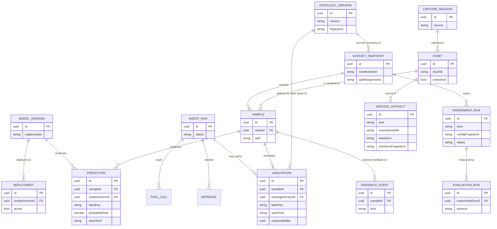

# Domain Model

> The 14 entities of Vision Lens as versioned Zod contracts in
> `@vision-lens/contracts` (spec 002). Status: Active · Date: 2026-11-10 ·
> Contract version: `1.0.0` · Plan: `specs/002-domain-model-contracts` (local, untracked
> per ADR-010).

Source of truth: `packages/contracts/src/` — `enums.ts` (vocabulary), `base.ts` (shared
primitives and the provenance/actor unions), `entities/` (one file per entity),
`manifest.ts` (machine-readable shape digest) and `version-guard.ts` (breaking-change
classifier). Nothing in this document is hand-maintained truth: it describes the schemas,
and `packages/contracts/tests/` proves them.

## The two invariants that shape everything

**Prediction ≠ Annotation (constitution II).** A model output and a human ground-truth
label are different schemas, not the same schema with a flag. `Prediction.actor` accepts
only the `model` variant of the actor union; `Annotation.actor` accepts only `human` or
`agent`. The two schemas are also strict objects that reject unknown keys, and each one
requires the field that is *unknown* to the other (`Prediction` requires
`modelVersionId`; `Annotation` requires `ontologyVersionId`). A payload therefore cannot
be parsed as the wrong kind of label — the rejection is structural, not conventional.

**Lineage is mandatory, not optional (constitution II, US4).** `DerivedArtifact` cannot
be constructed without `sourceAssetIds` (non-empty), `transform` and
`transformFingerprint`. Originals are immutable; everything derived points back at its
sources. The lineage ids are UUIDv7 entity ids — the identity format of the model — so a
lineage claim always resolves; a free-form string would point at something that cannot be
fetched.

**Provenance is complete on every label (constitution II, US4).** `Annotation` and
`Prediction` both carry the whole bundle: actor + surface + session + timestamp. `surface`
is REQUIRED on both (a model output always came through some surface); `sessionId` is
optional on both (a batch inference run may have no user session). The `predictions`
table mirrors this with two NOT NULL columns, so the contract is the first line of defence
and the database the second.

## Entity reference

| Entity | Purpose | Key fields | Constitutional invariant it encodes |
|---|---|---|---|
| `Asset` | An original, immutable media file | `id`, `sha256?`, `kind`, `bytes?`, `width?`/`height?`, `exifSanitizedJson?`, `captureSessionId?`, `unhashed`, `path?`, `createdAt` | Originals are immutable; `unhashed` flags assets whose bytes were never reachable (legacy/remote import) instead of dropping them. `sha256` is optional EXACTLY when `unhashed` is true — both directions are enforced by the schema (the database CHECK is the second line of defence) |
| `CaptureSession` | One camera/device producing a stream | `id`, `startedAt`, `endedAt?`, `source`, `contextJson?` | Provenance of the capture context, separate from the label that may later reference it |
| `Sample` | A labelled unit: one asset, optionally one region | `id`, `assetId`, `region?`, `split?`, `snapshotIds` (default `[]`), `sourceCaptureFrame?`, `createdAt` | Snapshots are immutable: a re-split produces a new snapshot, never an in-place edit |
| `OntologyVersion` | An immutable version of the label taxonomy | `id`, `version`, `categories[] {key,name,description}`, `fingerprint`, `parentId?`, `createdAt` | Full-config fingerprints (IV): the description is part of the fingerprinted configuration, so a description-only change changes the fingerprint |
| `Annotation` | Human- or agent-authored ground truth | `id`, `sampleId`, `ontologyVersionId`, `labelKey`, `geometry?`, `actor`, `surface`, `sessionId?`, `createdAt`, `supersededBy?` | Prediction ≠ Annotation; corrections are new rows linked by `supersededBy` — provenance is never mutated in place (FR-006) |
| `Prediction` | A model-produced label | `id`, `sampleId`, `modelVersionId`, `labelKey`, `probabilityRaw`, `probabilityCalibrated?`, `latencyMs?`, `costMicroUsd?`, `agreementJson?`, `actor`, `surface`, `sessionId?`, `createdAt` | Prediction ≠ Annotation; the provenance bundle is complete (US4); raw confidence is never treated as a probability (V); cost and latency travel with the prediction (VIII) |
| `DatasetSnapshot` | An immutable, content-addressed view of a dataset | `id`, `manifestHash`, `splitAssignments`, `ontologyVersionId`, `parentSnapshotId?`, `createdAt`, `lineageJson?` | Reproducibility (I): the manifest and the split assignment are both hashed, so any metric names the exact data it came from |
| `ExperimentRun` | One pipeline run (classify/train/eval/arena/al/agent) | `id`, `kind`, `inputSnapshotId?`, `configFingerprint`, `status`, `metricsSummaryJson?`, `startedAt`, `endedAt?` | Reproducibility (I) via the full config fingerprint; abstention is representable (`status: 'abstained'`, V) |
| `ModelVersion` | A versioned model in the registry | `id`, `name`, `version`, `registryState`, `recipe?`, `artifactPath?`, `calibrationRef?`, `modelCardPath?`, `createdAt` | Any prediction resolves to the exact artifact, recipe and calibration that produced it |
| `EvaluationRun` | A measured evaluation under a named protocol | `id`, `experimentRunId`, `protocol`, `resultsJson`, `reportPath?`, `createdAt` | A metric without its reproduction record is a hypothesis, not a result (I) |
| `Deployment` | A model version made available on a target | `id`, `modelVersionId`, `target`, `configJson`, `active`, `promotedAt?`, `pinnedFromId?`, `createdAt` | Promotion and rollback are traceable, not implicit |
| `FeedbackEvent` | A captured signal: correction / flag / production | `id`, `sampleId`, `kind`, `payloadJson`, `createdAt` | Append-only: a correction points at the sample it disputes; the new label is a separate `Annotation` row (FR-006) |
| `AgentRun` | One agent investigation | `id`, `goal`, `status`, `budgetJson`, `toolCalls[]`, `approvals[]`, `reportPath?`, `createdAt` | Budgets are explicit and approvals are recorded (VI); tool calls carry their permission tier |
| `DerivedArtifact` | An artifact derived from assets (thumbnail/embedding/report/mask/crop) | `id`, `kind`, `sourceAssetIds` (non-empty), `sourceSnapshotId?`, `transform`, `transformFingerprint`, `createdAt` | Lineage is structural (II, US4): sources and transform fingerprint cannot be omitted |

### Reserved entities (declared, not built)

`Track`, `Frame`, `Calibration` and `SynchronizedSequence` belong to the video /
Physical-AI frontier (spec 014). They are **declared** so their names cannot be claimed
by another entity, but they validate only `{ reserved: true, entity }` — any full
payload is rejected with a message pointing at spec 014. They are deliberately absent
from `ENTITY_SCHEMAS` and from the contract manifest until spec 014 activates them.

**Documented deviation from the spec's edge case.** The spec's edge case says the stubs
"validate as `{reserved: true}` only"; the implementation is deliberately STRICTER — a stub
requires BOTH `{ reserved: true, entity }` (self-describing, so a `track` can never be
mistaken for a `frame`) and rejects `{ reserved: true }` alone; the message always names
spec 014.

### Vocabulary

`ActorKind` (human/model/agent) · `Surface` (cli/studio/api/mcp/agent) · `JobState`
(queued/running/cancel_requested/succeeded/failed/cancelled/abstained) · `SplitKind`
(train/val/test/holdout/unassigned) · `RegistryState`
(draft/candidate/registered/deprecated/legacy) · `AgentToolTier`
(read/analyze/propose/gated-execute/approval-required) · `RunKind`
(classify/train/eval/arena/al/agent) · `FeedbackKind` (correction/flag/production).

### Shared primitives (`base.ts`)

| Primitive | Rule |
|---|---|
| Identity (`EntityIdSchema`) | UUIDv7 — time-ordered, index-friendly. Every entity id AND every lineage id (`sourceAssetIds`, `snapshotIds`) uses it, so a lineage claim always resolves |
| Timestamp (`TimestampSchema`) | ISO-8601 with an explicit offset (`Z` or `±HH:MM`). A non-`Z` offset is accepted; a zone-less local time is rejected — it is not a point in time |
| Content hash (`Sha256Schema`) | 64 lowercase hex characters |
| Fingerprint (`FingerprintSchema`) | `fp2:<16 hex>` — the exact shape `fingerprintV2` produces. A full-config fingerprint (constitution IV) is not a bare string, so a name or a legacy hash can never be passed off as one |
| Model actor (`ModelActorSchema.ref`) | The FULL actor reference: `model:<id>` or the constitutional `model:<id>@<version>`. The `model:` prefix is required, whitespace is rejected, and the separate `version` field carries the structured version — both may be present |
| Provenance (`ProvenanceSchema`) | A REFERENCE shape — who / surface / session / when — used to NAME the bundle the constitution requires. No entity is built from it: `Annotation` and `Prediction` keep the spec's field name (`createdAt`, not `recordedAt`) |

## Relationships



The separation the diagram encodes: `SAMPLE` has two independent label edges.
`ANNOTATION` hangs off `ONTOLOGY_VERSION` and carries an `actorKind` of `human` or
`agent`; `PREDICTION` hangs off `MODEL_VERSION` and carries an `actorKind` of `model`.
Neither table can hold the other's rows.

## Version-bump protocol

`CONTRACTS_VERSION` lives in `packages/contracts/src/version.ts` and is the contract
package's semver. The rule (FR-001): **a breaking change to the contract surface
requires a MAJOR bump**.

A manifest is derived from the live schemas and committed at
`packages/contracts/contract-manifest.json`:

```bash
corepack pnpm --filter @vision-lens/contracts run manifest:generate
```

`tests/version-guard.test.ts` then enforces two things:

1. **Staleness** — the committed manifest must equal the manifest derived from the live
   schemas. When it does not, the test fails and names the regeneration command above.
2. **Breaking-change gate** — the manifest at the merge-base with `origin/main` is read
   from git and diffed against the current one. A removed entity, a removed field, a
   changed field type, a changed field constraint, a field that became required, or a
   removed enum value requires the current MAJOR version to be strictly greater than the
   base MAJOR version.

The diff itself is a pure function (`diffManifests` / `checkVersionBump` in
`src/version-guard.ts`) — no git, no clock, no filesystem — so it is unit-tested
directly against synthetic manifest pairs. The git-dependent test only wires the base
manifest in; when the base revision has no manifest yet, that one test reports itself
as **skipped with an explicit reason** rather than passing silently.

#### What counts as breaking

The rule has a direction, and the direction is what makes it correct: a change is
**breaking when it NARROWS the contract** — the consumer's existing payload stops
validating, or the consumer stops being able to rely on something it relied on. It is
**compatible when it WIDENS the contract** — every payload that validated before still
validates.

| Change | Classification | Why |
|---|---|---|
| Entity removed | **breaking** | the consumer's payload can no longer be represented at all |
| Field removed | **breaking** | the consumer's payload no longer validates |
| Field type/shape changed | **breaking** | the value the consumer sends is no longer the value the contract accepts |
| Field validation constraint changed (e.g. the sha256 pattern tightened) | **breaking** | a payload that used to validate no longer does |
| Field became **required** (optional → required) | **breaking** | the consumer's existing payload stops validating |
| Field added as **required** | **breaking** | same: the consumer's existing payload stops validating |
| Enum value removed | **breaking** | the consumer may send a value that no longer exists |
| Entity added | compatible | additive; existing payloads are unaffected |
| Field added as **optional** | compatible | additive; existing payloads are unaffected |
| Field became **optional** (required → optional) | compatible | a relaxation — every payload that validated before still validates |
| Enum value added | compatible | additive; existing payloads are unaffected |

Note the two rows that are easy to get backwards: a field that becomes **optional** is a
relaxation and needs no version bump, while a field that becomes **required** — or is
added as required — is a tightening and does.

To make the constraint row work, each field in the manifest records its shape and its
validation constraint **separately**:

```json
"sha256": {
  "required": false,
  "type": "string",
  "constraint": "pattern=^[0-9a-f]{64}$"
}
```

`type` says what the value IS (`uuid`, `enum("image"|"video")`, `object{…}`,
`array<string>`, `json`); `constraint` says what the value MUST look like
(`pattern=…`, `minLength=1`, `minimum=0`, `maximum=1`). Splitting them means a
tightened digest format is detected as a constraint change instead of silently
disappearing into an unchanged type string.

### How to add an entity (additive-only rule)

1. Add `packages/contracts/src/entities/<entity>.ts` exporting the schema and the
   inferred type, with a doc comment naming the constitutional invariant it encodes.
2. Register it in `packages/contracts/src/entities/index.ts` (`ENTITY_SCHEMAS`) and
   re-export it.
3. Add a round-trip property case in `tests/entities.test.ts` (fast-check, fixed seed).
4. Regenerate the manifest (`manifest:generate`) and commit it together with the
   schema.
5. If the change is **breaking** (removed entity/field, changed type or constraint,
   field became or was added as required, removed enum value): bump the MAJOR version in
   `src/version.ts` and in `package.json`, and note the migration in the spec.

New optional fields, new entities and new enum values are **additive**: they do not
require a version bump, and the guard will not flag them. Fields that already exist must
never be removed, renamed, tightened, or made required without a MAJOR bump.

## Scope

This document covers the contract surface only. Persistence (SQLite store, repositories,
migrations) is spec 002 tasks 3–4; the legacy-run importer is task 4; the OpenAPI seed
is task 1.5/6.1; fingerprint v2 is task 2.
