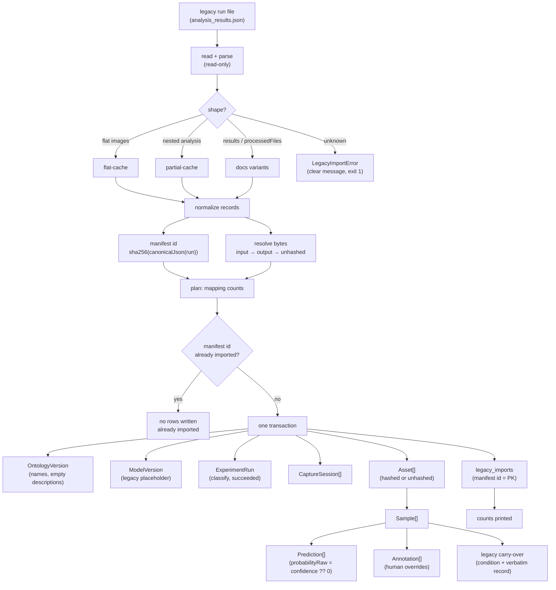

# Legacy run import

How a legacy analysis run (`analysis_results.json` and its historical
variants) becomes Vision Lens entities.

- **Code:** `packages/core/src/store/import/` (`legacy-shape.ts` — detection
  and normalization, `legacy-run.ts` — plan and transactional write).
- **CLI:** `vision-lens import-run <path> [--dry-run] [--db <path>]`
  (`packages/cli/src/commands/import-run.ts`).
- **Spec:** spec 002, US2 / tasks 4.1–4.4 and 7.2; FR-004; SC-002.

## The rules it obeys

| Constitution | How the importer honours it |
|---|---|
| II — Prediction ≠ Annotation | the model's label becomes a `Prediction` with a **model** actor; a human override becomes an `Annotation` with a **human** actor. They never mix. |
| II — originals are immutable | the run file and the image bytes are opened READ-ONLY. Nothing is written next to the run file, nothing is written into `input/` or `output/`, and the only thing written is the target database. (The legacy partial-cache code DELETES its checkpoint file — that pattern is deliberately **not** copied.) |
| IV — full-config fingerprints | the run's `configFingerprint` and the ontology's `fingerprint` are `fingerprintV2` digests over the real semantic configuration (taxonomy, data version, contracts version). |
| V — calibrated uncertainty | `probabilityRaw` carries the legacy confidence; `probabilityCalibrated` stays **absent** (no calibration exists). `latencyMs` and `costMicroUsd` stay **absent** — they were never recorded, and a fabricated `0` would look like a measurement. |
| I — evidence over vibes | everything that could not be recovered (model, provider, cost, latency, tokens, category descriptions) is either absent or explicitly marked as unknown. Nothing is invented. |
| VII — deterministic gates | the import is **transactional**: either the whole run lands or none of it does. |

## The mapping

| Legacy field | Entity | Caveat |
|---|---|---|
| `originalFile` (bare name) | `Asset.path` | joined to the **input root** — never to the CWD and never to the run file's own directory. |
| the bytes of that file | `Asset.sha256` | hashed when the bytes are reachable; otherwise the asset is flagged `unhashed` and carries a deterministic path-hash placeholder id (the rule already implemented in `packages/core/src/store/ids.ts`). |
| `outputFile` | fallback source | used only when the original is unreachable. The exported JPEG has a timestamp burned into it, so **one** canonical source is hashed — never both. |
| one record per image | `Sample` | one sample per asset; `split` is `unassigned`. |
| `category` | `Prediction.labelKey` | the key is the normalized name (`living_room` stays `living_room`). |
| `confidence` | `Prediction.probabilityRaw` | **absent → `0`**, never `1` (in this codebase `0` means "unsupported/skipped"). A confidence outside `0..1` is **refused**, not clamped: a fabricated probability is worse than a failed import. |
| — | `Prediction.probabilityCalibrated` | **absent**. No calibration exists for a legacy run. |
| — | `Prediction.latencyMs` / `costMicroUsd` | **absent**. Never recorded. |
| `overrides[]` | `Annotation` | human actor (`user:legacy-cli-reviewer`), surface `cli`, the original category and the override both preserved. The model's `Prediction` stays: a human label is an annotation, not an edit of the model's output. |
| `sessions[]` | `CaptureSession` + the links | `assets.capture_session_id` and `samples.source_capture_frame`; the session context keeps the legacy session id and its image numbers. |
| `categories[]` | `OntologyVersion` | **names only** — the legacy file has no descriptions. A missing description is stored as the **empty string** (the contract allows `description: z.string()`), which means "not recorded". No description is invented, and the ontology fingerprint therefore hashes the taxonomy that actually existed. |
| the observed labels (partial cache) | `OntologyVersion` | a partial cache records no taxonomy, but the labels it produced are real data: the taxonomy is reconstructed from them. |
| — | `ModelVersion` | **placeholder**, `registryState: 'legacy'`, name `legacy-unknown`. The real model and provider were never written to the legacy file, so no model name is invented. (If a run DOES record a `model`/`provider`, that name is used.) |
| the run itself | `ExperimentRun` | `kind: 'classify'`, `status: 'succeeded'`, `startedAt` = the run's `processedDate`. |
| `timestamp` (per record) | `createdAt` | **truncated to whole milliseconds**: the wild contains floats (`1753510199165.367`) and the column is an integer. |
| `condition` | **legacy carry-over** | it has **no target in the domain model** and is therefore neither normalized into a category or a defect enum, nor dropped: it is preserved **verbatim** (see below). |
| `shortDescription`, `elements`, `fullDescription`, `extractedText`, `number`, `relatedImages`, `lowConsensus` | **legacy carry-over** | preserved verbatim next to the sample, so nothing is lost in the translation. |

### The legacy carry-over

The legacy fields have no home in the contracts, and the public contract must
not pretend a legacy free-text field is part of the domain model. The
importer therefore keeps them in a **store-owned** table
(`legacy_sample_payloads`, migration `0002_legacy_import`):

| Column | Content |
|---|---|
| `sample_id` | the sample the legacy record produced |
| `manifest_id` | the run it came from |
| `condition_text` | the legacy `condition`, **verbatim** (queryable) |
| `payload_json` | the **whole** legacy record, verbatim (canonical JSON) |

The import summary reports how many records carried the legacy `condition`
(`legacy conditions: N` — every record of the historical run in this
repository carries one).

## The idempotency rule

> The identity of a run is `sha256(canonicalJson(parsedRunContent))`.

`canonicalJson` (from `@vision-lens/contracts`) sorts object keys, so a
file that was re-serialized with a different key order yields the **same** id.

**`processedDate` is NOT the identity.** Two different runs can share it, and
the same run imported twice must map to one id (SC-002).

The id is the PRIMARY KEY of `legacy_imports`. The importer checks it inside
the write transaction: when the run is already in the store, it writes
**nothing** and reports `already imported — nothing was written`. The
carry-over rows are keyed by `(sample_id, manifest_id)`, so a re-import can
never duplicate a child row either.

## The byte-resolution order

For every record, the bytes are looked up in this fixed order:

1. `<inputRoot>/<originalFile>` — the **original**, the canonical source.
2. `<outputRoot>/<outputFile>` — the export, when the original is gone.
3. `<outputRoot>/<originalFile>` — the original, when it was exported in place.
4. nothing → the asset is flagged **`unhashed`**.

The importer **never fails on missing bytes** (spec 002, edge case). An
`unhashed` asset carries `sha256 = NULL`, the path it was derived from, and
the deterministic **path-hash placeholder id** (the rule of
`packages/core/src/store/ids.ts`); spec 004 re-hashes it later.

The roots default to the layout of the pipeline: when the run file sits in a
directory named `output`, the roots are `<parent>/input` and `<parent>/output`;
otherwise they are the `input` and `output` subdirectories of the run file's
own directory.

Only the **bare file name** of a record is used, and the resolved path is
verified to stay inside the root: the importer never follows a path out of
the roots it was given.

## The CLI

```bash
# preview the mapping — writes nothing at all
vision-lens import-run ./output/analysis_results.json --dry-run

# import into a store
vision-lens import-run ./output/analysis_results.json --db ./store.db
```

| Flag | Meaning |
|---|---|
| `--dry-run` | print the mapping counts and write nothing (not even the database file) |
| `--db <path>` | the target store; defaults to the store's `defaultStorePath()` |

The real output (dry run, against this repository's own historical run):

```
legacy run:      /Users/erikhenriquealvescunha/Desktop/Projects/ai-image-labeling/output/analysis_results.json
store:           /tmp/mv-demo/store.db
manifest id:     a9476b3cc301643357da6f8612262d282d4a974804248f56c0dfc38b549ad31e
shape:           flat-cache
status:          dry run — nothing was written
assets:          144 (hashed 144, unhashed 0)
samples:         144
predictions:     144
annotations:     0
capture sessions:0
ontology versions:1
model versions:  1
experiment runs: 1
legacy carry-overs: 144
legacy conditions:144
```

and the real import prints the same counts with `status: imported`. A second
import of the same file prints `status: already imported — nothing was
written` and the same counts.

Failures exit with a non-zero code and one clear line on stderr: a missing
file (`Legacy run file not found: …`), an unreadable file, invalid JSON
(`… is not valid JSON: …`) and an unknown shape
(`Unrecognised legacy run shape: expected an object with an "images",
"results" or "processedFiles" array. …`).

## The import flow



## The store change

One **append-only** migration: `0002_legacy_import.sql` (with its paired
`0002_legacy_import.rollback.sql`). It only ADDS two tables —
`legacy_imports` and `legacy_sample_payloads` — and never touches a table
created by `0001_init`. No already-applied migration was edited, so the
hash-recorded migration history stays reproducible.

## Security

The importer reads untrusted JSON and untrusted image bytes:

- the content is **data**: it is never executed, never interpolated into a
  command, and never evaluated;
- the **paths** are constrained: only the bare file name of a record is used,
  and the resolved path is verified to stay inside the given root;
- the **writes** are constrained: the only write target is the target
  database. Nothing is written next to the run file, and nothing is written
  into `input/` or `output/`.
