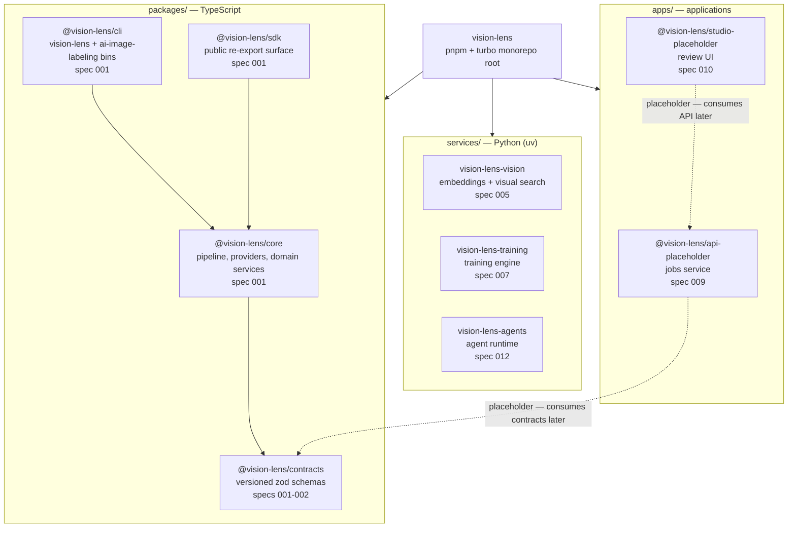

# Monorepo Map

Workspace layout after spec 001 (foundation monorepo): what lives where, which spec owns each component, and how the tooling wires together. See `specs/README.md` for the full phase map (F0-F5 → specs 001-014) and `docs/adr/006-monorepo-ts-python.md` for the TypeScript + Python decision.

## Layout

```text
vision-lens/                # pnpm + turbo monorepo root (private tooling shell)
├── packages/                 # TypeScript packages (NodeNext ESM, .js import suffixes)
│   ├── core/                 # @vision-lens/core — pipeline, providers, domain services (spec 001)
│   ├── cli/                  # @vision-lens/cli — vision-lens + ai-image-labeling bins (spec 001)
│   ├── sdk/                  # @vision-lens/sdk — public re-export surface (spec 001)
│   └── contracts/            # @vision-lens/contracts — versioned zod schemas (specs 001-002)
├── apps/                     # user-facing applications (TypeScript)
│   ├── api/                  # @vision-lens/api-placeholder — jobs service (spec 009)
│   └── studio/               # @vision-lens/studio-placeholder — review UI (spec 010)
└── services/                 # Python services (uv + hatchling, >=3.11, stdlib-only for now)
    ├── vision/               # vision-lens-vision — embeddings + visual search (spec 005)
    ├── training/             # vision-lens-training — training engine (spec 007)
    └── agents/               # vision-lens-agents — agent runtime (spec 012)
```

## Diagram



Solid arrows are current build-time dependencies; dotted arrows are planned integration points that land with their specs.

## Component notes

| Component | Kind | Language | Spec | Status |
|---|---|---|---|---|
| `packages/core` | package | TypeScript | 001 | live (all former src + tests) |
| `packages/cli` | package | TypeScript | 001 | landing with spec 001 |
| `packages/sdk` | package | TypeScript | 001 | landing with spec 001 |
| `packages/contracts` | package | TypeScript | 001-002 | seeded (`CONTRACTS_VERSION`, `UnitSeededSchema`); grows into the 14-entity domain model |
| `apps/api` | app | TypeScript | 009 | placeholder |
| `apps/studio` | app | TypeScript | 010 | placeholder |
| `services/vision` | service | Python | 005 | skeleton (`SERVICE_NAME` constant + smoke test) |
| `services/training` | service | Python | 007 | skeleton |
| `services/agents` | service | Python | 012 | skeleton |

## Tooling wiring

- **Workspace**: `pnpm-workspace.yaml` globs `packages/*`, `apps/*`, `services/*` (Python service dirs carry no `package.json` and are ignored by pnpm).
- **Tasks**: `turbo.json` defines `build`, `typecheck`, `test`, `lint`; turbo auto-discovers each package's scripts — no per-package wiring needed.
- **TypeScript**: `tsconfig.base.json` (ES2022, NodeNext, strict) extended by every package; root `tsconfig.json` stays `{"files":[]}` with no project references.
- **JS tests**: root `vitest.config.ts` includes `packages/*/tests/**/*.test.ts` and `apps/*/tests/**/*.test.ts`.
- **Python tests**: root script `pnpm test:py` runs `python3 -m pytest services -q`; each service is uv-managed (`uv sync` creates `uv.lock` + `.venv`).
