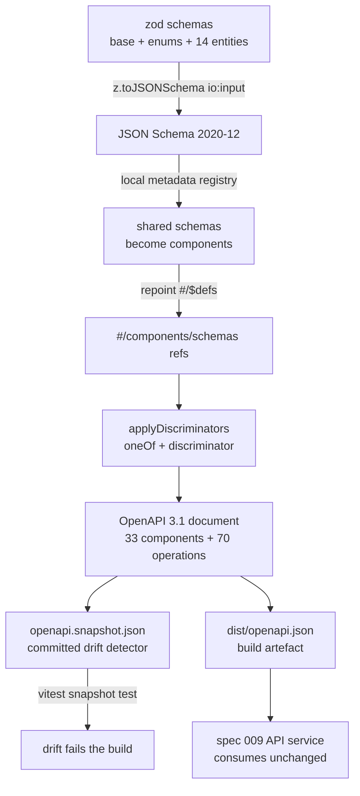

# OpenAPI Seed

> The OpenAPI 3.1 seed of the Vision Lens domain model, generated from the
> `@vision-lens/contracts` schemas (spec 002 task 1.5 / 6.1, FR-007, US5).
> Status: Active · Date: 2026-11-10 · Contract version: `1.0.0` · Plan:
> `specs/002-domain-model-contracts` (local, untracked per ADR-010).

Source of truth: `packages/contracts/src/openapi.ts` — the generator.
`packages/contracts/openapi.snapshot.json` — the committed snapshot.
`packages/contracts/dist/openapi.json` — the build artefact.
Nothing in the document is hand-written: the wire shape lives in the zod schemas
(`packages/contracts/src/base.ts`, `packages/contracts/src/enums.ts`,
`packages/contracts/src/entities/`), and the seed is derived from it on every build.

## What the seed is, and what it is not

The seed is the **HTTP contract the platform intends to serve**, expressed in
OpenAPI 3.1. It is generated from the same schemas the runtime validates against,
so the published contract and the accepted payloads cannot drift apart
(constitution III, contracts-first).

It is a **seed**, not a finished API. It declares the shape of the entities and a
skeleton of the operations that will address them. Everything that belongs to the
HTTP API service — authentication, authorization, error envelopes, pagination
beyond the `limit` hint, rate limits, servers — belongs to spec 009 and is
deliberately absent. Every operation says so in its own `description`, and every
`operationId` is prefixed `spec002Skeleton` so a reader can never mistake a
skeleton operation for a shipped one.

## How it is generated

`buildOpenApiDocument()` is a **pure function** over the schemas: no filesystem, no
clock, no network. The same schemas always produce the same document, which is
what makes the committed snapshot a meaningful drift detector rather than a
snapshot of a random run.

The conversion happens in four steps:

1. **zod → JSON Schema 2020-12.** `z.toJSONSchema(..., { io: 'input' })` converts
   each schema. `io: 'input'` is the same direction the contract manifest uses, so
   the `required` arrays describe what a producer must *send* — a field with a
   default is optional on the wire.
2. **Shared schemas become components.** A local zod metadata registry (never the
   global one, so generation cannot mutate shared state) registers the schemas
   that more than one entity uses. zod then emits `$ref`s to them instead of
   inlining a private copy at every use site, and the generator repoints those
   references from zod's `#/$defs/...` to OpenAPI's `#/components/schemas/...`.
3. **Discriminators are added.** zod emits `oneOf` for a discriminated union but
   never the OpenAPI `discriminator` keyword, so the mapping between the
   discriminator value and the schema that accepts it is built by a separate pure
   post-processing step (`applyDiscriminators`). A union whose branches do not
   carry distinct constants is *not* exclusive, so it keeps its `anyOf` and gets
   no discriminator.
4. **The document is assembled** — components, path templates, tags — and
   normalized so the committed snapshot has a stable, readable key order.



The same schemas validate at runtime, so the published wire shape and the
accepted payloads come from one source (constitution III).

### The JSON-valued fields

A field that carries a free-form payload (`exifSanitizedJson`, `budgetJson`,
`resultsJson`, …) is typed with the shared `JsonValueSchema`, which is a real
JSON Schema: a union of string, number, boolean, null, array and object, with the
array and the object referring back to the component itself. It is published as
the `JsonValue` component, so the seed says "a JSON value" and not "a string that
happens to hold JSON".

## What the document contains

| Part | Count | Notes |
|---|---|---|
| Entity components | 14 | one per entry of `ENTITY_SCHEMAS`, each with a `title` and a `description` |
| Enum components | 8 | one per entry of `ENUM_SCHEMAS`, each a string enumeration |
| Shared components | 11 | `EntityId`, `Timestamp`, `Sha256`, `Region`, `JsonValue`, the three actor variants and the three actor unions |
| Path templates | 28 | two per entity: the collection (`/assets`) and the item (`/assets/{id}`) |
| Operations | 70 | five per entity: list, create, get, update, delete |
| Tags | 14 | one per entity |

The five operations of the CRUD skeleton are the point of the path templates:

| Operation | Method and path | `operationId` |
|---|---|---|
| list | `GET /assets` | `spec002SkeletonListAssets` |
| create | `POST /assets` | `spec002SkeletonCreateAsset` |
| get | `GET /assets/{id}` | `spec002SkeletonGetAsset` |
| update | `PUT /assets/{id}` | `spec002SkeletonUpdateAsset` |
| delete | `DELETE /assets/{id}` | `spec002SkeletonDeleteAsset` |

Every operation carries the entity's tag, a `default` error response that points
at spec 009, and a body that references the entity component — the *same*
component the runtime validates against, never a copy.

The actor unions are the interesting part of the component set, because they are
where the constitutional split between a human label and a model output becomes
visible on the wire:

```json
"Actor": {
  "title": "Actor",
  "oneOf": [
    { "$ref": "#/components/schemas/HumanActor" },
    { "$ref": "#/components/schemas/ModelActor" },
    { "$ref": "#/components/schemas/AgentActor" }
  ],
  "discriminator": {
    "propertyName": "kind",
    "mapping": {
      "human": "#/components/schemas/HumanActor",
      "model": "#/components/schemas/ModelActor",
      "agent": "#/components/schemas/AgentActor"
    }
  }
}
```

`AnnotationActor` (human or agent only) and `PredictionActor` (model only) are
published the same way, so a consumer can pick the branch of a union without
guessing.

## Regenerating and checking it

The build produces the artefact:

```bash
pnpm --filter @vision-lens/contracts run build   # → packages/contracts/dist/openapi.json
```

The committed snapshot is refreshed with:

```bash
pnpm --filter @vision-lens/contracts run openapi:snapshot
```

`packages/contracts/tests/openapi.test.ts` compares the generated document with
the committed snapshot. When they differ, the failure prints the **first
differing line** with its context and the command that refreshes the snapshot —
the document is ~100 kB, so a structural diff would drown the reader.

## What is validated, and what is not

Two different claims are checked, with two different schemas, because they are two
different things:

1. **The document is a real OpenAPI 3.1 document.** It is validated against the
   official OpenAPI 3.1 JSON Schema published by the OpenAPI Initiative
   (`@apidevtools/openapi-schemas`). This checks the *envelope*: the version, the
   `info` object, the shape of the paths, the shape of the operations.
2. **Every component is a real JSON Schema 2020-12 schema.** Every component is
   checked against the 2020-12 metaschema and then compiled, with the whole
   document registered under one `$id`, so that every `$ref` between components is
   resolved while compiling. A dangling reference fails the check instead of
   shipping.

Stated plainly, so nobody over-reads the result:

- The OpenAPI envelope check does **not** validate the *contents* of a Schema
  Object — the OpenAPI schema accepts any JSON Schema there and delegates that to
  the dialect. The contents are covered by check 2.
- The OpenAPI 3.1 schema uses `$dynamicRef` to reach the Schema Object dialect.
  The validator uses the canonical `$dynamicRef` workaround (the same one
  `@apidevtools/swagger-parser` uses), which means the dialect is not loaded as a
  separate resource.
- Check 2 validates the components; it does not validate the *request and
  response bodies* of the skeleton operations against real payloads.
- The `format` keywords (`uuid`, `date-time`) are validated by `ajv-formats`.
  Every component also carries the equivalent `pattern`, so the constraint does
  not rest on the format alone.

## Consuming it

The package publishes the seed under two subpaths, so spec 009 can serve it
without copying or re-deriving anything:

```ts
// The document as a module — the generated object, no file reading.
import { openapiDocument } from '@vision-lens/contracts/openapi';

// The document as JSON — the build artefact.
import openapi from '@vision-lens/contracts/openapi.json' with { type: 'json' };
```

The seed is deliberately **not** re-exported from the package's main entry: the
document is generated eagerly, and every consumer of the contracts — the CLI
included — should not pay for it.
