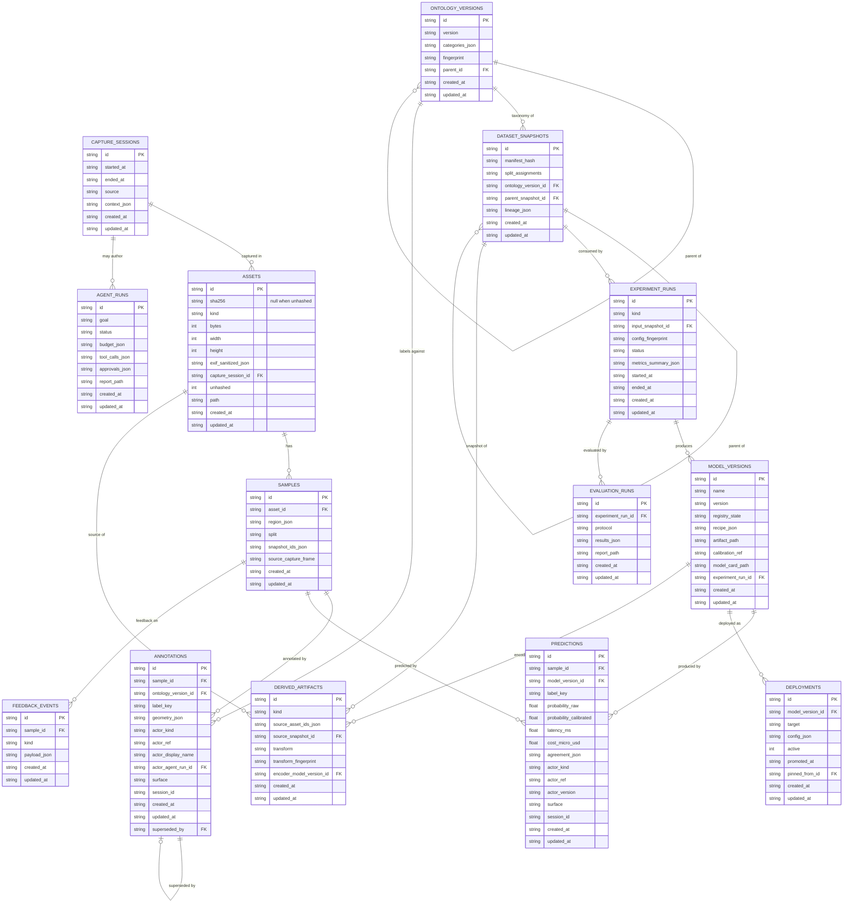
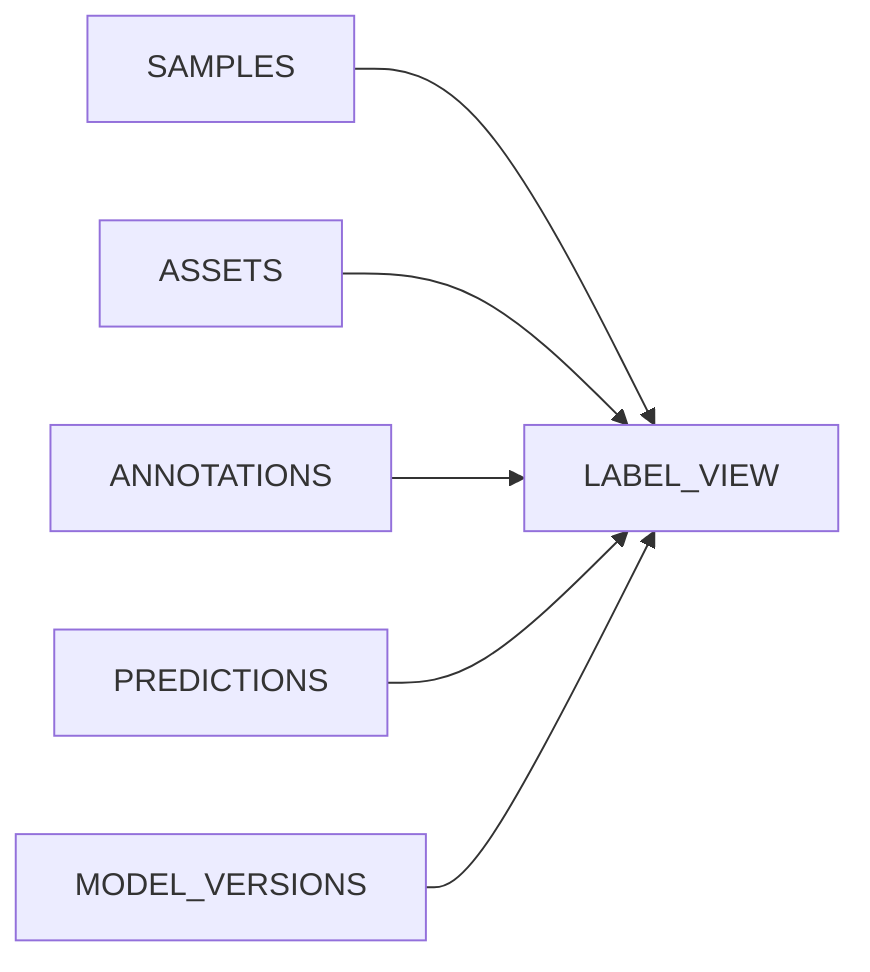

# The Master Vision store — schema and protocol

**Spec:** 002 — Domain model & contracts (US2 store, US4 lineage)
**Code:** `packages/core/src/store/**`
**Status:** implemented (chunk 2 of spec 002)

The store is the local metadata spine of Master Vision: a SQLite database
holding the 14 domain entities, the repositories that write them, and the
provenance and lineage invariants that make every record auditable. It
replaces the "flat JSON cache" world as the source of truth; the JSON caches
remain as run artifacts that the importer (spec 002, task 4) reads.

This document is the reference for the schema, the migration protocol, the
operational assumptions and the read-only view.

---

## 1. Table map

Every entity of the contracts (`@master-vision/contracts`) has exactly one
table. The contracts own the SHAPE of an entity; the store adds operational
bookkeeping columns (`created_at`, `updated_at`) and, where the auditor walk
needs a pointer the contracts do not carry, two explicitly **store-owned link
columns** (see §5).

| Entity (contract) | Table | Key columns | Invariants enforced at the DB level |
|---|---|---|---|
| `Asset` | `assets` | `id` PK, `sha256?`, `kind`, `bytes?`, `width?`, `height?`, `exif_sanitized_json?`, `capture_session_id?` FK, `unhashed`, `path?`, `created_at`, `updated_at` | `sha256` present **iff** `unhashed = 0` (CHECK); `unhashed ∈ {0,1}`; `kind` enum CHECK; `capture_session_id` → `capture_sessions` ON DELETE SET NULL |
| `CaptureSession` | `capture_sessions` | `id` PK, `started_at`, `ended_at?`, `source`, `context_json?`, `created_at`, `updated_at` | — |
| `Sample` | `samples` | `id` PK, `asset_id` FK, `region_json?`, `split?`, `snapshot_ids_json`, `source_capture_frame?`, `created_at`, `updated_at` | `asset_id` → `assets` ON DELETE CASCADE; the snapshot ids of `snapshot_ids_json` are verified by the repository (the JSON array cannot carry a foreign key) |
| `OntologyVersion` | `ontology_versions` | `id` PK, `version`, `categories_json`, `fingerprint`, `parent_id?` FK, `created_at`, `updated_at` | `parent_id` → `ontology_versions` ON DELETE SET NULL |
| `Annotation` | `annotations` | `id` PK, `sample_id` FK, `ontology_version_id` FK, `label_key`, `geometry_json?`, `actor_kind`, `actor_ref`, `actor_display_name?`, `actor_agent_run_id?` FK, `surface`, `session_id`, `created_at`, `updated_at`, `superseded_by?` FK | **provenance NOT NULL** (`actor_kind`, `actor_ref`, `surface`, `session_id`, `created_at`); `actor_ref <> ''` and `surface <> ''` (CHECK — the provenance that names a thing can never be blank); `actor_kind ∈ {human, agent}` (CHECK — a model can never author an annotation); `sample_id` → `samples` CASCADE; `ontology_version_id` → `ontology_versions` RESTRICT; `superseded_by` → `annotations` SET NULL |
| `Prediction` | `predictions` | `id` PK, `sample_id` FK, `model_version_id` FK, `label_key`, `probability_raw`, `probability_calibrated?`, `latency_ms?`, `cost_micro_usd?`, `agreement_json?`, `actor_kind`, `actor_ref`, `actor_version`, `surface`, `session_id`, `created_at`, `updated_at` | **provenance NOT NULL**; `actor_ref <> ''` and `surface <> ''` (CHECK); `actor_kind = 'model'` (CHECK — a human label can never be a prediction); `probability_raw ∈ [0,1]`; `sample_id` → `samples` CASCADE; `model_version_id` → `model_versions` RESTRICT |
| `DatasetSnapshot` | `dataset_snapshots` | `id` PK, `manifest_hash`, `split_assignments`, `ontology_version_id` FK, `parent_snapshot_id?` FK, `lineage_json?`, `created_at`, `updated_at` | `ontology_version_id` → `ontology_versions` RESTRICT; `parent_snapshot_id` → `dataset_snapshots` SET NULL |
| `ExperimentRun` | `experiment_runs` | `id` PK, `kind`, `input_snapshot_id?` FK, `config_fingerprint`, `status`, `metrics_summary_json?`, `started_at`, `ended_at?`, `created_at`, `updated_at` | `kind` and `status` enum CHECKs; `input_snapshot_id` → `dataset_snapshots` SET NULL |
| `ModelVersion` | `model_versions` | `id` PK, `name`, `version`, `registry_state`, `recipe_json?`, `artifact_path?`, `calibration_ref?`, `model_card_path?`, `experiment_run_id?` FK (store-owned), `created_at`, `updated_at` | `registry_state` enum CHECK; `experiment_run_id` → `experiment_runs` SET NULL |
| `EvaluationRun` | `evaluation_runs` | `id` PK, `experiment_run_id` FK, `protocol`, `results_json`, `report_path?`, `created_at`, `updated_at` | `experiment_run_id` → `experiment_runs` CASCADE |
| `Deployment` | `deployments` | `id` PK, `model_version_id` FK, `target`, `config_json`, `active`, `promoted_at?`, `pinned_from_id?` FK, `created_at`, `updated_at` | `active ∈ {0,1}`; `model_version_id` → `model_versions` RESTRICT; `pinned_from_id` → `deployments` SET NULL |
| `FeedbackEvent` | `feedback_events` | `id` PK, `sample_id` FK, `kind`, `payload_json`, `created_at`, `updated_at` | `kind` enum CHECK; `sample_id` → `samples` CASCADE |
| `AgentRun` | `agent_runs` | `id` PK, `goal`, `status`, `budget_json`, `tool_calls_json`, `approvals_json`, `report_path?`, `created_at`, `updated_at` | `status` enum CHECK |
| `DerivedArtifact` | `derived_artifacts` | `id` PK, `kind`, `source_asset_ids_json`, `source_snapshot_id?` FK, `transform`, `transform_fingerprint`, `encoder_model_version_id?` FK (store-owned), `created_at`, `updated_at` | **lineage NOT NULL** (`source_asset_ids_json`, `transform`, `transform_fingerprint`); the source list must be a non-empty JSON array (CHECK); `source_snapshot_id` → `dataset_snapshots` SET NULL; `encoder_model_version_id` → `model_versions` SET NULL |
| — | `schema_migrations` | `id` PK, `hash`, `applied_at` | the migration ledger (§4) |
| — | `legacy_imports` | `manifest_id` PK, `run_path`, `shape`, `experiment_run_id` FK, `ontology_version_id` FK, `model_version_id` FK, `counts_json`, `imported_at` | the idempotency ledger of the legacy importer: the content-addressed manifest id is the primary key, so re-importing the same run writes zero rows |
| — | `legacy_sample_payloads` | `sample_id` PK, `manifest_id` FK, `condition_text?`, `payload_json` | the legacy carry-over area: the verbatim per-image payload (including the free-text `condition`) that has no place in the domain model; FK → `legacy_imports` CASCADE |
| — | `label_view` | SQL VIEW | read-only by construction (§6) |

### Column conventions

- **Names** are snake_case; the repositories map them to the camelCase field
  names of the contracts. The mapping is explicit, row by row — there is no
  generic ORM in this layer.
- **JSON columns** hold *canonical JSON*: object keys sorted, no
  insignificant whitespace. The canonicaliser is the very same
  `canonicalJson` from `@master-vision/contracts` that fingerprint v2 uses
  (it is NOT re-implemented here), so a value written to a JSON column and
  the same value used in a fingerprint serialize identically. **Absent is
  `NULL`** — never the string `'null'`, never `''`. Arrays keep their order
  (it is semantic: `toolCalls` is a timeline).
- **Booleans** are stored as `INTEGER` constrained to `{0,1}` (SQLite has no
  boolean type).
- **Timestamps** are ISO-8601 strings with an explicit offset (`Z`).
  `created_at` is set on insert; `updated_at` is bumped on every write. The
  store's clock is monotonic within a process, so two writes in the same
  millisecond still produce strictly increasing timestamps.
- **Identity** is UUIDv7 (`z.uuidv7()` in the contracts): time-ordered, so
  primary-key inserts stay append-mostly.
- **Absent is `NULL`, except for the one documented sentinel** — see below.

### The "not recorded" sentinel

Two contract fields are OPTIONAL while the column that carries them is NOT
NULL: `sessionId` on an `Annotation` and on a `Prediction`. Those columns
store the **empty string** as the "not recorded" sentinel, so the column can
stay NOT NULL now and does not need a table rebuild when the contracts later
require a session.

**The sentinel is a storage detail, never a value.** It is written by
`sentinelText()` and read back by `optionalText()`, both in
`packages/core/src/store/repositories/base.ts` — the only place in the store
where the rule lives:

| Direction | Function | Behaviour |
|---|---|---|
| write | `sentinelText(value)` | `undefined` → `''` |
| read | `optionalText(value)` | `''` → `undefined` |

Every optional text column of every repository is read through
`optionalText()`, so a new optional column cannot silently reintroduce the
leak. The leak is not hypothetical: a `''` read back as a string makes
`PredictionSchema.safeParse()` fail ("Invalid option: expected one of
cli|studio|api|mcp|agent"), i.e. the entity read back from the database did
not satisfy its own contract.

The sentinel columns are deliberately NOT CHECK-constrained against `''` —
the empty string is a legitimate state there. The columns that carry a
*named* provenance (`actor_ref`, `surface`) ARE constrained (`<> ''`), because
"who produced this" and "through which surface" must never be blank.

### The `unhashed` placeholder rule

An asset is content-addressed by the sha256 of its bytes. When those bytes
cannot be read (a legacy run pointing at a moved file, a remote path), the
row is stored with `unhashed = 1` and `sha256 = NULL` instead of being
dropped — the importer never fails on missing bytes.

Such a row still needs a stable identity, otherwise the same file imported
twice would produce two rows. The rule is therefore:

> **When `assets.unhashed = 1`, the asset id MUST be the deterministic
> path-hash placeholder derived from the asset's absolute path.**

The placeholder is `sha256(resolve(path))` truncated to 16 bytes and stamped
with the UUID version-7 and variant bits, so it is a valid `z.uuidv7()` string
while staying a pure function of the path (`AssetsRepository.placeholderIdFor`).
Re-hashing the file later (spec 004) replaces the placeholder with the real
content hash; it does not change the row id, because the row id is not the
content address. The rule is enforced in the repository layer — SQLite cannot
recompute a hash of a path on the caller's filesystem.

---

## 2. ER diagram



The four RESERVED names of the contracts (Track, Frame, Calibration,
SynchronizedSequence) have **no table**: they are contracts-only stubs
(`{ reserved: true }`). Activating them is spec 014's declaration discipline.

---

## 3. Pragmas, durability and the single-writer assumption

`openStore()` applies four pragmas to every connection:

| Pragma | Value | Why | Operational consequence |
|---|---|---|---|
| `journal_mode` | `WAL` | Readers do not block the writer, and the writer does not block readers. Crash recovery depends on WAL. | The database is three files: `store.db`, `store.db-wal`, `store.db-shm`. Copying only `store.db` while a writer is active loses the newest commits. |
| `busy_timeout` | `5000` ms | A contending writer waits for the lock instead of failing immediately with `SQLITE_BUSY`. | Covers SHORT contention only. It is not a queue: after 5 s the write fails with `SQLITE_BUSY`. |
| `foreign_keys` | `ON` | Foreign keys are enforced, not decorative. `ON DELETE` behaviour is defined per relation (§1). | SQLite honours this pragma **per connection**: every connection must be opened through `openStore()`. A raw `new Database(...)` has foreign keys OFF. |
| `synchronous` | `NORMAL` | With WAL, `NORMAL` is crash-safe against process death but can lose the most recent transactions on a power / OS crash. `FULL` fsyncs every commit at a large throughput cost. | The deliberate trade-off of a local-first store. A store that must survive power loss opens with `synchronous = 'FULL'`. |

### Single writer

**One writer process at a time.** The store assumes a single-user,
single-process application (spec 002 assumption "Single-user
single-process"; spec 009 documents the same constraint for the API service).
`busy_timeout` absorbs the brief overlap between a CLI run and a studio
session; it does **not** make two long-running writers safe. A second writer
either waits up to 5 s and then fails with `SQLITE_BUSY`, or interleaves
logically unrelated transactions. Callers that need real concurrency must
serialise writes themselves.

The concurrency test (`tests/store/concurrency.test.ts`) exercises exactly
this path with two real processes: one holds the write lock, the other writes
into the window and must wait rather than fail.

---

## 4. Migration protocol

Migrations live in `packages/core/src/store/migrations/` as plain `.sql`
files, one per version, named `<id>_<name>.sql` (`0001_init.sql`). Every
migration has a paired rollback file `<id>_<name>.rollback.sql`.

The runner (`packages/core/src/store/migrate.ts`) applies them as follows:

1. **Hash-recorded ledger.** `schema_migrations(id, hash, applied_at)` stores
   the sha256 of the migration file's bytes.
2. **History check first.** Before applying anything, the runner verifies
   that every already-applied migration still hashes to its recorded value.
   An edited migration file aborts the run with an error naming the
   migration and **both** hashes. Silently re-running a changed migration is
   how a store ends up with a schema nobody can reproduce.
3. **One transaction per migration.** Each pending migration is applied
   inside its own transaction: it lands completely or not at all.
4. **Broken history is refused.** A recorded migration whose file has
   vanished is an error, not a warning.
5. **A broken SEQUENCE is refused.** The known migration ids (recorded in the
   ledger + present on disk) must form a contiguous sequence, and no pending
   migration may have a lower id than an already-applied one. Two defects are
   caught here, both of which used to slip through:
   - **a gap** — a never-applied migration whose file is missing (`0002`
     vanished while `0003` is on disk) used to be skipped silently, leaving
     the store with a schema nobody can reproduce;
   - **out of order** — a lower-id migration that appears later (`0000` shows
     up after `0002` was applied) used to be applied and to die with a raw
     `SqliteError` ("table already exists").

   Both raise a `StoreMigrationError` that names the offending ids, before
   anything is applied.
6. **Rollback is real.** `rollbackMigrations(db, targetVersion)` applies the
   paired rollback files in descending id order, each in its own
   transaction, and removes the ledger rows. A missing rollback script is an
   error — rollback scripts must exist and must work.

### The destructive-change rule

> **A migration that drops or rewrites data requires a MAJOR
> `CONTRACTS_VERSION` bump.**

Additive changes (a new table, a new nullable column, a new index) are fine
under a minor bump. Anything that drops a column, narrows a constraint or
rewrites stored rows changes the meaning of data that already exists, and
the contracts are the versioned description of that meaning — so the version
must say so. The runner cannot detect the intent of a migration; this is the
discipline the reviewer applies, mirrored by the contracts' version guard
(`packages/contracts/src/version-guard.ts`).

### Where the files live at runtime

The package build copies `src/store/migrations/` into
`dist/store/migrations/`, so the compiled store finds them next to itself.
In development (vitest, tsx) the source directory is used. Tests that need a
tampered copy pass an explicit `migrationsDir` — the repository's own `.sql`
files are never modified.

---

## 5. Store-owned link columns

Two columns exist in the database but NOT in the contract entities:

| Column | Why |
|---|---|
| `model_versions.experiment_run_id` | The auditor walk must reach the experiment run from a prediction: Prediction → ModelVersion → ExperimentRun → Snapshot → Assets. The contracts' `ModelVersion` carries no pointer to its run. |
| `derived_artifacts.encoder_model_version_id` | The auditor walk must reach the encoder of an embedding. The contracts' `DerivedArtifact` carries no pointer to the model that produced it. |

Both are nullable, are never returned inside a contract entity, and are
written through an explicit optional link argument of the repository
(`models.insert(model, { experimentRunId })`,
`derivedArtifacts.insert(artifact, { encoderModelVersionId })`). Promoting
them into the contracts is a `CONTRACTS_VERSION` event, not a silent drift.

**They are validated by the store, not by the driver.** A typo in a
store-owned link used to surface as a raw `SQLITE_CONSTRAINT_FOREIGNKEY` —
an error that names the constraint but not the mistake. The repositories now
look the target up first and raise a `StoreValidationError` that names it:

```
Model version links to an unknown experiment run '0190…'.
Derived artifact links to an unknown encoder model version '0190…'.
```

A third link has no foreign key at all: `samples.snapshot_ids_json` is a
JSON array. The repository therefore verifies that every referenced snapshot
exists before it writes, because a phantom snapshot id would silently empty
the auditor walk ("which assets does this snapshot contain?" would answer
"none").

The contract's own `derived_artifacts.source_snapshot_id` is validated the same
way: the repository looks the snapshot up first and raises a
`StoreValidationError` naming it, instead of letting the driver's raw
`SQLITE_CONSTRAINT_FOREIGNKEY` surface.

---

## 6. `label_view` — the read-only join

`label_view` joins `samples`, `assets`, `annotations` and `predictions` (and
`model_versions`) into one row per (sample × annotation × prediction)
combination, so a surface can render "what does the platform know about this
image?" without hand-writing the join.



**It never writes.** The guarantee is structural, not a convention: it is a
SQL VIEW, and SQLite rejects any INSERT/UPDATE/DELETE against a view that has
no INSTEAD OF trigger:

```
SqliteError: cannot modify label_view because it is a view
```

The same holds for the domain rules the view exposes: it joins the annotation
and the prediction tables, but it cannot merge them into a single "label" —
the columns stay separate (`annotation_label_key` vs `prediction_label_key`),
because a model output is not ground truth (constitution II).

Note the fan-out: a sample with three annotations and two predictions
produces six rows. Filter with `sampleId` / `assetId` when a single row is
needed.

---

## 7. The rules the repository layer enforces

- **Contracts-first.** Every repository validates its payload with the
  contract schema BEFORE writing. The schema is the first line of defence;
  the database constraints are the second. A payload the contracts reject
  never reaches SQLite.
- **Provenance is mandatory.** Annotations and predictions carry actor,
  surface, session and timestamp. The columns are NOT NULL, and the two that
  name something — `actor_ref` and `surface` — are CHECK-constrained against
  the empty string, so a raw INSERT cannot write a blank provenance either.
  The fields the contracts leave optional (`sessionId`) use the "not
  recorded" sentinel and are read back as absent (§1).
- **Labels are never mutated.** No repository exposes an "update label" or an
  "update provenance" method. A correction is a NEW annotation row;
  `AnnotationsRepository.correctAnnotation(originalId, correction)` inserts it
  and sets `supersededBy` on the row it replaces, in one transaction. The old
  row keeps its actor, surface, session and `createdAt` forever. The history
  is queryable with `annotationHistory(sampleId)`.
  The only update methods that exist (`experiments.updateStatus`,
  `deployments.setActive`, `agentRuns.updateStatus`) touch lifecycle state
  only.
- **The supersede pointer belongs to the repository.** `insert()` REJECTS a
  payload that carries a `supersededBy`: the pointer's direction (the OLD row
  points at its replacement) and its validity are facts about the chain that
  only the repository can know. A caller-supplied pointer could point at a
  row of another sample and would leave the sample with no annotation in
  force — a silent hole in the ground truth. The pointer the repository
  writes is validated too (the target must exist and belong to the same
  sample), so a sample always has exactly one annotation in force.
- **Snapshot membership is frozen.** A sample records the snapshots it
  belongs to ONCE, at insert time; no repository method updates
  `snapshot_ids_json`. A snapshot is immutable, so the set of samples that
  belong to it is decided when the sample is written.
- **Originals are immutable.** The asset repository has no update method.
- **Lineage is structural.** A derived artifact cannot be created without its
  source assets, its transform and its transform fingerprint — and the
  repository additionally verifies that every referenced source asset
  actually exists, because the JSON source list cannot carry a foreign key.
- **Store-owned links are checked by the store.** A store-owned link that
  points at a row that does not exist raises a `StoreValidationError`, not a
  raw driver error (§5).

### The error classes of the store

| Class | Meaning | Operator action |
|---|---|---|
| `StoreUnavailableError` | the optional native driver (`better-sqlite3`) could not be loaded | install it |
| `StoreValidationError` | the payload was rejected by the contracts or by a repository link rule; **nothing was written** | fix the payload |
| `StoreMigrationError` | the schema history is inconsistent (edited migration, missing rollback script, missing migration file, gap, out-of-order history) | restore the migration files or migrate deliberately |
| `StoreConsistencyError` | the stored data contradicts an invariant the store guarantees (a chain that points nowhere) | the database is damaged; inspect it |

A database-level constraint violation (NOT NULL, FOREIGN KEY, CHECK) is NOT
wrapped: it surfaces as the driver's own `SqliteError`, whose `code`
(`SQLITE_CONSTRAINT_NOTNULL`, `SQLITE_CONSTRAINT_FOREIGNKEY`,
`SQLITE_CONSTRAINT_CHECK`) is part of the store's contract with its callers.

---

## 8. The default path is a proposal

`defaultStorePath()` follows ADR-007 (local-first): `MASTER_VISION_HOME`
when set, otherwise `~/.master-vision`, with the database in `store.db`.
**This default is a PROPOSAL pending maintainer confirmation** — the location
is not yet pinned by an ADR. Every store function accepts an explicit path,
and the test suite always uses an explicit temporary directory: the home
directory is never touched by the tests.
