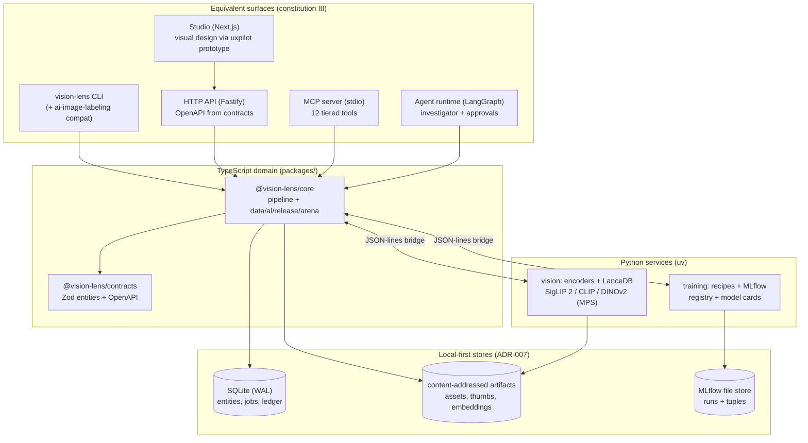
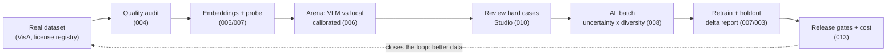

# Vision Lens — the vision evolution

> Product name: **Vision Lens** (repo `erikunha/VisionLens`, formerly `LAIbemage` / the
> `ai-image-labeling` CLI). Status: Active · Date: 2026-11-10 · Decisions: ADR-005…010 ·
> Plan: `specs/001–014` (local, untracked per ADR-010) · Progress mirror: `ROADMAP.md`

## What Vision Lens is becoming

A **Visual Intelligence Engineering Workbench**: a local-first platform that turns images and
visual datasets into specialized models, verified evaluations and operational decisions — not
another labeling tool. Where CVAT, Label Studio and Roboflow own annotation and FiftyOne owns
dataset analytics, Vision Lens owns the **engineering layer that connects data → models →
measured outcomes**: which model wins under quality/cost/latency constraints, which images
damage the dataset, which examples deserve human review, what a retrained model actually
changed, and whether an agent can run that investigation safely with evidence.

It demonstrates, in one system: software engineering → data engineering → computer vision →
deep learning → ML systems → agent engineering → MLOps → production AI.

## Positioning theses

1. **Follow the money**: the differentiating loop is *AI Evaluation & CostOps* — reduce the
   cost of classifying thousands of images (local encoders first, expensive VLMs or humans
   only for genuinely hard cases) while proving quality did not drop. Directly measurable.
2. **Data quality before auto-labeling**: find the 10k images that matter in 500k before
   labeling anything (dedup, leakage, imbalance, outliers — spec 004).
3. **Evidence over vibes**: real datasets with ground truth, calibrated probabilities,
   full-config fingerprints, holdout-or-no-claim (ADR-008).
4. **Agents as investigators, not replacements**: tiered-permission agents that audit,
   compare, propose and run budgeted experiments with human approvals (ADR-009).

First vertical: **industrial visual inspection** (VisA, CC BY 4.0) — measurable value,
public ground truth. Then logistics/inventory, document intelligence, geospatial, Physical AI.

## System map (Mermaid)

Surfaces and the single contract spine:

The data flywheel (F2 demo slice):

## Capability map (16 systems, P0 now → P2 later)

| Domain | System | Priority | Spec |
|---|---|---|---|
| Visual Data Engineering | Media processing (hashes, EXIF, thumbs, quality probes) | P0 | 004 |
| | Dataset management (immutable snapshots, splits, lineage) | P0 | 004 |
| | Data quality lab (dup/leakage/imbalance/outliers) | P0 | 004 |
| | Annotation engine (classification now; geometry later) | P0–P1 | 010 |
| | Data discovery (hybrid visual/text search, clustering) | P1 | 005 |
| | Acquisition breadth (S3/URLs/cameras) | P2 | — |
| Vision Intelligence | Visual models (encoders: SigLIP 2 / CLIP / DINOv2) | P0 | 005 |
| | Evaluation lab (suites, calibration, Pareto) | P0 | 006, 003 |
| | Training engine (probe → fine-tune, MLflow, registry) | P1 | 007 |
| | Inference engine (caching, cascade routing) | P1 | 008, 013 |
| | Visual reasoning (VLM suites over the same contracts) | P1 | 006 |
| | Video intelligence | P2 | 014 |
| Agentic Ops | Agent runtime (LangGraph investigator, approvals) | P1 | 012 |
| | MLOps & observability (traces, ledger, drift, gates) | P1 | 013 |
| | Automation engine (jobs, DAGs, triggers) | P1 | 009 |
| | Developer/enterprise platform (CLI/SDK/API/MCP/Studio) | P0–P2 | 001, 009–011 |

## Core differentiators (build order)

1. **Visual Model Arena** (006): same dataset through VLM vs encoder+sklearn vs trained model;
   side-by-side predictions, calibrated uncertainty, cost per image, Pareto frontier.
2. **Budget-Aware Active Learning** (008): review only what moves the model (uncertainty ×
   diversity), each batch measured by the holdout delta it produced.
3. **Autonomous Experiment Scientist** (012): agent investigates failures, proposes and runs
   budgeted experiments, pauses for approvals, reports with artifact-cited evidence.
4. **Vision AI Cost Optimizer** (008/013): cascade local → specialized → VLM → human under
   explicit quality floors; total expected cost = inference + review + FP + FN costs.
5. Later: capture copilot, visual knowledge graph, incident time travel (013 seeds it).

**Teacher → Student**: strong VLMs label candidates; humans verify; small specialized models
distill — measured, not assumed (holdout proves the student before it replaces the teacher).

## Domain model (spec 002)

Asset · CaptureSession · Sample · OntologyVersion · Annotation · Prediction ·
DatasetSnapshot · ExperimentRun · ModelVersion · EvaluationRun · Deployment · FeedbackEvent ·
AgentRun (+ reserved Track, Frame, Calibration, SynchronizedSequence — spec 014).
Invariants: Prediction ≠ Annotation; immutable originals; provenance on every label;
full-semantic fingerprints; reserved: video/physical-AI entities.

## Stack (ADR-006/007)

pnpm + Turborepo · TypeScript ESM (Fastify, Zod contracts, OpenAPI) · Python/uv (PyTorch MPS,
scikit-learn, MLflow, LanceDB, LangGraph) · Next.js Studio (visual design arrives later from
an external uxpilot.ai prototype — structure only until then) · MCP stdio · OpenTelemetry ·
SQLite + content-addressed artifacts (local-first).

## Quality gates (constitution)

Reproducibility · Quality (per-class, holdout, failure analysis) · Reliability (resumable,
idempotent, rollback) · Security (untrusted content, tiers, approvals) · Observability
(trace/cost/provenance) · Integration (CLI = API = Studio = MCP).

Metrics taxonomy: macro F1, per-class P/R, ECE · IoU/Dice (later) · mAP (later) · Recall@K ·
latency p50/p95, throughput, cost per correctly-processed image, review minutes, total
expected cost.

## Monetization hypotheses (validation order)

1. AI Evaluation & CostOps (sell measured savings) → 2. Visual Data Operations (curation/
   review productivity) → 3. Visual Process Automation (operational loss reduction).
Open-source distribution first (community CLI/SDK/Studio local); team/enterprise later.

## First demo (closes F2)

VisA import → quality audit → embedding baseline probe → arena (VLM vs local) → Studio review
of hard cases → AL batch → retrain → holdout delta report (quality × cost × latency) → the
same investigation run by the agent over MCP. One flow, every layer, all evidence.

## Frontier (declared, not built — spec 014)

Video intelligence · Physical AI/robotics data (sensor fusion, calibration, sync) · synthetic
data factory (real-holdout-validated) · document intelligence (OCR → structured fields with
evidence regions) · open-vocabulary concepts · SAM-family GPU workers (optional adapters).
