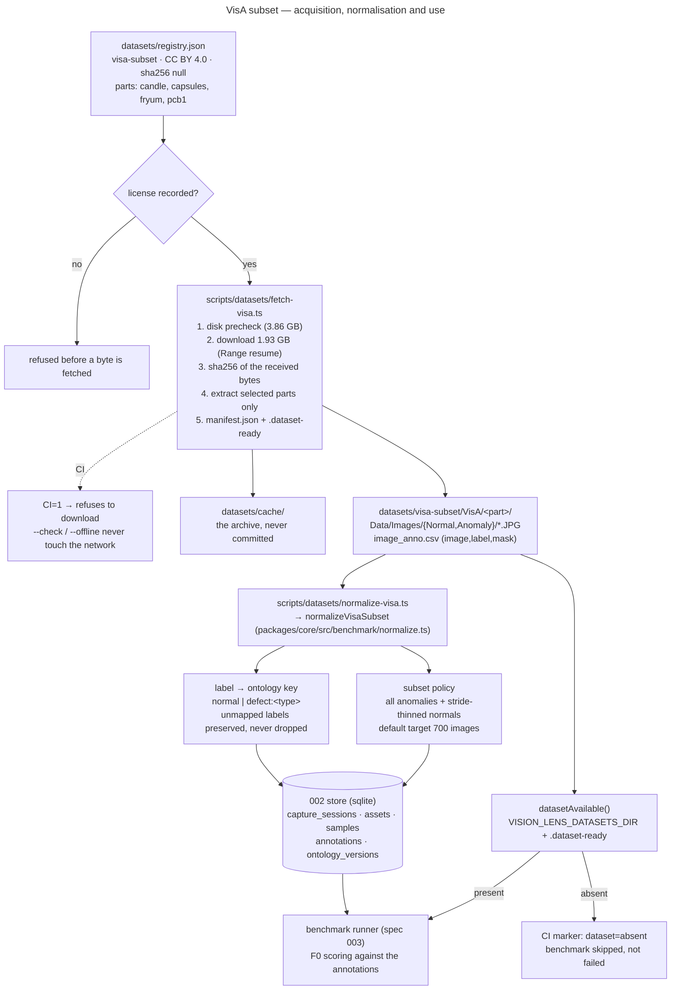

# VisA subset — acquisition and normalisation

> Status: **implemented, dataset not downloaded** · Spec: `specs/003-benchmark-ground-truth`
> (US1, tasks 1.1–1.4) · Registry: `datasets/registry.json` · Revision: `9ef7b95`

This document is the operator's guide to the benchmark ground truth: where the dataset
comes from, under which license, how it is fetched, how it is turned into Vision Lens
ground truth, and what CI does with it.



---

## 1. The dataset

| | |
|---|---|
| Name | Visual Anomaly (VisA) |
| Publisher | Amazon (amazon.science) — [Registry of Open Data on AWS](https://registry.opendata.aws/visa/) |
| Release used | `VisA_20220922` (2022-09-22) |
| Object | `arn:aws:s3:::amazon-visual-anomaly/VisA_20220922.tar` (region `us-west-2`, anonymous access, no AWS account required) |
| Archive size | **1,929,840,640 bytes** (1.93 GB / 1.80 GiB) |
| Object ETag | `05c830591a1172938cb714895c9e0cfb-113` |
| Content | 12 object classes, 3 domains, 10,821 images (9,621 normal, 1,200 anomalous), image-level **and** pixel-level annotations |
| Documentation | [amazon-research/spot-diff](https://github.com/amazon-research/spot-diff) |

The direct object URL used by the fetch script is
`https://amazon-visual-anomaly.s3.us-west-2.amazonaws.com/VisA_20220922.tar`.

### 1.1 License proof

The registry listing states, verbatim:

> **License** — <https://creativecommons.org/licenses/by/4.0/>

and the machine-readable metadata of the same page carries
`"license": "<a href=\"https://creativecommons.org/licenses/by/4.0/\">https://creativecommons.org/licenses/by/4.0/</a>"`.

CC BY 4.0 permits commercial use, so the dataset is admissible as a **benchmark**
source. The entry in `datasets/registry.json` records `usage: "benchmark"`,
`license: "CC BY 4.0"`, `licenseUrl: "https://creativecommons.org/licenses/by/4.0/"` and
`commercialUse: true`, and the fetch script refuses to fetch a dataset whose license
field is empty (`assertDatasetLicensed`).

### 1.2 Attribution (required by CC BY)

The registry's "How to Cite" section, copied into `datasets/registry.json`:

> Visual Anomaly (VisA) was accessed on DATE from https://registry.opendata.aws/visa.
> Zou, Yang, Jongheon Jeong, Latha Pemula, Dongqing Zhang, and Onkar Dabeer.
> "SPot-the-Difference Self-Supervised Pre-training for Anomaly Detection and Segmentation."
> arXiv preprint arXiv:2207.14315 (2022).

This string is carried in the registry entry, written into the `contextJson` of every
capture session the normalisation creates, and must accompany any published result.

### 1.3 The checksum rule

The archive is a **multipart** S3 upload: the `-113` suffix of the ETag is the part
count. A multipart ETag is neither the content MD5 nor a checksum of any kind, so it
is recorded as **provenance only** — which object revision was fetched — and is never
compared against a locally computed digest.

The trustworthy digest is the sha256 the fetch script computes **from the bytes it
received**. Therefore:

* `sha256` is `null` in the tracked registry, and stays `null` until a real fetch pins
  it with `--record-checksums`;
* `sha256PinnedAt` and `fetchedAt` are stamped at the same instant as the digest;
* an unpinned entry is reported as **unpinned** — never as "verified".

`--check` on the current registry state therefore reports an unpinned entry and exits
non-zero. That is the honest answer, not a failure of the script.

---

## 2. Which object classes are in the subset

The upstream release carries **12** classes: `candle`, `capsules`, `cashew`,
`chewinggum`, `fryum`, `macaroni1`, `macaroni2`, `pcb1`–`pcb4`, `pipe_fryum`.

The subset selects **4**:

| Part | Why |
|---|---|
| `candle` | Multiple instances per scene, 8 anomaly classes — the richest defect vocabulary of the release. |
| `capsules` | Multiple instances per scene, 5 anomaly classes, different visual domain (pharmaceutical blister packs). |
| `fryum` | Single instance per scene, 8 anomaly classes — the opposite object layout. |
| `pcb1` | Complex PCB structure, 4 anomaly classes — fine-grained structural defects on a non-natural object. |

Rationale (recorded verbatim in `datasets/registry.json`): visual distinctness rather
than size. The four classes cover **both object layouts** (multi-instance and
single-instance) and **both defect granularities**, each contributing both normal and
anomalous images in usable volume, while keeping the F0 benchmark loop inside the
spec's 600–800 image band. The remaining eight classes are left out for that reason —
not because they are unusable. Expand the selection by editing `parts.selected` and
re-running the fetch with `--parts`.

The part list is **archive-driven**: the fetch script discovers the layout of the
tarball and extracts only the selected parts, so a class that the upstream release
renames or drops is reported rather than silently mis-handled.

---

## 3. Fetching

```bash
# 1. Verify what is on this machine. Never downloads, never touches the network.
pnpm tsx scripts/datasets/fetch-visa.ts --check

# 2. Download, verify, extract the selected parts. ~1.93 GB down, ~3.86 GB needed.
pnpm tsx scripts/datasets/fetch-visa.ts

# 3. Pin the computed sha256 into datasets/registry.json (the ONLY write path that
#    may set `sha256`).
pnpm tsx scripts/datasets/fetch-visa.ts --record-checksums

# 4. Re-stage from the local cache only, with no network at all.
pnpm tsx scripts/datasets/fetch-visa.ts --offline

# 5. Stage a different selection (the registry entry is unchanged).
pnpm tsx scripts/datasets/fetch-visa.ts --parts candle,capsules
```

Flags: `--check`, `--offline`, `--record-checksums`, `--parts <a,b,c>`,
`--dataset <id>`, `--registry <path>`, `--datasets-dir <path>`.

**Steps 2, 3 and 5 download 1.93 GB and need the maintainer's authorisation** (the
download is deliberate, not a test). Step 1 and step 4 never touch the network.

### 3.1 What the script guarantees

* **License gate first.** The registry entry must carry a non-empty license before a
  single byte is fetched.
* **Disk before network.** The free space is checked *before* the download starts and
  the run is refused with the numbers it would have needed (archive 1,929,840,640 B +
  extraction headroom 1,929,840,640 B = **3,859,681,280 B**).
* **Resumable.** An interrupted download continues with an HTTP `Range` request; the
  sha256 is still computed in one pass over the bytes.
* **Checksum computed, never assumed.** A digest that does not match the pinned value
  aborts the run and **names the offending file**.
* **Partial extraction.** Only the selected parts are written; the tar is sequential,
  so the reader stops as soon as the selected parts are complete. If the archive turns
  out not to be laid out part by part, the script says so and finishes the extraction
  instead of silently returning a partial subset.
* **Path traversal refused.** Every entry path of the archive is sanitised — an
  absolute path or a `..` segment rejects the whole archive, including entries of
  parts that were not selected.
* **Writes stay inside the datasets directory.** Nothing is written anywhere else, in
  particular never into `input/` or `output/`.
* **CI refuses to download.** With `CI` set, the script aborts instead of fetching.

After a successful run:

```
datasets/cache/VisA_20220922.tar         # the archive (git-ignored)
datasets/visa-subset/
├── manifest.json                        # per-file sha256 + archive provenance
├── .dataset-ready                       # the CI presence marker
└── VisA/<part>/Data/Images/{Normal,Anomaly}/*.JPG
```

---

## 4. Normalisation into the 002 store

```bash
# Normalise the staged subset into the default store.
pnpm tsx scripts/datasets/normalize-visa.ts

# A narrower run: two object classes, 400 images, an explicit store.
pnpm tsx scripts/datasets/normalize-visa.ts --parts candle,capsules --target-images 400 --db ./bench.db
```

Flags: `--datasets-dir <path>`, `--db <path>`, `--parts <a,b,c>`,
`--target-images <n>`.

The mapping itself lives in `packages/core/src/benchmark/normalize.ts`; the script is
only the command line around it, so there is exactly one implementation of the
mapping and the tests exercise the same code path.

### 4.1 Label mapping

The ground truth is the dataset's own `image_anno.csv` (`image,label,mask`) — the
image-level label, not a mask.

| CSV label | Ontology key | Note |
|---|---|---|
| `normal` | `normal` | |
| `chunk of wax missing` (a class in the upstream taxonomy) | `defect:chunk-of-wax-missing` | canonical names come from the dataset's own taxonomy (`amazon-research/spot-diff`, `utils/id2class.py`) |
| `Chunk  Of   Wax Missing` | `defect:chunk-of-wax-missing` | case- and punctuation-insensitive |
| `chunk of wax missing,foreign particals on candle` | `defect:chunk-of-wax-missing` | multi-defect label: the **first** defect is the key, the whole raw label is preserved |
| `a brand new defect nobody catalogued` | `defect:a-brand-new-defect-nobody-catalogued` | **preserved, never dropped**; the label is reported as unmapped and gets its own ontology category carrying the raw text |

### 4.2 Subset policy

* **Every anomalous image is kept.**
* Normal images are thinned by an **even stride anchored at both ends** over their
  sorted order (a prefix would sample only the most uniform head of the capture
  session). Default target: **700 images** (the spec's band is 600–800), overridable
  with `--target-images`.

### 4.3 What is written

| Table | Content |
|---|---|
| `capture_sessions` | One per object class, `source = visa/<part>`, context carrying dataset id, version, license and attribution |
| `assets` | One per image, addressed by the sha256 of its bytes |
| `samples` | One per image, linked to the asset |
| `annotations` | The ground-truth label, actor `human` / `dataset:visa-subset`, surface `cli` |
| `ontology_versions` | The keys actually observed, version `visa-subset-<version>`, fingerprint `fp2:<16 hex>` |

**Masks are not turned into assets.** F0 scores classification; a mask is carried in
the report (`maskPath`), not materialised as an image.

**Re-running is safe.** The normalisation upserts: a second run writes no new rows.
A *changed* label does not overwrite the old one — the constitution says a correction
is a **new** annotation row that supersedes the old one, and the old row keeps its
actor, surface, session and timestamp forever.

The run also reports, rather than swallows, the three honest failure modes:

* `unlabeledImages` — images on disk with no row in the CSV;
* `danglingAnnotations` — CSV rows naming an image that is not on disk;
* `unmappedLabels` — labels outside the upstream taxonomy (kept, and reported).

---

## 5. Behaviour in CI

CI never fetches datasets. Two mechanisms make that explicit:

1. **The fetch script refuses to download when `CI` is set.** The error names the
   reason and points at `--check`.
2. **`datasetAvailable()`** (`packages/core/src/benchmark/dataset-availability.ts`)
   decides whether the ground truth is present. It resolves the datasets directory
   from `VISION_LENS_DATASETS_DIR` (default: `datasets/`) and requires the **`.dataset-ready`
   marker**, not merely an existing directory — a half-staged subset is reported as
   absent.

When the dataset is absent, the benchmark is **skipped, not failed**: the helper
returns the marker string `dataset=absent`, which the benchmark job emits so a
missing 1.93 GB download never breaks the pipeline. The same message is what a CI log
should contain when the ground truth was never staged.

---

## 6. MVTec AD — documented, not fetched

`datasets/registry.json` also carries `mvtec-ad`, with `usage: "research-only"`,
license **CC BY-NC-SA 4.0** and `commercialUse: false`. MVTec AD is the field's
classic comparison point (15 categories, ~5,354 high-resolution images with
pixel-precise masks), but its license forbids commercial use and its download is
form-gated (no anonymous object URL). Nothing in this repository fetches or scores
against it. It is recorded so the research path is explicit and a later, deliberate,
license-reviewed task can pick it up.

---

## 7. What is verified, and what is not

| Item | State |
|---|---|
| Registry schema, license gate, checksum pinning | verified by tests (`packages/core/tests/benchmark/registry.test.ts`) |
| Label mapping, subset policy, store writes, idempotency | verified by tests against a real SQLite store (`normalize.test.ts`) |
| Fetch script (license gate, disk precheck, checksum mismatch, traversal refusal, partial extraction, CI refusal, offline mode) | verified by tests with an **injected** fetcher — no network (`fetch.test.ts`) |
| The real 1.93 GB download | **NOT RUN** — it needs the maintainer's authorisation |
| The pinned sha256 | **NOT PINNED** — `sha256` is `null` until a real fetch computes it |

## References

* [Registry of Open Data on AWS — Visual Anomaly (VisA)](https://registry.opendata.aws/visa/)
* [amazon-research/spot-diff](https://github.com/amazon-research/spot-diff) — the dataset's documentation and class taxonomy
* [SPot-the-Difference Self-Supervised Pre-training for Anomaly Detection and Segmentation](https://arxiv.org/abs/2207.14315)
* [CC BY 4.0](https://creativecommons.org/licenses/by/4.0/)
* [MVTec AD](https://www.mvtec.com/research-teaching/datasets/mvtec-ad) — research reference only
