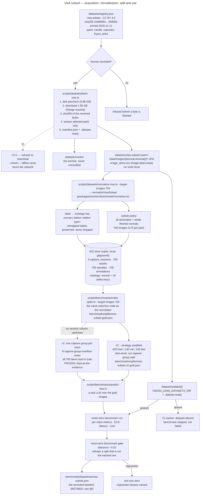

# VisA subset — acquisition and normalisation

> Status: **implemented, dataset fetched and checksum-pinned, split replaced (VLN-007)** ·
> Spec: `specs/003-benchmark-ground-truth`
> (US1, tasks 1.1–1.4) · Registry: `datasets/registry.json` · Measured at snapshot `4afc0d8`
>
> The archive was fetched on **2026-11-11** and its sha256 is pinned. The normalised subset
> holds 700 images and the gold manifest is committed. The **first** measurement
> (`gpt-4o`, macro F1 0.9795 / balanced accuracy 0.9700) was taken on a **degenerate
> all-train split**: all 700 items were in `train`, so there was no held-out set at all,
> and the number is **not publishable as model performance** (§8). The split has been
> replaced by a real 60/20/20 partition (`visa-subset.v2.gold.json`, 420 train / 140 val /
> 140 test), and the old measurement is retired with that reason recorded next to it.

This document is the operator's guide to the benchmark ground truth: where the dataset
comes from, under which license, how it is fetched, how it is turned into Vision Lens
ground truth, and what CI does with it.



---

## 1. The dataset

| | |
|---|---|
| Name | Visual Anomaly (VisA) |
| Publisher | Amazon (amazon.science) — [Registry of Open Data on AWS](https://registry.opendata.aws/visa/) |
| Release used | `VisA_20220922` (2022-09-22) |
| Object | `arn:aws:s3:::amazon-visual-anomaly/VisA_20220922.tar` (region `us-west-2`, anonymous access, no AWS account required) |
| Archive size | **1,929,840,640 bytes** (1.93 GB / 1.80 GiB) |
| Object ETag | `05c830591a1172938cb714895c9e0cfb-113` |
| Content | 12 object classes, 3 domains, 10,821 images (9,621 normal, 1,200 anomalous), image-level **and** pixel-level annotations |
| Documentation | [amazon-research/spot-diff](https://github.com/amazon-research/spot-diff) |

The direct object URL used by the fetch script is
`https://amazon-visual-anomaly.s3.us-west-2.amazonaws.com/VisA_20220922.tar`.

### 1.1 License proof

The registry listing states, verbatim:

> **License** — <https://creativecommons.org/licenses/by/4.0/>

and the machine-readable metadata of the same page carries
`"license": "<a href=\"https://creativecommons.org/licenses/by/4.0/\">https://creativecommons.org/licenses/by/4.0/</a>"`.

CC BY 4.0 permits commercial use, so the dataset is admissible as a **benchmark**
source. The entry in `datasets/registry.json` records `usage: "benchmark"`,
`license: "CC BY 4.0"`, `licenseUrl: "https://creativecommons.org/licenses/by/4.0/"` and
`commercialUse: true`, and the fetch script refuses to fetch a dataset whose license
field is empty (`assertDatasetLicensed`).

### 1.2 Attribution (required by CC BY)

The registry's "How to Cite" section, copied into `datasets/registry.json`:

> Visual Anomaly (VisA) was accessed on DATE from https://registry.opendata.aws/visa.
> Zou, Yang, Jongheon Jeong, Latha Pemula, Dongqing Zhang, and Onkar Dabeer.
> "SPot-the-Difference Self-Supervised Pre-training for Anomaly Detection and Segmentation."
> arXiv preprint arXiv:2207.14315 (2022).

This string is carried in the registry entry, written into the `contextJson` of every
capture session the normalisation creates, and must accompany any published result.

### 1.3 The checksum rule

The archive is a **multipart** S3 upload: the `-113` suffix of the ETag is the part
count. A multipart ETag is neither the content MD5 nor a checksum of any kind, so it
is recorded as **provenance only** — which object revision was fetched — and is never
compared against a locally computed digest.

The trustworthy digest is the sha256 the fetch script computes **from the bytes it
received**. Therefore:

* `sha256` is the digest of the bytes actually received, and it was **pinned on
  2026-11-11** by the first authorised fetch:
  `2eb8690c803ab37de0324772964100169ec8ba1fa3f7e94291c9ca673f40f362`;
* `sha256PinnedAt` and `fetchedAt` are stamped at the same instant as the digest
  (`2026-11-11T11:04:36.707Z`);
* the pinned digest is also recorded in `datasets/visa-subset/manifest.json` next to the
  archive's url, byte count and ETag;
* an **unpinned** entry is reported as unpinned — never as "verified".

`--check` on the current registry state therefore passes: it verifies the cached
archive against the pinned digest and the staged files against the per-file
manifest, and reports *"The staged 'visa-subset' matches the pinned sha256
2eb8690c…f40f362"*. The same rule still holds for any future dataset: the digest
is computed from the bytes, never typed.

### 1.4 What is in the archive — the extracted layout

The archive's object-class directories sit at the **top level**: there is **no `VisA/`
level**. The fetch script extracts the selected parts into the dataset root, so the
staged tree is:

```
datasets/visa-subset/
├── manifest.json                        # per-file sha256 + archive provenance (3910 files)
├── .dataset-ready                       # the CI presence marker
├── candle/
│   ├── image_anno.csv
│   └── Data/Images/{Normal,Anomaly}/*.JPG
├── capsules/ …
├── fryum/ …
└── pcb1/ …
```

`scripts/datasets/normalize-visa.ts` accepts both shapes (it looks for a `VisA/`
subdirectory and falls back to the flat root), but **the fetch produces the flat one** —
so the split manifest's relative paths start at the part name
(`candle/Data/Images/Normal/0000.JPG`), with no `VisA/` prefix.

---

## 2. Which object classes are in the subset

The upstream release carries **12** classes: `candle`, `capsules`, `cashew`,
`chewinggum`, `fryum`, `macaroni1`, `macaroni2`, `pcb1`–`pcb4`, `pipe_fryum`.

The subset selects **4**:

| Part | Why |
|---|---|
| `candle` | Multiple instances per scene, 8 anomaly classes — the richest defect vocabulary of the release. |
| `capsules` | Multiple instances per scene, 5 anomaly classes, different visual domain (pharmaceutical blister packs). |
| `fryum` | Single instance per scene, 8 anomaly classes — the opposite object layout. |
| `pcb1` | Complex PCB structure, 4 anomaly classes — fine-grained structural defects on a non-natural object. |

Rationale (recorded verbatim in `datasets/registry.json`): visual distinctness rather
than size. The four classes cover **both object layouts** (multi-instance and
single-instance) and **both defect granularities**, each contributing both normal and
anomalous images in usable volume, while keeping the F0 benchmark loop inside the
spec's 600–800 image band. The remaining eight classes are left out for that reason —
not because they are unusable. Expand the selection by editing `parts.selected` and
re-running the fetch with `--parts`.

The part list is **archive-driven**: the fetch script discovers the layout of the
tarball and extracts only the selected parts, so a class that the upstream release
renames or drops is reported rather than silently mis-handled.

---

## 3. Fetching

```bash
# 1. Verify what is on this machine. Never downloads, never touches the network.
pnpm tsx scripts/datasets/fetch-visa.ts --check

# 2. Download, verify, extract the selected parts. ~1.93 GB down, ~3.86 GB needed.
pnpm tsx scripts/datasets/fetch-visa.ts

# 3. Pin the computed sha256 into datasets/registry.json (the ONLY write path that
#    may set `sha256`).
pnpm tsx scripts/datasets/fetch-visa.ts --record-checksums

# 4. Re-stage from the local cache only, with no network at all.
pnpm tsx scripts/datasets/fetch-visa.ts --offline

# 5. Stage a different selection (the registry entry is unchanged).
pnpm tsx scripts/datasets/fetch-visa.ts --parts candle,capsules
```

Flags: `--check`, `--offline`, `--record-checksums`, `--parts <a,b,c>`,
`--dataset <id>`, `--registry <path>`, `--datasets-dir <path>`.

**Steps 2, 3 and 5 download 1.93 GB and need the maintainer's authorisation** (the
download is deliberate, not a test). Step 1 and step 4 never touch the network.

The archive has already been fetched once (2026-11-11), so the digest in
`datasets/registry.json` is pinned and a re-fetch is **checked against it** rather than
writing a new one. Step 3 is what pins it; on a machine that already has the pinned
value, step 2 alone refuses to continue on a mismatch.

### 3.1 What the script guarantees

* **License gate first.** The registry entry must carry a non-empty license before a
  single byte is fetched.
* **Disk before network.** The free space is checked *before* the download starts and
  the run is refused with the numbers it would have needed (archive 1,929,840,640 B +
  extraction headroom 1,929,840,640 B = **3,859,681,280 B**).
* **Resumable.** An interrupted download continues with an HTTP `Range` request; the
  sha256 is still computed in one pass over the bytes.
* **Checksum computed, never assumed.** A digest that does not match the pinned value
  aborts the run and **names the offending file**.
* **Partial extraction.** Only the selected parts are written; the tar is sequential,
  so the reader stops as soon as the selected parts are complete. If the archive turns
  out not to be laid out part by part, the script says so and finishes the extraction
  instead of silently returning a partial subset.
* **Path traversal refused.** Every entry path of the archive is sanitised — an
  absolute path or a `..` segment rejects the whole archive, including entries of
  parts that were not selected.
* **Writes stay inside the datasets directory.** Nothing is written anywhere else, in
  particular never into `input/` or `output/`.
* **CI refuses to download.** With `CI` set, the script aborts instead of fetching.

After a successful run:

```
datasets/cache/VisA_20220922.tar         # the archive (git-ignored)
datasets/visa-subset/
├── manifest.json                        # per-file sha256 + archive provenance
├── .dataset-ready                       # the CI presence marker
└── <part>/Data/Images/{Normal,Anomaly}/*.JPG
```

The four parts — `candle`, `capsules`, `fryum`, `pcb1` — staged **3910 files** in the
fetch of 2026-11-11 (`candle` 1201, `capsules` 803, `fryum` 701, `pcb1` 1205).

---

## 4. Normalisation into the 002 store

```bash
# Normalise the staged subset into the default store.
pnpm tsx scripts/datasets/normalize-visa.ts

# A narrower run: two object classes, 400 images, an explicit store.
pnpm tsx scripts/datasets/normalize-visa.ts --parts candle,capsules --target-images 400 --db ./bench.db
```

Flags: `--datasets-dir <path>`, `--db <path>`, `--parts <a,b,c>`,
`--target-images <n>`.

The mapping itself lives in `packages/core/src/benchmark/normalize.ts`; the script is
only the command line around it, so there is exactly one implementation of the
mapping and the tests exercise the same code path.

### 4.1 The annotation CSV of the real release

Each object class carries its own `image_anno.csv`, with the header
`image,label,mask` — **three columns and no more**. The upstream release has no
`session` column, no `defect_type` column and no `class` column.

| column | what the real release puts there |
|---|---|
| `image` | the path of the image **relative to the dataset root**, carrying the part prefix: `candle/Data/Images/Normal/0000.JPG` |
| `label` | `normal` for a normal capture; for an **anomalous** capture the **defect type** — `chunk of wax missing`, `bubble`, `melt`, `bent`, … Sometimes the cell is quoted, and sometimes it is a comma-separated list of several defects: `"chunk of wax missing,foreign particals on candle"` |
| `mask` | the path of the pixel-level mask (empty for a normal capture) |

Two consequences the tooling relies on:

* The `image` cell is resolved against **both** the dataset root and the CSV's own
  directory, so the upstream convention and the repository's fixture convention both
  work. A cell that resolves to two files, or to none, is a loud error.
* The `label` is cross-checked against the directory the image sits in
  (`Data/Images/Normal` vs `Data/Images/Anomaly`). A disagreement is a hard error —
  the two sources describe the same image and one of them is wrong. Over the **3506
  upstream rows** of the four selected parts the cross-check found **0 contradictions**.

### 4.2 Label mapping

The ground truth is the dataset's own `image_anno.csv` (`image,label,mask`) — the
image-level label, not a mask.

| CSV label | Ontology key | Note |
|---|---|---|
| `normal` | `normal` | |
| `chunk of wax missing` (a class in the upstream taxonomy) | `defect:chunk-of-wax-missing` | canonical names come from the dataset's own taxonomy (`amazon-research/spot-diff`, `utils/id2class.py`) |
| `Chunk  Of   Wax Missing` | `defect:chunk-of-wax-missing` | case- and punctuation-insensitive |
| `chunk of wax missing,foreign particals on candle` | `defect:chunk-of-wax-missing` | multi-defect label: the **first** defect is the key, the whole raw label is preserved |
| `a brand new defect nobody catalogued` | `defect:a-brand-new-defect-nobody-catalogued` | **preserved, never dropped**; the label is reported as unmapped and gets its own ontology category carrying the raw text |

### 4.3 Subset policy

* **Every anomalous image is kept.**
* Normal images are thinned by an **even stride anchored at both ends** over their
  sorted order (a prefix would sample only the most uniform head of the capture
  session). Default target: **700 images** (the spec's band is 600–800), overridable
  with `--target-images`.

The run of 2026-11-11 selected **700 images** — all **400 anomalous** ones plus
**300 stride-thinned normals**, **175 per part** (100 anomalous + 75 normal each).

### 4.4 What is written

| Table | Content | The 2026-11-11 run |
|---|---|---|
| `capture_sessions` | One per object class, `source = visa/<part>`, context carrying dataset id, version, license and attribution | **4** — `visa/candle`, `visa/capsules`, `visa/fryum`, `visa/pcb1` |
| `assets` | One per image, addressed by the sha256 of its bytes | **700** |
| `samples` | One per image, linked to the asset | **700** |
| `annotations` | The ground-truth label, actor `human` / `dataset:visa-subset`, surface `cli` | **700** |
| `ontology_versions` | The keys actually observed, version `visa-subset-<version>`, fingerprint `fp2:<16 hex>` | version `visa-subset-20220922`, fingerprint `fp2:8277ac3536ccc24b`, **19 keys** — `normal` + **18 defect keys** |

The store of that run lives at `datasets/store/visa-benchmark.db`. It is a **local,
git-ignored artifact** (`datasets/*/` is ignored) — a re-run recreates it; it is never
a tracked file.

**Masks are not turned into assets.** F0 scores classification; a mask is carried in
the report (`maskPath`), not materialised as an image.

**Re-running is safe.** The normalisation upserts: a second run writes no new rows.
A *changed* label does not overwrite the old one — the constitution says a correction
is a **new** annotation row that supersedes the old one, and the old row keeps its
actor, surface, session and timestamp forever.

The run also reports, rather than swallows, the three honest failure modes:

* `unlabeledImages` — images on disk with no row in the CSV;
* `danglingAnnotations` — CSV rows naming an image that is not on disk;
* `unmappedLabels` — labels outside the upstream taxonomy (kept, and reported).

---

## 5. Behaviour in CI

CI never fetches datasets. Two mechanisms make that explicit:

1. **The fetch script refuses to download when `CI` is set.** The error names the
   reason and points at `--check`.
2. **`datasetAvailable()`** (`packages/core/src/benchmark/dataset-availability.ts`)
   decides whether the ground truth is present. It resolves the datasets directory
   from `VISION_LENS_DATASETS_DIR` (default: `datasets/`) and requires the **`.dataset-ready`
   marker**, not merely an existing directory — a half-staged subset is reported as
   absent.

When the dataset is absent, the benchmark is **skipped, not failed**: the helper
returns the marker string `dataset=absent`, which the benchmark job emits so a
missing 1.93 GB download never breaks the pipeline. The same message is what a CI log
should contain when the ground truth was never staged.

---

## 6. MVTec AD — documented, not fetched

`datasets/registry.json` also carries `mvtec-ad`, with `usage: "research-only"`,
license **CC BY-NC-SA 4.0** and `commercialUse: false`. MVTec AD is the field's
classic comparison point (15 categories, ~5,354 high-resolution images with
pixel-precise masks), but its license forbids commercial use and its download is
form-gated (no anonymous object URL). Nothing in this repository fetches or scores
against it. It is recorded so the research path is explicit and a later, deliberate,
license-reviewed task can pick it up.

---

## 7. The end-to-end command sequence

The whole path from the archive to a gated baseline, in the order it was run on
2026-11-11. Every flag below is verified against the script that implements it.

```bash
# 1. Fetch, verify and stage the four selected parts (~1.93 GB down, ~3.86 GB needed).
pnpm tsx scripts/datasets/fetch-visa.ts
pnpm tsx scripts/datasets/fetch-visa.ts --record-checksums   # pins the sha256

# 2. Normalise the staged subset into the store (700 images, 4 capture sessions).
pnpm tsx scripts/datasets/normalize-visa.ts --target-images 700 --db datasets/store/visa-benchmark.db

# 3. Build the gold manifest over the SAME subset the normaliser selected.
#    This is the v1 split, the one that degenerated to an all-train partition.
#    It is FROZEN: the file is never rewritten, it is the evidence of the defect.
pnpm exec tsx scripts/benchmarks/make-splits.ts \
  --dataset visa-subset \
  --root datasets/visa-subset \
  --seed 42 \
  --target-images 700 \
  --out benchmarks/splits/visa-subset.gold.json

# 3b. Build the v2 split: the same 700 images in a real 60/20/20 partition.
#     --strategy stratified gives up the capture-group property (the upstream
#     release has no session column, so a class is one capture group and it is
#     larger than every quota) and stratifies by class and anomaly instead.
#     The manifest states in `groupBasis` that the partition is item-level.
pnpm exec tsx scripts/benchmarks/make-splits.ts \
  --dataset visa-subset \
  --root datasets/visa-subset \
  --seed 42 \
  --target-images 700 \
  --strategy stratified \
  --id visa-subset.v2.gold \
  --out benchmarks/splits/visa-subset.v2.gold.json

# 4. Compute the config fingerprint — it is COMPUTED, never typed.
pnpm exec tsx scripts/benchmarks/config-fingerprint.ts \
  --split benchmarks/splits/visa-subset.gold.json \
  --provider openai --model gpt-4o --model-version model:gpt-4o@2024-11-20
# → fp2:3883e2f9a01107f8   (the components go to stderr)

# 5. Run the real model over the gold images.
pnpm exec tsx scripts/benchmarks/predict-visa.ts \
  --split benchmarks/splits/visa-subset.gold.json \
  --root datasets/visa-subset \
  --out benchmarks/predictions/visa-subset.gpt-4o.json \
  --provider openai --model gpt-4o --model-version 2024-11-20

# 6. Score them.
pnpm exec tsx packages/cli/src/index.ts benchmark run \
  --suite visa-subset --model-id gpt-4o \
  --model-version 'model:gpt-4o@2024-11-20' \
  --config-fingerprint fp2:3883e2f9a01107f8 \
  --split benchmarks/splits/visa-subset.gold.json \
  --predictions benchmarks/predictions/visa-subset.gpt-4o.json \
  --out benchmarks/results --min-samples 30

# 7. Gate against the baseline, and record it the first time.
pnpm exec tsx packages/cli/src/index.ts benchmark gate --suite visa-subset --model-id gpt-4o
pnpm exec tsx packages/cli/src/index.ts benchmark gate --suite visa-subset --model-id gpt-4o --update-baseline
```

Steps 3b to 7 are the v2 workflow, and the suite id changes with the split:
the v2 split belongs to the suite **`visa-subset.v2`**, so the split file is
`benchmarks/splits/visa-subset.v2.gold.json`, the predictions are
`benchmarks/predictions/visa-subset.v2.gpt-4o.json` and the baseline is
`benchmarks/baselines/visa-subset.v2.json`.

```bash
# 3b..7 for the v2 suite: same commands, the v2 split and the v2 suite id.
pnpm exec tsx scripts/benchmarks/make-splits.ts \
  --dataset visa-subset --root datasets/visa-subset --seed 42 --target-images 700 \
  --strategy stratified --id visa-subset.v2.gold \
  --out benchmarks/splits/visa-subset.v2.gold.json

pnpm exec tsx scripts/benchmarks/predict-visa.ts \
  --split benchmarks/splits/visa-subset.v2.gold.json \
  --root datasets/visa-subset \
  --out benchmarks/predictions/visa-subset.v2.gpt-4o.json \
  --provider openai --model gpt-4o --model-version 2024-11-20 \
  --max-usd-micro 750000
# --max-usd-micro is an OPTIONAL ceiling in micro-USD (750000 = 0.75 USD): the
# run refuses before the first provider call when the pinned estimate exceeds
# it and aborts when the observed spend crosses it mid-run; in both cases no
# prediction file is written, because partial results are never published. 0
# means no paid calls; without the flag there is no ceiling. Mid-run tracking
# needs the run's model pinned in PROVIDER_PRICING (gpt-4o above is); an
# unlisted model's ceiling is pre-flight only, priced at the provider's
# default model.

pnpm exec tsx packages/cli/src/index.ts benchmark run \
  --suite visa-subset.v2 --model-id gpt-4o \
  --model-version 'model:gpt-4o@2024-11-20' \
  --split benchmarks/splits/visa-subset.v2.gold.json \
  --predictions benchmarks/predictions/visa-subset.v2.gpt-4o.json \
  --out benchmarks/results --min-samples 30
```

**`--target-images 700` is the flag that keeps the two artefacts on the same subset.**
The selection is shared code (`collectVisaPartData` + `selectVisaSubsetImages` in
`packages/core/src/benchmark/normalize.ts`), so the manifest describes exactly the 700
images the store holds: 700 assignments against 700 samples, with **identical paths and
identical sha256 digests**. Without the flag the generator would split **every** row of
every `image_anno.csv` — 3506 upstream rows, a different set from the one the store
describes.

---

## 8. The measured result (historical, retired)

> **This number is not a performance figure.** The run below was scored on the
> **v1** split, whose 700 assignments are all in `train`: there was no held-out
> set, so nothing was measured on unseen images. It is kept as the historical
> record of the first real run, and the baseline entry that carries it is
> **retired** (`status: "retired"` with the reason recorded next to it in
> `benchmarks/baselines/visa-subset.json`). Do not quote it as the accuracy of a
> model. The tracked split is now the v2 one (§8.5), and the first number
> recorded against it is still to be measured.

### 8.1 What was run

| | |
|---|---|
| Model | `gpt-4o`, version `model:gpt-4o@2024-11-20` |
| Provider | `openai` |
| Items scored | **700** (the whole gold manifest) |
| Correct | **685** |
| LLM calls | **35** (20 images per call) |
| Cost | **0.535723 USD** total, **0.000765 USD** per image |
| Latency (per batch call) | p50 **7482.84 ms**, p95 **10159.64 ms** |
| Run id | derived from the tuple (the report directory name) |

Reproduction tuple:

| Field | Value |
|---|---|
| Snapshot | the commit the run was scored at (the `snapshotId` recorded in the baseline) |
| Split fingerprint | `76dee597ea8d42bdba657f37c357cdfc4afc3d3e1de617d90ced7b77e485a0b2` |
| Model version | `model:gpt-4o@2024-11-20` |
| Config fingerprint | `fp2:3883e2f9a01107f8` |
| Environment | node v24.22.1 / darwin / arm64 |

The run carried **no caveats**: the image bytes were verified against the manifest.

**Where the evidence lives.** The run report itself (`benchmarks/results/<runId>/`) is a
**local** artifact — `benchmarks/results/` is gitignored, because a report names a machine
and a clock. The tracked evidence is the gold set, the raw predictions and the baseline:

| tracked file | what it is |
|---|---|
| `benchmarks/splits/visa-subset.gold.json` | the 700 gold items, their sha256 and the manifest hash of the **v1** split (frozen) |
| `benchmarks/predictions/visa-subset.gpt-4o.json` | the 700 raw model answers (id, label key, confidence, latency, cost) of the historical run |
| `benchmarks/baselines/visa-subset.json` | the metrics of that run, **with the snapshot, the split fingerprint and the config fingerprint of the run it was recorded from**, and the recorded reason the entry is **retired** |
| `benchmarks/splits/visa-subset.v2.gold.json` | the **tracked** split of the suite `visa-subset.v2`: the same 700 items in a real 420/140/140 partition |

The commands in §7 reproduce the report from those files alone — on a machine without the
dataset the runner reproduces the same numbers and records that the image bytes could not be
re-verified, because there are no bytes to hash.

**The provider key never travels on the command line.** `predict-visa.ts` reads
`OPENAI_API_KEY` (or `ANTHROPIC_API_KEY`, `GOOGLE_API_KEY`) from the environment, which is
what the documented command below relies on. The `--api-key` flag exists, but a key passed
that way is visible in the process list and in the shell history.

### 8.2 The numbers of the historical run

| Metric | Value |
|---|---|
| **Macro F1** | **0.9795** |
| **Balanced accuracy** | **0.9700** |
| **ECE (10 bins)** | **0.0479** |
| Accuracy | 0.9786 |

| Class | Support | Precision | Recall | F1 |
|---|---|---|---|---|
| `defect:candle` | 100 | 1.0000 | 0.9400 | 0.9691 |
| `defect:capsules` | 100 | 1.0000 | 1.0000 | 1.0000 |
| `defect:fryum` | 100 | 1.0000 | 1.0000 | 1.0000 |
| `defect:pcb1` | 100 | 1.0000 | 0.9100 | 0.9529 |
| `normal` | 300 | 0.9524 | 1.0000 | 0.9756 |

**All 15 errors are anomalies the model called `normal`** — 6 candle and 9 pcb1.
There was not a single false defect alarm.

The baseline was recorded with `benchmark gate --update-baseline` into
`benchmarks/baselines/visa-subset.json` (macro F1 0.9795, balanced accuracy 0.97, the
per-class F1s above). A second gate run passed at the time: *"macro F1 moved by
0.0000, within the tolerance of -0.0200"*.

**Today the same gate run fails**, and that is the point of VLN-007: the tracked
split is no longer the split the number was measured against, so the gate refuses
to compare it (see §8.4).

### 8.3 The limitations — read these before quoting the number

1. **The split is 100 % `train`. There is no held-out set.** The upstream release
   carries no session information, so each class collapses into **one** capture group.
   A 100-item group fits no 60/20/20 quota, so the whole group is assigned to `train`
   and the generator records a `capture-group-overflow:` note. The manifest holds
   **8** such notes — one per class and anomaly kind — and **every** assignment is
   `split: "train"`; `val` and `test` are empty. **The benchmark therefore scores all
   700 gold items.** It is not a 60/20/20 split, and the upstream release does not
   carry the session data that would make one.
2. **One model, one dataset subset, one day.** This is a baseline to regress against,
   not "the product's accuracy". A different model, a different subset or a different
   day gives a different number.
3. **The benchmark scores the COARSE vocabulary** — `normal` plus one class per object
   class (`defect:candle`, `defect:capsules`, `defect:fryum`, `defect:pcb1`). The store
   knows the **defect type** as well (`defect:bubble`, `defect:melt`,
   `defect:chunk-of-wax-missing`, …, 18 of them); the benchmark does not score that
   finer vocabulary.
4. **The dataset binaries are not in git.** Only the registry entry, the gold
   manifest, the predictions and the baseline are tracked. `datasets/visa-subset/`,
   `datasets/cache/` and `datasets/store/` are git-ignored.
5. **A model answer outside the gold vocabulary is scored as the miss it is.** An
   answer such as `unknown` is recorded verbatim and never mapped onto a gold class.
   In this run `unseenPredictedLabels` was **empty** — every answer was one of the
   five gold classes.

### 8.4 The v2 split, and what the gate now decides

`benchmarks/splits/visa-subset.v2.gold.json` is the tracked split of the suite
`visa-subset.v2`. It holds the **same 700 images** (the same paths, the same
sha256 digests) in a real partition:

| | train | val | test | total |
|---|---|---|---|---|
| all items | 420 | 140 | 140 | 700 |
| `candle` / `capsules` / `fryum` / `pcb1` (each) | 105 | 35 | 35 | 175 |
| `anomalous` | 240 | 80 | 80 | 400 |
| `normal` | 180 | 60 | 60 | 300 |

| field | value |
|---|---|
| `schemaVersion` | 2 |
| `strategy` | `stratified` |
| `manifestHash` | `503c568463739a1522d675a474a219aecc918553315e0ec4e2800c2b10b21bb5` |
| `partitionFingerprint` | `4ac0940380d0283a4ac52bda0884449bc8778ea2605b27c7ef2f26f666b9c963` |
| `groupBasis.captureGroupsEnforced` | `false` |
| `groupBasis.oversizedCaptureGroupCount` | `4` (one per class) |

**What the v2 partition gives up.** The capture-group property is not enforced:
the upstream release has no session column, so the capture group of an item is its
object class, and a class of 175 images cannot be kept whole in three partitions
of 420/140/140. The v2 partition is therefore **item-level**: two images of the
same class may sit in `train` and in `test`. The manifest says so in
`groupBasis.statement` and in a `notes[]` entry, and an item-level partition
cannot prove acquisition-level independence. What it does give is a held-out set
with every class and both anomaly labels in the expected proportion.

**What the gate now decides.** The gate takes the split that is currently tracked
and refuses to bless a number that was measured on another one:

* the tracked split has **no held-out partition** (all 700 items in `train`): the
  gate fails, because a number measured without held-out data measures nothing;
* the tracked baseline was recorded against **another split** (the split is found
  by the `splitFingerprint` of the entry, which is the manifest hash of the split
  the run was scored against): the gate fails and names **both** splits.

Against the tracked artifacts that means:

| gate run | verdict |
|---|---|
| the historical baseline against the tracked **v2** split | **FAILS**: the baseline was recorded against `visa-subset.gold`, the tracked split is `visa-subset.v2.gold` |
| the historical baseline against the **v1** split | **FAILS**: the v1 split has no held-out partition (all 700 items in `train`) |
| the tracked baseline as committed (the entry is retired) | **SKIPS**: the previous baseline was retired, with the reason recorded in the baseline file |

Re-running the predictions against the v2 split needs a provider key and costs
money, so it was **not** done here. The honest state of the repository is
therefore: the v1 measurement is retired as a historical artifact, the v2 split is
tracked, and the suite `visa-subset.v2` has **no baseline yet** until the
predictions are re-run against it.

---

## 9. What is verified, and what is not

| Item | State |
|---|---|
| Registry schema, license gate, checksum pinning | verified by tests (`packages/core/tests/benchmark/registry.test.ts`) |
| Label mapping, subset policy, store writes, idempotency | verified by tests against a real SQLite store (`normalize.test.ts`) |
| Fetch script (license gate, disk precheck, checksum mismatch, traversal refusal, partial extraction, CI refusal, offline mode) | verified by tests with an **injected** fetcher — no network (`fetch.test.ts`) |
| The real 1.93 GB download | **RUN** — 2026-11-11, four parts, 3910 files staged |
| The pinned sha256 | **PINNED** — `2eb8690c803ab37de0324772964100169ec8ba1fa3f7e94291c9ca673f40f362`, stamped `2026-11-11T11:04:36.707Z` |
| The label/directory cross-check over the 3506 upstream rows | **0 contradictions** |
| The gold manifest | **COMMITTED**: 700 assignments, `manifestHash 76dee597ea8d42bdba657f37c357cdfc4afc3d3e1de617d90ced7b77e485a0b2`. **Frozen**: it is the v1 split, and all 700 of its assignments are `train`. The generator now emits the v2 schema, so this artifact is reproducible only at the commit that created it (`64a72d1`); its `manifestHash` is still validated on every read. |
| The v2 split | **COMMITTED**: `benchmarks/splits/visa-subset.v2.gold.json`, strategy `stratified`, 420 train / 140 val / 140 test, `partitionFingerprint 4ac0940380d0283a4ac52bda0884449bc8778ea2605b27c7ef2f26f666b9c963`, regeneration byte-identical, verified against the image bytes on disk |
| The first real measurement | **MEASURED, THEN RETIRED**: macro F1 0.9795 / balanced accuracy 0.9700 over the 700 items of the **v1** split, which has no held-out set. It is **not** publishable as model performance; the baseline entry carries `status: "retired"` and the reason |
| The first measurement on the v2 split | **NOT MEASURED YET**: it needs a provider key and costs money. Until it is run, the suite `visa-subset.v2` has no baseline and the gate skips instead of blessing the old number. When it is run, it is still a **whole-set** figure over the same 700 items: the v2 partition is locked for future selection, not applied as a filter (the held-out scorecard is `VLN-008`), so it is **not** publishable as model performance either |

## References

* [Registry of Open Data on AWS — Visual Anomaly (VisA)](https://registry.opendata.aws/visa/)
* [amazon-research/spot-diff](https://github.com/amazon-research/spot-diff) — the dataset's documentation and class taxonomy
* [SPot-the-Difference Self-Supervised Pre-training for Anomaly Detection and Segmentation](https://arxiv.org/abs/2207.14315)
* [CC BY 4.0](https://creativecommons.org/licenses/by/4.0/)
* [MVTec AD](https://www.mvtec.com/research-teaching/datasets/mvtec-ad) — research reference only
