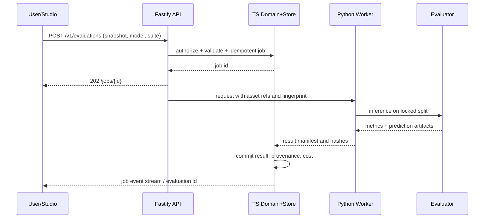

# Architecture — contexts, components and boundaries

## C4 context

Vision Lens has five entrypoints: Python library, Next.js Studio, Node CLI, TypeScript SDK, MCP. External systems include VLM providers (optional), local models, source files/object storage, MLflow artifacts and GitHub for CI. All data flow paths preserve tenant/workspace scope if multi-user is introduced later; the first release is one local workspace with authenticated access for network deployment.

## Containers

| Container | Responsibility | Must not own |
|---|---|---|
| `apps/studio` | visualization, review, async operation state | business rules, model inference, raw secrets |
| `apps/api` | Fastify auth/session, job submission, signed downloads, SSE, tool facade | ML algorithms, direct arbitrary SQL from user |
| `packages/core` | TS workflow/application services, domain store, legacy adapters, audit/event ledger | Python ML numerical code, presentation concerns |
| `packages/contracts` | external domain entities, wire schemas, compatibility metadata | runtime business decisions |
| `packages/cli` | user ergonomics, env/config parsing, programmatic facade | duplicated inference math |
| `packages/sdk` | HTTP client + legacy compatibility | server dependencies imported by default |
| `packages/mcp` | tool registration + scope/policy enforcement | arbitrary disk or shell access |
| `python/visionlens` | ML pipelines, model adapters, evaluation implementations | UI, identity/access policy, TS SQLite store schema ownership |
| `services/{vision,training,agents}` | bounded workers/adapters around Python core | independent copies of core algorithms |

## Component boundaries

- Ingest service hashes bytes and writes immutable `Asset`; dedup references content hashes; dataset snapshots refer to sets of sample IDs and ontology versions.
- Predictions and annotations are separate entities. A model prediction is never silently promoted to ground truth. Reviewer actions produce new append-only annotations with supersession links.
- Worker accepts validated immutable dataset snapshot, model spec, experiment config, resources and budget; produces versioned prediction/eval/model artifacts with hashes.
- Fastify enqueues jobs and returns handles; Python worker consumes jobs under explicit resource and filesystem scopes; stdout JSONL carries protocol data only, logs stderr.
- Studio renders structured data from API. It never directly accesses the content-addressed store from arbitrary browser paths.
- Agent runtime uses named allowlisted domain tools; no generic `exec` or unrestricted filesystem access.

## Sequence: evaluate models

## Failure handling and event ownership

- Submission must be idempotent on (`workspace_id`, `idempotency_key`, operation fingerprint). A retry never starts duplicate paid jobs.
- Worker error is terminal or retryable by typed code; preserve partial artifacts but do not promote them.
- A worker crash yields `LOST` then retry only if operation is idempotent and remaining budget permits; use heartbeat/lease expiry.
- Cancelling a job is requested, not assumed successful until worker ack/exit; no unbounded subprocess orphaning.
- Artifact writing is temp file + hash + atomic commit; metadata status transitions occur only after manifest is safely written.
- Define monotonic timestamps, UTC storage, model/runtime/hardware IDs and deterministic seeds in every run.

## Architecture review gates

Review changes to: schema source-of-truth, runtime boundary, security effects, storage migration, model selection, regulated vertical assumptions. Require ADR for introducing a persistent extra database or job engine.
