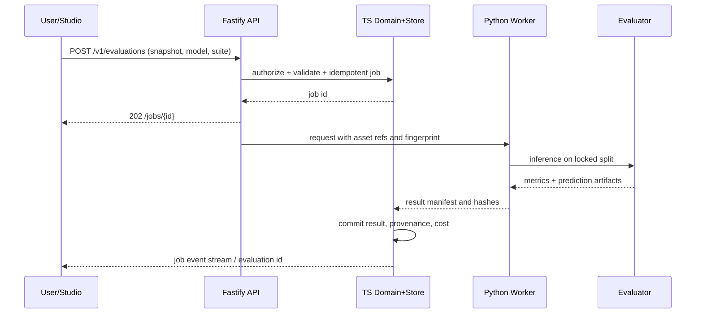

# Vision Lens vNext — Complete canonical design specification

**Generated:** 2026-11-11. **Authority:** design proposal / agent handoff; never apply blindly to a live working tree. **Repository:** erikunha/LAIbemage (`feat/visual-lens` public snapshot).


---

<!-- Source file: README.md -->

# Vision Lens — Canonical Engineering Specification vNext

**Date:** 2026-11-11. **Status:** design target and agent handoff; **not** a claim that these features are built. **Product:** Vision Lens (formerly LAIbemage / ai-image-labeling). **Repository:** `erikunha/LAIbemage`, working development branch `feat/visual-lens`. **Technical direction:** Python-first visual ML runtime + TypeScript-first product/developer platform; one contract spine, two public SDKs.

## How to use this package without losing work

1. Start with `00-ADOPTION-NO-OVERWRITE.md`. This document is essential when a coding agent is already working.
2. Compare the agent's **actual working tree and branch** with `01-REPO-STATE-2026-11-11.md`. The remote branch is a snapshot, not an assertion about unpushed edits.
3. Read `02-ARCHITECTURE-DECISION.md` and `adrs/ADR-011-python-first-ml-runtime.md`. These override the *future technical direction* of the previous design; **they do not invalidate or overwrite shipped TypeScript code**.
4. Read `03-PRODUCT-AND-SUCCESS.md`, `04-ARCHITECTURE-C4.md`, then the specific technical domains `05` through `22`.
5. Execute only the next unblocked implementation specification under `specs/`. Follow the release gates in `23-RELEASE-ROADMAP.md`.
6. Run the validation in `validation/validate_pack.py`. Use `docs` as reference; **do not copy schemas or migration SQL over tracked files** until compared with the live implementation.

## Authority and precedence

- **Reality:** local working tree > HEAD of active branch > publicly inspected `feat/visual-lens` > older `main` > old generated documentation.
- **Design target:** this package supersedes the 2026-11-10 LAIbemage master proposal *only where explicitly stated*. Product direction is approved by the user; implementation and accepted ADRs require repository integration.
- **Existing runtime contracts:** the implemented Zod and store schema in `packages/contracts` and `packages/core/src/store` stay canonical until new versions are deliberately shipped. Example schemas in this ZIP are **proposals**, not replacements.
- **Agent rule:** first produce a discrepancy report, then apply focused changes on a branch; never delete, reset, rebase, or overwrite unrelated user/agent work to fit this blueprint.

## North-star demo

A visitor imports a small licensed visual dataset, audits it, computes visual embeddings, compares a VLM with a local encoder + linear probe, reviews uncertain images, retrains on corrected data, and sees a **strictly held-out** evaluation of quality, p95 latency, cost per accepted result, and human-review work. CLI, Studio, Python library, npm SDK, API, and MCP expose the same audited operations. An investigation agent uses bounded tools and approval gates; it never silently trains, exports private images, or promotes models.

## Read map

| Area | Files |
|---|---|
| Adoption & observed state | `00`, `01`, `02`, `26` |
| Product | `03`, `22`, `24` |
| Architecture | `04`, `05`, `06`, `07`, `08`, `09` |
| Data & ML | `10`, `11`, `12`, `13`, `14`, `15`, `16` |
| Interfaces & operations | `17`, `18`, `19`, `20`, `21` |
| Roadmap, delivery | `23`, `25`, `specs/`, `adrs/` |
| Machine-readable examples | `contracts/proposed/`, `examples/`, `validation/` |
| Prior vision retained | `reference/LAIbemage_Master_2026-11-10.zip` (historical, NOT canonical) |

**Out of scope for first public demo:** SaaS billing and multitenancy, a generic enterprise data labeling replacement, training foundation models, on-device robotics control, real-time camera streams, distributed GPUs, autonomous irreversible actions.

---

<!-- Source file: 00-ADOPTION-NO-OVERWRITE.md -->

# Adoption protocol: do not erase work already in progress

This package is a **new design baseline**, not a wholesale repository replacement. The user's coding agent has already started the pivot. Even the public branch may lag the agent's local work.

## Required handoff sequence

1. Confirm the actual repository path and branch. Record `git status --short`, `git branch -vv`, `git log -8 --oneline`, `git diff --stat`, untracked filenames, existing specs directories and unmerged PRs. Do not assume `main` is the working branch.
2. Take a read-only inventory of `packages/`, `apps/`, `services/`, `docs/`, `specs/`, tests and CI. The public `feat/visual-lens` already contains substantive work.
3. Produce `docs/migration/vision-lens-vnext-reconciliation.md` **in a new branch**: per module list `KEEP`, `AMEND`, `DEFER`, `SUPERSEDE`, `CONFLICT`, with code pointers and test evidence. If a doc exists locally and is more current, retain it and reconcile the new decision into it.
4. Make an explicit compatibility matrix for CLI flags, SDK exports, store migrations, dataset manifests, model artifacts and the Python smoke services. Record all deltas that may break users.
5. Introduce an ADR to express Python ownership of **ML runtime**, not of all domain entities. Keep current TS contracts and stores functional.
6. Divide implementation into small PRs with contracts/tests and rollback. A single PR must not combine renaming packages, Python migration, new Studio and new ML algorithms.

## Read-only inspection commands

```bash
git status --short
git branch -vv
git log --all --oneline --decorate -20
git diff --stat
git ls-files 'specs/**' 'docs/**' 'services/**'
pnpm --filter @vision-lens/contracts test
pnpm --filter @vision-lens/core test
pnpm --filter @vision-lens/cli test
```

Run tests only after checking available dependencies and potential side effects; reports must distinguish executed vs not executed. Do not run dataset downloads or paid model calls as routine inspection.

## Safe application strategy

- Introduce the canonical package in `docs/vnext/` initially, not as blind replacements for `README.md`, `AGENTS.md`, `ROADMAP.md`, or `docs/adr/006-monorepo-ts-python.md`.
- Compare the existing local `specs/001–014` (untracked per current ADR-010) against this package. Existing completed tasks remain **DONE**; new tasks acquire unique IDs (`VLN-...`) rather than reusing old numbers.
- Avoid storing customer images, model weights, huge datasets and API keys in Git. Datasets remain content-hashed and license-aware.
- Change the public PyPI/npm names only after registry availability/license verification. `@vision-lens/sdk` is already present locally but is not a published lightweight HTTP SDK yet.
- No destructive database migrations without backup, forward-only migration verification and a tested restoration procedure.
- If a decision conflicts with a shipped API or accepted ADR, write a new superseding ADR and prove migration, rather than silently revising history.

## Design decisions that *change* versus 2026-11-10

| Previously proposed | Current vNext decision | Effect |
|---|---|---|
| TypeScript domain engine + three Python *service-only* skeletons | **Python-first public vision/ML library**, with existing TS app/domain backbone | Add `python/visionlens` incrementally; keep `services/` adapters |
| TypeScript SDK primarily re-exporting heavy core | Split lightweight typed remote SDK from compatibility/fat in-process exports | Preserve old APIs during transition; publish stable paths by major version |
| Python only behind JSON-lines services | Python users can execute local ML in-process; JS app uses worker protocol | No forced HTTP server to use Python SDK |
| Existing VisA 700-item accuracy as product success | Treat as regression baseline; **no holdout**, not generalization proof | Gate comparisons on leakage-resistant holdout |
| `vision-lens` and `@vision-lens/*` fully public | On public branch, packages are marked unpublished, some private | Registry check/publishing gates before claiming availability |
| Many libraries immediately | Begin with one Python distribution `visionlens` and optional extras | Avoid dependency explosion, preserve small installs |

## Completion criterion

The developer can explain precisely what remains implemented in TS and what moves to Python, with one green end-to-end vertical slice, no lost commits, no accidental API breaks and an archived evidence report.

---

<!-- Source file: 01-REPO-STATE-2026-11-11.md -->

# Observed repository state — public GitHub snapshot

**Inspected:** 2026-11-11, connected GitHub. **Repository:** `erikunha/LAIbemage`. **Main:** commit `027d1c852f5ac5fb23d8de04b916c8b14a9027ad`. **Observed branches:** `main`, `feat/master-rebirth`, `feat/visual-lens` and Dependabot branches. `feat/visual-lens` is ahead of `main` (37 commits by GitHub compare at inspection); it contains additional work beyond `feat/master-rebirth`. Do not infer which branch the user's local agent uses.

## Already present on `feat/visual-lens` (observed files and docs)

| Area | Observed work | Status evidence |
|---|---|---|
| Monorepo | `pnpm`, Turbo, `packages/core`, `cli`, `sdk`, `contracts`; `apps/api`, `studio`; `services/{vision,training,agents}` | Existing source, config, tests |
| Legacy CLI | canonical `vision-lens`; compatibility bin `ai-image-labeling`; old analysis/providers retained | `packages/cli`, README, AGENTS |
| Contracts | 14 domain entities, Zod shapes, OpenAPI 3.1 seed, manifest and version guard | `packages/contracts/src`, tests, snapshots |
| Local store | SQLite migrations, repositories, lineage, provenance; legacy importer | `packages/core/src/store`, tests |
| Benchmark | VisA registry and download, gold manifest 700 images, real VLM predictions and baseline | `datasets/registry.json`, `benchmarks/`, docs |
| Dataset label taxonomy | `normal` and `defect:<label>` mapping | `docs/datasets/visa.md` |
| Python | Three `uv`/hatchling package skeletons; no real ML dependencies in their `pyproject.toml` | `services/vision`, `training`, `agents` |
| API / Studio | TypeScript placeholders only; no functional HTTP or UI application yet | `apps/api/src/index.ts`, `apps/studio/src/index.ts` |
| npm | `@vision-lens/sdk` is an in-repo re-export facade; CLI package is `private: true` | `packages/*/package.json` |
| Product docs | ADR-005–010, architecture, VisA benchmark, legacy import, ROADMAP F0–F5 | `docs/`, `ROADMAP.md` |

## Critical benchmark caveat

The VisA 700-image real-data benchmark reports approximately **macro F1 0.9795** and **balanced accuracy 0.9700** for one `gpt-4o` run. The same documentation explicitly says no held-out split was created: the source had no usable capture-session identifier, and the grouping algorithm placed all items in `train`. This is a **repeatable baseline on the selected images**, not evidence of generalization, leakage-free training comparison, or performance on independent unseen images.

Before any training/active-learning success claim: define true independent train/validation/test partitions using item identifiers, near-duplicate controls and where available production/batch provenance. Record class coverage. If group stratification is infeasible, document a different justified split rather than silently accepting a degenerate one. Lock test data before tuning and never let active learning query test labels.

## Existing program is more advanced than the 2026-11-10 proposal

`ROADMAP.md` reports F0 specs 001–003 as shipped and has F1–F5 planned. The branch docs describe 361 passing tests for the earlier monorepo migration and a real-data benchmark. I inspected source and docs but **did not run those tests or benchmark** during this packaging task. Do not re-open shipped tasks unless a new bug or incompatibility requires it.

## Known unknowns

- Unpushed changes on the user's machine or in the coding agent's worktree.
- Local untracked spec-kit `specs/001–014`, explicitly excluded from Git by ADR-010.
- Whether Python-package names and npm scope can be published; must check registries and trademarks.
- Actual Python runtime parity (currently skeleton only), Studio behavior and production readiness.
- Local benchmark environment, hardware and reproducibility outside the recorded execution.

The read-only inspection contains **no code changes to GitHub**. Use this as the observed anchor; reconcile against `git status` before applying any new spec.

---

<!-- Source file: 02-ARCHITECTURE-DECISION.md -->

# Architecture decision — Python-first for ML, TypeScript-first for platform

## Decision statement

- **Python package `visionlens`** owns in-process image/embedding/training/inference/evaluation capabilities, model adapters, numerical processing and training recipes. Built on PyTorch/scikit-learn/Transformers as optional extras. Its API must work from a Python process *without* Node, Fastify or the npm SDK.
- **TypeScript** keeps frontend, Node CLI, lightweight npm SDK, application API/job orchestration, integrations, local metadata store and current legacy image workflow while migration proceeds.
- **`@vision-lens/contracts` remains canonical** for existing external domain entities, public operation payloads and OpenAPI. Generate Python validators/adapters from versioned JSON Schema; do not invent competing entity variants. Python-specific tensor/recipe types can live in Python with exported schemas when crossing the runtime boundary.
- **Bridge:** long-lived Python worker via versioned JSONL for local app, batch operations and CLI; authenticated API adapter for remote workers when necessary. Transfer binary images via validated asset references or bounded uploads, not base64 megabytes in line-oriented JSON.
- **No big-bang port:** current TypeScript providers and Sharp pipeline remain until contract parity and profiling support moving them. Python-first means ML research/production code ownership, not indiscriminate rewriting.

## Why not all-Python?

A web frontend and npm SDK serve different consumers. Porting the tested Node CLI/provider ecosystem to Python at once would add risk and remove an existing adoption channel without improving ML capability. Likewise, maintaining independent ML algorithms in TS and Python would produce behavioral drift.

## End state

```text
Web Studio (Next.js) --HTTP--+    Python SDK (in-process) --+
Node CLI (vision-lens) ------+                                 
TS npm SDK (@vision-lens/sdk)-+--> App/API & Job orchestration -> VisionLens Python runtime
MCP (TS tools) --------------+                |                  (embeddings, train,
                                             |                   inference, evaluations)
                                TS domain + store (Zod) -------+
                                        |                      |
                                   SQLite + CAS         MLflow / ML artifacts
```

## Compatibility rules

1. `vision-lens` bin remains canonical; `ai-image-labeling` compatibility alias maintained during transition with a sunset policy.
2. `@vision-lens/sdk` is already a *fat local facade*. Do not silently replace exports with HTTP-only client: add a new entrypoint (`@vision-lens/sdk/client`) or major version, keep `@vision-lens/sdk/legacy` where required.
3. Python PyPI package proposal `visionlens` / import `visionlens` (registry availability pending) is **one distribution**, extras `[vision]`, `[training]`, `[agents]`, `[server]`, `[all]` only when package dependencies are truly compatible.
4. Existing three Python service skeletons stay as adapters initially; they may import the public Python package. No forced directory moves in R0.
5. All persisted snapshots and contracts are versioned. Incompatible changes require explicit migration, old fixture support and a version gate.
6. Cross-language operations use stable `operation` codes, error codes and emitted metrics; never parse English model text to decide program control.

**Acceptance of the architecture change:** dual-runtime parity tests pass for one golden inference path, old Node CLI suite stays green, Python works standalone and can be packaged into a wheel, and `@vision-lens/sdk/client` can call the application API without Python installed in the JS consumer environment.

---

<!-- Source file: 03-PRODUCT-AND-SUCCESS.md -->

# Product and portfolio specification

## Positioning

**Vision Lens** is a local-first Visual AI Engineering Workbench: curate visual data, adapt/compare specialized vision models, measure quality and operating cost, and verify agent-assisted decisions. It is not merely an image labeler nor a generic hosted annotation SaaS. Primary audience: CV/ML engineers, applied AI engineers, data quality teams and systems-oriented software engineers.

## Core jobs-to-be-done

1. Given unorganized images, determine dataset completeness, licensing, duplicates, label reliability and splitting risks.
2. Given two model approaches, compare them under the **same locked evaluation protocol** rather than just prompt anecdotes.
3. Given limited budget, decide which examples merit human review or an expensive VLM call.
4. Given review corrections, train/adapt a small model and demonstrate improvement on a genuinely unseen test set.
5. Given suspicious output, trace the prediction through asset bytes, model checkpoint, preprocessing, ontology, prompt, calibration, evidence and feedback.
6. Given a request through Python, TS SDK, CLI, Studio or MCP, execute the **same application operation** with equivalent results and permissions.

## Personas

| Persona | Critical workflow | Acceptance |
|---|---|---|
| Researcher | Compare zero-shot encoder, linear probe, VLM | reproducible metrics, splits and environment |
| Annotation reviewer | Correct uncertain examples | provenance, keyboard flow, batch undo, review time |
| Platform engineer | Deploy/rollback model under limits | artifact pinning, fail-closed gates, telemetry |
| Applied AI engineer | Agent investigates dataset failures | tool traces, bounded permissions, artifact citations |
| Developer | Integrate from Python or npm | typed SDK, examples, reproducible local start |

## Outcome metrics

- **Scientific:** macro F1, per-class precision/recall, balanced accuracy, AUROC where relevant, ECE/Brier, IoU/mAP per task, confidence intervals; measure on explicit test partitions.
- **Operational:** p50/p95 latency, batch throughput, peak RAM/VRAM, failure/retry counts, run success, cost per correctly processed image including human review.
- **Review:** correction yield, minutes per resolved mistake, accepted label count, disagreement types, post-review improvement vs random sampling.
- **Developer:** first successful Python run, first SDK run, CLI/API/Studio/MCP contract parity, setup failures, linkable artifact report.

## First public showcase

A single reproducible walkthrough using a documented licensed subset (VisA or alternate). Visitors can inspect sample records, compare predictions, see the ground truth and review queue, and reproduce a non-paid baseline. BYOK is optional and sandboxed. No marketing claims are made from the current all-train benchmark.

## Not building yet

Multi-tenant SaaS, facial recognition of persons, medical diagnosis, unrestricted code-executing agents, production controls on robotics, large-scale distributed GPU training. Advanced modules may be researched but are not dependencies of the first demo.

---

<!-- Source file: 04-ARCHITECTURE-C4.md -->

# Architecture — contexts, components and boundaries

## C4 context

Vision Lens has five entrypoints: Python library, Next.js Studio, Node CLI, TypeScript SDK, MCP. External systems include VLM providers (optional), local models, source files/object storage, MLflow artifacts and GitHub for CI. All data flow paths preserve tenant/workspace scope if multi-user is introduced later; the first release is one local workspace with authenticated access for network deployment.

## Containers

| Container | Responsibility | Must not own |
|---|---|---|
| `apps/studio` | visualization, review, async operation state | business rules, model inference, raw secrets |
| `apps/api` | Fastify auth/session, job submission, signed downloads, SSE, tool facade | ML algorithms, direct arbitrary SQL from user |
| `packages/core` | TS workflow/application services, domain store, legacy adapters, audit/event ledger | Python ML numerical code, presentation concerns |
| `packages/contracts` | external domain entities, wire schemas, compatibility metadata | runtime business decisions |
| `packages/cli` | user ergonomics, env/config parsing, programmatic facade | duplicated inference math |
| `packages/sdk` | HTTP client + legacy compatibility | server dependencies imported by default |
| `packages/mcp` | tool registration + scope/policy enforcement | arbitrary disk or shell access |
| `python/visionlens` | ML pipelines, model adapters, evaluation implementations | UI, identity/access policy, TS SQLite store schema ownership |
| `services/{vision,training,agents}` | bounded workers/adapters around Python core | independent copies of core algorithms |

## Component boundaries

- Ingest service hashes bytes and writes immutable `Asset`; dedup references content hashes; dataset snapshots refer to sets of sample IDs and ontology versions.
- Predictions and annotations are separate entities. A model prediction is never silently promoted to ground truth. Reviewer actions produce new append-only annotations with supersession links.
- Worker accepts validated immutable dataset snapshot, model spec, experiment config, resources and budget; produces versioned prediction/eval/model artifacts with hashes.
- Fastify enqueues jobs and returns handles; Python worker consumes jobs under explicit resource and filesystem scopes; stdout JSONL carries protocol data only, logs stderr.
- Studio renders structured data from API. It never directly accesses the content-addressed store from arbitrary browser paths.
- Agent runtime uses named allowlisted domain tools; no generic `exec` or unrestricted filesystem access.

## Sequence: evaluate models



## Failure handling and event ownership

- Submission must be idempotent on (`workspace_id`, `idempotency_key`, operation fingerprint). A retry never starts duplicate paid jobs.
- Worker error is terminal or retryable by typed code; preserve partial artifacts but do not promote them.
- A worker crash yields `LOST` then retry only if operation is idempotent and remaining budget permits; use heartbeat/lease expiry.
- Cancelling a job is requested, not assumed successful until worker ack/exit; no unbounded subprocess orphaning.
- Artifact writing is temp file + hash + atomic commit; metadata status transitions occur only after manifest is safely written.
- Define monotonic timestamps, UTC storage, model/runtime/hardware IDs and deterministic seeds in every run.

## Architecture review gates

Review changes to: schema source-of-truth, runtime boundary, security effects, storage migration, model selection, regulated vertical assumptions. Require ADR for introducing a persistent extra database or job engine.

---

<!-- Source file: 05-PYTHON-CORE-AND-PYPI.md -->

# Python-first ML library: package design, extras and execution

## Packaging strategy

Add **one publishable** `python/visionlens/` distribution (tentative PyPI name `visionlens`); keep existing `services/{vision,training,agents}` as thin runnable entrypoints while feature parity lands. Only later decide whether workers should remain separate packages. Do not rename the current services as a first step.

```text
python/visionlens/
  pyproject.toml
  README.md
  src/visionlens/
    __init__.py
    py.typed
    api.py                  # typed local Python facade
    config.py               # Pydantic runtime config
    errors.py               # stable typed exceptions
    io/                     # image decoding, MIME, EXIF, hashing
    data/                   # dataset manifests, validation, sampling
    encoders/               # CLIP/SigLIP/DINO adapters
    models/                 # detector/classifier/VLM adapters
    inference/              # batching, calibration, prediction
    evaluation/             # metrics, splits, reports
    training/               # linear probes, fine-tune recipes
    selection/              # uncertainty/diversity AL
    runtime/                # resource/device selection, cache
    bridge/                 # framed JSONL protocol, version handshake
    agents/                 # optional LangGraph import boundary
  tests/
```

## Dependency policy

- Python minimum **3.11** initially because the existing service skeletons use `>=3.11`; matrix 3.11/3.12/3.13 only after dependencies prove compatibility. Explicit pins in `uv.lock` for the development workspace; compatible ranges in published `pyproject`.
- Base install `pip install visionlens` should include Pydantic, limited I/O and lightweight NumPy only if core operations truly need it; **no mandatory GPU/PyTorch/Transformers/MLflow download**.
- Optional extras `vision`, `train`, `agents`, `server`, `all`. Heavy optional imports lazy and produce actionable `MissingExtraError` with `pip install visionlens[train]`.
- `uv` workspace supported; one workspace lock if dependencies compatible. If ML stacks conflict, use isolated services and per-service locks (do not force an impossible single environment).
- Wheels: pure-Python universal wheel where possible; no bundled model checkpoints; Hugging Face downloads opt-in with explicit license and SHA provenance.
- Public distribution blocked until registry availability, license audit, README and local wheel + sdist tests pass. Avoid accidental typosquatting or naming collision claims.

## Native Python API (proposed)

```python
from visionlens import VisionLens, LocalConfig

with VisionLens.local(LocalConfig(device='auto', cache_dir='./.cache')) as vl:
    dataset = vl.datasets.from_directory('./examples/inspection', ontology='ontology.json')
    embedding_run = vl.embeddings.run(dataset.id, model='siglip2-base')
    report = vl.evaluations.run(
        dataset_snapshot_id=dataset.snapshot_id,
        model_id='siglip2-base',
        suite='classification-v1', split='test'
    )
    print(report.metrics.macro_f1)
```

All operation names and object types are **proposed**. File hashes, split, model revision and device metadata always flow into the run manifest. Must support `device='cpu'` and MPS when actually supported; unsupported operations should explicitly fall back or fail with reason, never silently change method.

## Runtime internals

- `ModelRegistry` resolves exact model revision, model license, preprocessing version and hardware capabilities, not an implicit `latest`.
- `DevicePlanner` checks MPS availability, available memory and operator compatibility; accepts CPU fallback with status. CUDA is optional and isolated in GPU workers.
- `DecodeService` guards decompression bombs, invalid metadata, oversized dimensions and allowed MIME. Decode in restricted process for untrusted media when exposed over HTTP.
- `BatchScheduler` dynamically groups by image dimensions/memory; retries transient resource exhaustion by reducing batch size with bounded attempts and emits explicit `resource_fallback` events.
- `Predictor` returns typed predictions with raw model score and optional separately calibrated probability; a missing calibration is `null` (not confidence 1.0).
- `Evaluator` consumes only a read-only locked split and emits per-sample predictions, metrics and errors; no training writes allowed.
- `Trainer` snapshots recipe/config/weights/optimizer states for resumability. On MPS OOM, checkpoint, reduce batch size or fail explicitly; do not claim equivalence if hyperparameters changed.

## Library tests

`pytest` unit tests with tiny deterministic fixtures; property tests for splits and transforms; parity harness against TS public schemas; CPU CI always green; MPS/CUDA integration optional on actual hardware with recorded environment; publish only from a signed/tagged release and build provenance.

---

<!-- Source file: 06-NPM-SDK-CLI-COMPATIBILITY.md -->

# npm SDK, CLI and TypeScript package evolution

## Observed baseline

`@vision-lens/sdk` already exists on `feat/visual-lens`; its current `index.ts` re-exports the legacy `@vision-lens/core` APIs. `@vision-lens/cli` exposes both `vision-lens` and `ai-image-labeling` bins; the CLI package currently has `private: true`. Do not advertise them as npm-published until verified.

## Recommended package API

- `@vision-lens/sdk/client`: **lightweight, dependency-minimal** typed HTTP client generated or checked against canonical OpenAPI (browser/Node/edge compatible). No Sharp, Node filesystem, GPU bindings or Python requirement.
- `@vision-lens/sdk/legacy`: explicitly named exports for the existing in-process TypeScript workflow; deprecated slowly with compatibility tests.
- Root `@vision-lens/sdk`: keep current exports until a versioned migration; on a future major version, may point to remote client if migration guide is approved.
- `@vision-lens/react` (optional, not prerequisite): data hooks built on the TS client and TanStack Query; UI components separately versioned.
- `@vision-lens/cli`: canonical user command `vision-lens`; fallback `ai-image-labeling` alias until deprecation decision; no breaking changes to existing flags in F0/F1.
- `@vision-lens/mcp`: tools over same API/domain operation registry, not a second business logic layer.

## Example client (proposed)

```ts
import { VisionLensClient } from '@vision-lens/sdk/client';

const vl = new VisionLensClient({ baseUrl: 'http://127.0.0.1:8787', token });
const dataset = await vl.datasets.create({ name: 'inspection' });
const job = await vl.evaluations.start({
  snapshotId: dataset.snapshotId,
  modelId: 'siglip2-base',
  suiteId: 'classification-v1',
  idempotencyKey: 'demo-check-001'
});
const result = await vl.jobs.wait(job.jobId, { signal: abortController.signal });
```

Design constraints: typed errors (`Unauthorized`, `VersionMismatch`, `BudgetExceeded`, `ResourceUnavailable`, `ValidationError`); `AbortSignal`; bounded exponential retry only on idempotent requests and 429/503; ETag conditional GET; pagination; SSE events with reconnect cursor; response redaction; userland fetch injection for testing.

## CLI examples (proposed future commands)

```bash
vision-lens --input ./photos --output ./sorted  # existing path, preserved
vision-lens datasets import ./dataset --ontology ./ontology.json
vision-lens dataset audit --snapshot snap_123 --format json
vision-lens models list --local
vision-lens eval run --snapshot snap_123 --model siglip2-base --suite class-v1
vision-lens arena compare --runs run-a,run-b
vision-lens agent investigate --snapshot snap_123 --goal 'find hard classes' --dry-run
vision-lens mcp serve --transport stdio
```

CLI commands are proposals; no assertion that they work now. CLI must provide `--json` stable envelopes, `--quiet`, exit-code map (0 success, 2 validation, 3 unavailable, 4 policy, 5 runtime), `--dry-run` for side effects, shell completion and `doctor`. Never leak access keys in debug logs.

## Contract parity

For the same immutable dataset/model/config and deterministic evaluator, compare canonical JSON results across Python SDK, CLI, HTTP, npm SDK and MCP. Allow permitted envelope differences (latency, request ID) but forbid divergent labels, sample IDs, fingerprints and evaluation protocol. Golden fixtures include stale contract, unsupported capability and interrupted jobs.

## Publishing controls

- Build TypeScript packages with ESM + valid `exports`, `.d.ts`, `types`, `files` whitelist and package smoke tests installed in a clean temporary consumer.
- Test Node LTS, browser bundling, no unintended `node:*` import in HTTP client.
- npm provenance and registry credentials via trusted CI identity; no `npm publish` from a contributor branch.
- Maintain package version matrix aligned to schema semver; `@vision-lens/sdk/legacy` deprecates only after documented alternative and usage evidence.

---

<!-- Source file: 07-CONTRACTS-PROTOCOL.md -->

# Shared contracts, JSONL worker protocol and API versioning

## Source of truth: do not fork the domain

The **implemented** `packages/contracts/src` Zod schemas and `openapi.snapshot.json` own the stable public entities. Python adapts by generated JSON Schemas/validators and cross-language fixture conformance. Internal Python tensors and experiment recipes may have Pydantic models; when crossing the boundary, export an explicit schema and version it under `contracts/` after validation.

**Current domain invariants:** Prediction != Annotation; immutable original assets; required provenance/lineage; versioned ontology, experiment and model; accurate unknown fields; no invented cost, confidence or latency on legacy import. Existing SQLite store migrations are authoritative until a tested migration supersedes them.

## Protocol envelope (proposed v1)

```json
{
  "protocol": "visionlens.worker.v1",
  "kind": "request",
  "requestId": "req_001",
  "operation": "vision.embed",
  "contractVersion": "1.0.0",
  "workspaceId": "local",
  "params": {
    "snapshotId": "snap_001",
    "encoder": "siglip2-base",
    "outputArtifactDir": "/approved/workspace/artifacts"
  },
  "budget": {"maxSeconds": 120, "maxTokens": 0, "maxUsdMicro": 0}
}
```

Wire details: UTF-8 one JSON object per line; no stdout logs; `hello` includes supported operations, protocol version, model capabilities; `progress`, `result`, `error` event frames always include `requestId`, `seq` and monotonically increasing progress; `result` emitted at most once; typed error `code` and `retryable`. Stderr carries structured logs with secret redaction. Unknown major protocol -> fail closed before work. Limit message bytes, nesting and fields. Enforce request TTL, cancellation, bounds for `max*` values. Never interpolate asset path into a shell command; process is launched from a fixed allowlist.

## Operation catalog (proposed)

| Code | Side effects | Inputs | Result | Tier |
|---|---|---|---|---|
| `dataset.inspect` | none | snapshotId | stats, coverage | read |
| `dataset.audit` | report artifact | snapshotId, rules | auditReportId | analyze |
| `vision.embed` | derived artifacts | snapshotId, encoder | embeddingRunId | bounded compute |
| `vision.predict` | predictions | snapshotId, modelId | predictionRunId | bounded compute |
| `model.train` | checkpoints | dataset splits, recipe, budget | experimentRunId | approval |
| `eval.run` | metrics/report | immutable eval split, modelId | evaluationRunId | bounded compute |
| `annotation.propose` | review queue | sample ids, candidates | proposalId | propose |
| `model.promote` | deployment mapping | model id, gate decision | promotionId | privileged approval |

## Worker handshake

Before accepting operations, validate protocol major, contract major, Python build, installed extras, device capabilities and max frame size; return structured `UNSUPPORTED_PROTOCOL` or `MISSING_EXTRA`. The Fastify process must not assume Python models exist merely because the service imports.

## HTTP API patterns

Existing `packages/contracts/openapi.snapshot.json` is an **entity/operation seed**, not a shipped network API. Do not overwrite it with a hand-written file. Evolve it through Zod source + snapshot test.

Proposed routes:

| Endpoint | Description |
|---|---|
| `POST /v1/datasets` | create dataset workspace and metadata |
| `POST /v1/datasets/{id}/snapshots` | create immutable snapshot |
| `GET /v1/datasets/{id}/audit` | return latest quality audit (not implicit new run) |
| `POST /v1/jobs` | submit named operation with idempotency and budget |
| `GET /v1/jobs/{id}` | job status/result reference |
| `GET /v1/jobs/{id}/events` | SSE with cursor and reconnect |
| `POST /v1/evaluations` | submit immutable evaluation |
| `GET /v1/evaluations/{id}` | metrics, errors, evidence references |
| `POST /v1/annotations/proposals` | queue proposals; no auto-promotion |
| `POST /v1/annotations/{id}/review` | explicit human decision |
| `GET /v1/models` | available models + capabilities |
| `POST /v1/agent-runs` | start bounded investigation; default read-only |

Use POST 202 with `Location` + immutable operation ID for async work. Response schema: `data`, `meta`, optional `error`; never hidden `200` on failed job. Resource authorization runs before lookup to prevent ID probing.

## Schema evolution

- Structural breaking changes bump major. Additional optional fields may be minor if consumers ignore unknowns by policy; existing strict schemas may require explicit versions.
- Each run records contract fingerprint, runtime build, ontology fingerprint and model revision.
- Keep golden payload snapshots for TS->Python->TS parity. Fuzz invalid enums, missing fields, huge arrays and malicious paths.

---

<!-- Source file: 08-DOMAIN-STORE-AND-PROVENANCE.md -->

# Domain store, datasets, immutable artifacts and provenance

## Starting point

`packages/core/src/store` already implements SQLite migrations, repositories, lineage and a legacy importer. **Preserve** this existing store; do not replace with a speculative PostgreSQL schema. SQLite WAL with single writer is the local-first choice. PostgreSQL is a future shared-deployment adapter only if justified.

## Entity relationships

- `Asset`: immutable source bytes, content hash, EXIF sanitation metadata and original URI; write-once CAS.
- `CaptureSession`: camera/source provenance, not a classification label.
- `Sample`: image/region/frame pointing at Asset; split membership belongs to a **DatasetSnapshot**.
- `OntologyVersion`: stable class keys, hierarchy, descriptions, aliases, parents, version fingerprint.
- `Prediction`: model-origin label, model version and raw scores, calibrated score optional, source sample/run.
- `Annotation`: reviewer- or agent-proposed artifact, separate from Prediction; human approval is explicit and append-only.
- `DatasetSnapshot`: immutable list of sample IDs, ontology, split assignments and source fingerprints.
- `ExperimentRun`, `EvaluationRun`, `ModelVersion`: config, metrics, dataset/model/code/environment/provenance links.
- `DerivedArtifact`, `FeedbackEvent`, `AgentRun`, `Deployment`: full history and operational state.

## Invariants

1. No mutable overwrite of original asset or prior annotation; corrections supersede with `superseded_by` and audit event.
2. Train/validation/test membership versioned at snapshot creation. No model trained on test split and no AL selection from test labels.
3. Asset-to-annotation lineage complete; every model output references model revision, preprocessing spec and evaluation protocol.
4. Missing provenance, cost or latency is explicit `unknown`, not zero. Raw self-declared confidence is not probability calibration.
5. Asset IDs stable by full hash when bytes available; remote placeholders flagged, cannot claim verified bytes.
6. Transactions across repositories use idempotency keys; new result artifacts become visible only after checksum and atomic completion.
7. Versioned schema migration uses backup/snapshot, rollback plan and test; no implicit migration in `GET` API.

## Storage layout

```text
VISION_LENS_HOME/
  metadata/visionlens.sqlite
  assets/sha256/aa/bb/<hash>
  artifacts/<kind>/<run-id>/<manifest.json|data...>
  models/<model-id>/<revision>/
  cache/encoders/<revision>/
  sessions/<session-id>/
  temp/<job-id>/
```

No path from client input is trusted; resolve against approved root, forbid traversal/symlinks escaping root, and use size quotas. Encrypt or redact EXIF GPS/device identifiers for publicly displayed assets. Record per-artifact license, consent/usage scope and deletion semantics; lifecycle policies separate git from model/dataset artifacts.

## Cross-language ownership

TypeScript store remains the sole writer for domain metadata initially. Python emits versioned artifact manifests for TS to validate and commit. Python may use a local MLflow store for experiment internals but **must not independently mutate the SQLite domain tables**. Future Python in-process SDK may use an adapter to a stable application repository API; define single-writer guarantees before allowing offline direct DB writes.

## Migration and compatibility

Existing `analysis_results.json` imports via `vision-lens import-run`, not a destructive conversion. Preserve original file bytes and classification provenance. Bump legacy hash to full-config fingerprint only behind a backward-compatible read strategy; unknown provider/model metadata must not be fabricated.

---

<!-- Source file: 09-RUNTIME-JOBS-RESILIENCE.md -->

# Jobs, worker lifecycle and resource governance

## Job lifecycle

`CREATED -> QUEUED -> LEASED -> RUNNING -> (SUCCEEDED|FAILED|CANCELED|PARTIAL)`; `LEASED/RUNNING -> LOST` after heartbeat expiry and then a bounded retry if operation allows it. Terminal state immutable. Cancellation is best effort and has `CANCEL_REQUESTED` intermediate state. Every transition appended to audit ledger.

## Required Job fields

`id, operation, contract_version, workspace_id, subject_id, actor, idempotency_key, input_fingerprint, status, attempt, max_attempts, lease_owner, lease_until, heartbeat_at, created_at, started_at, ended_at, budget, resources, output_manifest_id, error_code, retention_policy`.

## Execution rules

- Persistent queue stored in existing SQLite using one writer and short transactions. Avoid adding Redis/Temporal until evidence of throughput or fault tolerance requirements.
- Lease by compare-and-set; heartbeat while worker running; queue limits per workspace and execution type (CPU vs MPS vs remote provider).
- Resource budget covers wall time, CPU/RAM/VRAM, token calls, USD micro-cost, image count, artifact bytes and nested agent iterations. When exhausted, fail closed with partial report.
- MPS model residency is controlled by a shared semaphore; no two heavy models assumed to fit. `DevicePlanner` checks actual capability at runtime; CPU fallback must be recorded, not hidden.
- Provider 429/503 and transient I/O errors use bounded backoff with jitter; deterministic invalid inputs do not retry. Never retry non-idempotent external action without reconciliation.
- Durable resumption requires checkpoint plus input/config fingerprint equality. Resume refuses changed ontology, model revision or dataset hash.
- SSE stream supports cursor (`Last-Event-ID`), history catchup, reconnect and terminal event, without holding a DB lock.

## Fault injection / acceptance

Kill Python worker mid-embedding, interrupt trainer after checkpoint, exhaust disk, corrupt an image, force provider timeout, issue duplicate idempotency key, cancel training during model save, restart API with pending jobs. Success means no double billing, no orphan models promoted, no corrupted snapshots and useful error reporting to the CLI/UI.

## Observability fields

Each job span includes operation, fingerprint, dataset hash, model revision, worker runtime version, resource decision, attempts, token usage, latency, cost, reviewer minutes and failure code; never raw images or secrets in telemetry.

---

<!-- Source file: 10-INGEST-CURATION-ANNOTATION.md -->

# Visual data ingestion, curation and annotation

## Workflow: import

1. User creates dataset with ontology and source/license policy.
2. Ingest adapter enumerates allowed paths/cloud objects; rejects MIME/path/size violations; reads bytes via bounded stream; hashes source; normalizes orientation as **derived** asset (original immutable).
3. Decode gathers dimensions, EXIF provenance if permitted, optical metadata and quality probes. Store original, thumbnail and optional tiles as separate artifacts with lineage.
4. Dedup: exact SHA256; near-duplicate pHash/dHash with labeled thresholds and false-positive review. Never delete likely duplicates automatically.
5. Create samples, ontology version and immutable snapshot; stage split manifest with counts by label, domain, capture group and provenance.
6. Run data audit and produce a versioned `QualityReport`. User may propose corrections but only reviewer confirmation creates an approved label.

## Supported input types by horizon

- F1: JPEG/PNG/WebP/TIFF; COCO image classification where compatible; common classification directory layout; import/export Label Studio classification.
- F2: bounding box/polygon/mask formats with explicit geometry validity; do not generate fake `full_image` YOLO detection boxes to express class labels.
- F5: video frames/tracks, multisensor capture timestamps, DICOM only under a separate regulated ADR, 3D point clouds via optional adapters.

## Quality audit checks

| Check | Method | Output |
|---|---|---|
| Corrupt/unsafe | decoder + MIME + dimension guards | quarantine reason |
| Exact/near duplicates | SHA256, pHash Hamming, visual embedding neighbors | candidate groups |
| Leakage | image-hash and near-duplicate cluster across splits | flagged pair IDs |
| Class distribution | counts, entropy, rare classes | imbalance report |
| Label conflict | multiple approved labels or model disagreement | adjudication queue |
| Outliers | embedding density/cluster boundaries | samples, not automatic deletions |
| Domain shift | capture metadata, embeddings, per-class rate | slice report |
| Licensing | dataset/model license manifest | allowed/prohibited uses |
| Image quality | blur, exposure, resolution, aspect ratio | feature values and policy |

## Annotation

Annotation types: whole-image category and multi-label (first), bounding box/rotated box, polygon, mask, keypoints, OCR regions (next), temporal event/tracks (frontier). Tooling must support zoom/pan/keyboard, class shortcuts, undo/redo, adjudication, annotations per ontology version and provenance. AI proposed labels remain separate from approved human ground truth, with reviewer action and timestamp. Prevent bulk review accidents with preview/confirm, transaction scope and undo actions.

## Dedup & split policy

Avoid time-window-only grouping as a universal signal. Prefer real acquisition group IDs (camera run, product batch, scene, patient/entity where permitted) with explicit strategy and a fallback when group coverage is absent. The current VisA split degenerates when it assumes capture groups that are not present. A future F1 gate must produce nonempty train/val/test, audited class coverage and duplicate leakage checks; if a class cannot meet the constraints, document exclusion or a leave-group-out alternative rather than fabricating test coverage.

## Export

Dataset cards plus manifest in JSON/Parquet; classification directories for Ultralytics classification; COCO detection exports only when real boxes exist; segmentation export only with masks; manifest records ontology mapping, license, conversion version and loss of semantics. Round-trip tests preserve IDs and geometry where format supports them.

---

<!-- Source file: 11-VISION-MODEL-REGISTRY-INFERENCE.md -->

# Vision models, local/hosted routing, device and inference contracts

## Model capability registry

Each record: `modelId`, `revision`, source URI+digest, license/usage restrictions, required extras, tasks, preprocessing fingerprint, device support (`cpu`, `mps`, `cuda`), input image size, tokenizer/feature extractor, output shape, latency/cost profile, calibration status and trust policy. `latest` never used in saved evaluation runs.

## Candidate families (adapters, not permanent pins)

- Image-text retrieval / zero-shot: CLIP, SigLIP2, OpenCLIP families.
- Visual feature extraction: DINOv2/DINOv3 or alternatives after checking local weights and license.
- Classification: frozen encoder + logistic regression/linear probe, ResNet/ViT transfer learning.
- Detection: YOLO/RT-DETR behind a common geometry contract; commercial use license must be verified.
- Segmentation: SAM family with optional GPU worker; MPS/CPU capability determined experimentally.
- OCR/document layouts: PaddleOCR family when document-intelligence module is activated.
- General VLM: existing OpenAI/Anthropic/Google/Ollama adapters retained until validated migration; structured outputs versioned and provider failures isolated.

## Inference shape

`PredictRequest` binds dataset snapshot + model version + preprocessing + taxonomy + seed + budgets + slice; `PredictResult` is append-only per sample, with `label`, optional geometry, raw score, calibrated probability optional, cost, latency and artifact references. No uncited per-image model claim of certainty. Pixel-level predictions must use consistent coordinate convention (image orientation, normalized vs absolute, shape/version).

## Processing pipeline

`asset reference -> image decode/orientation -> canonical preprocessing -> batch admission -> model inference -> postprocess -> calibration -> schema validation -> persist predictions -> trace`. Every step has a fingerprint; two runs with different preprocessing cannot be compared as equivalent without notation.

## Cascade selection

Local cheapest model first when predicted reliability meets calibrated criterion; escalate uncertain outliers to stronger specialized model, then VLM, then human review. Implement as **policy** with target critical-class recall floor, latency budget and expected unit cost. Route based on held-out calibrated reliability and runtime constraints, not VLM self-reported confidence. Log route decisions for offline evaluation and drift analysis.

## Core safety

Untrusted model artifacts may execute Python pickles or custom code. Prefer safetensors and allowlisted sources/revisions; no auto-loading arbitrary `.pt` from untrusted upload. Disable network in isolated inference worker unless provider access explicitly required. Image text/OCR is data, never agent instruction.

## Hardware matrix

CPU always tested; MPS tested on eligible macOS with recorded PyTorch version and operator limits; CUDA optional separate runner. Benchmark different hardware separately. Report throughput, p50/p95 per image, cold/warm start and peak RSS/VRAM. `device='auto'` emits chosen device and fallback reason.

---

<!-- Source file: 12-TRAINING-EXPERIMENTS-MLFLOW.md -->

# Training, experimentation and model governance

## Training maturity ladder

1. **M0 baseline:** frozen encoder embeddings -> scikit-learn logistic regression; deterministic split and seed; class weights documented.
2. **M1 linear head:** train only classifier head on frozen PyTorch backbone; test calibration and inference export.
3. **M2 fine-tune:** selectively unfreeze layers, optimizers/schedulers, early stopping, augmentations; checkpoint/resume.
4. **M3 task-specific:** anomaly detection, detection/segmentation adapters when labels exist; task-specific metrics.
5. **M4 efficient deployment:** quantization/distillation/ONNX where supported; re-evaluate accuracy, calibration and latency on representative device.

Do **not** train full foundation models or attempt distributed GPUs to demonstrate ML engineering. Demonstrating correct experimental control, leakage prevention and deployment quality is higher-value than a large training job.

## Recipe contract

A recipe must include dataset snapshot fingerprint and partition IDs, ontology version, exact model checkpoint hash, preprocessing fingerprint, optimizer+hyperparameters, seeds, device policy, augmentation pipeline, max epochs, early stopping criterion, checkpoint interval, resources and budget. A single config file is stored alongside the resolved environment and result. Hyperparameter search may use Optuna with bounded trial count; no test-set optimization.

## MLflow

Log resolved params, dataset lineage, code/git commit, train/val curves, confusion matrix, calibration, model file hash, data card and model card; local file backend first. MLflow is experiment system of record for ML artifacts, but the domain store maintains the canonical pointers and promotion approvals. Model promotions require a gate evaluation against locked test data and an explicit reviewer decision. No automatically approved `best_model` after seeing test performance multiple times.

## Experiment discipline

- Fix seeds but do not claim exact reproducibility across all GPU kernels; report tolerance and environment.
- Keep validation for model selection and calibration. Test partition is used for final evidence after selection.
- Check that a metric improvement is robust to repeated seeds, confidence intervals and per-class regression.
- Track training energy or GPU time where feasible; compare total expected cost not only API tokens.
- Treat missing/failed predictions as errors in metrics, not as deleted samples that improve scores.

## Model card minimum

Description, intended tasks, data source/license, train/val/test splits and hashes, critical failure modes, subgroup/slice metrics, calibration, latency hardware, dependencies, security provenance, reviewers, approved use, limitations and rollback target.

## Model promotion gate example

Reject if holdout missing, identity leakage found, critical-class recall below floor, ECE above maximum, cost savings require violating quality, model license disallows distribution, or artifact hash mismatches. Favor explicit `inconclusive` when statistical support is insufficient.

---

<!-- Source file: 13-EVALUATION-SCIENCE.md -->

# Evaluation science and benchmark governance

## Current observed baseline

On `feat/visual-lens`, a real `gpt-4o` run over 700 VisA images reports macro-F1 ≈ 0.9795 and balanced accuracy ≈ 0.9700. **Do not describe it as held-out accuracy**: upstream release lacked capture-group IDs and the generated split placed all 700 in `train`. This remains an artifact integrity/regression reference, not a validated estimate of generalization.

## Mandatory evaluation design (F1 gate)

1. Lock dataset source digest, license, selected sample hashes, ontology version and capture/group strategy.
2. Create nonempty train/validation/test split with independent groups where possible; near-duplicate collision tests run across partitions. Record label coverage; for rare classes report insufficient support.
3. Use training and validation only to fit and select models; **test cannot be used to calibrate a threshold or choose a checkpoint**.
4. Compare candidates on exactly same sample IDs, preprocessing rules (where meaningful) and fixed task schema; missing model outputs count as failures.
5. Record cost with provider/model/token rates as-of date; actual billing separated from estimates. Record p50/p95 latency including model loading separately.
6. Store model-version hash, hardware, Python/TS versions, seeds, prompt template, config fingerprint, split hash and code commit with results.
7. Run at least two seeds or repeats for stochastic models, report confidence intervals or variability; label small samples as exploratory.

## Task metrics

| Task | Metrics | Required caveat |
|---|---|---|
| Classification | macro F1, balanced acc., class precision/recall, confusion, abstention coverage | imbalance and rare classes |
| Anomaly detection | image AUROC/AUPRC, region IoU/PRO where applicable | mask quality + imbalance |
| Detection | mAP@[.5:.95], recall, FP per image | IoU thresholds and annotation quality |
| Segmentation | per-class Dice/IoU | empty/ambiguous masks |
| Retrieval | Recall@k, mAP/nDCG | query relevance judgment |
| Calibration | ECE, Brier, reliability diagram | calibration partition separate from test |
| Active learning | improvement per annotated sample/minute | compare vs random selection |
| Agents | task success, trajectory/tool correctness, evidence accuracy, false-action rate | cannot replace rule checks |
| Cost | $/correct image, labor minutes, p95, failure cost | recorded currency/date/rate |

## Three strata of tests

**Unit:** synthetic swatches, mocks, tiny fixtures validate plumbing. **Integrated real-data:** VisA selected real examples with pinned license and hash validate model output shape and reproducibility. **Scientific holdout:** independent locked test subset validates claims. Do not promote unit-fixture metrics to real-world quality.

## Evaluation anti-patterns to ban

No result without count/split/version; no post-hoc test selection; no test-set active learning; no silent filtering of hard cases; no per-class metric inferred from aggregate score; no claims of cost savings from list-price estimates alone; no swapping provider prompts in an uncontrolled comparison; no claims of calibration from verbal model confidence.

## Required scorecard

Include model names/revisions, dataset and license, N train/N val/N test, split method, per-class table, confusion, calibration, key failure slices, time, API tokens/cost where used, model size, reproducibility tuple, limitations and screenshot-friendly artifact. Regression gates must compare the same metric in the same regime and not silently compare synthetic to real datasets.

---

<!-- Source file: 14-ARENA-COST-OPTIMIZATION.md -->

# Model Arena and AI CostOps engine

## Product objective

Compare model strategies by **quality, coverage, latency, cost and review workload** under one evaluation protocol; choose a non-dominated Pareto candidate or declare insufficient evidence. The tool does not crown a universally best model.

## Arena comparison

On the same immutable evaluation snapshot, run (A) VLM cloud, (B) local zero-shot encoder, (C) encoder+probe or fine-tuned model, (D) cascaded routing. Store per-sample prediction and errors, confidence (raw/calibrated), output category, model ID, time, tokens, API rate timestamp, fallback decision and provenance. UI supports side-by-side disagreements and slicing by class/device/quality.

## Economic model

```text
ExpectedCostPerAcceptedDecision =
  (InferenceCost + CloudEscalationCost + HumanReviewCost
   + InfrastructureCost + EstimatedErrorLoss) / AcceptedCorrectDecisions
```

`EstimatedErrorLoss` requires a domain-specific loss matrix or is marked `not_estimated`. Show both measured cost (API/compute) and hypothetical business loss separately. Report `coverage` and `abstain_rate` alongside accuracy. An optimization that reduces tokens while multiplying false negatives fails the gate.

## Router decision

1. Require valid per-model calibration or empirical reliability for the target domain.
2. Apply user policy on critical class recall, false negative cost, max latency, privacy and offline-only constraints.
3. Decide local/probe first for eligible class/difficulty slices, then stronger vision model, then human review.
4. Record decision reason, route path and cost; enforce calls/budgets.
5. Periodically reevaluate routing on drifted data. Route rules change only after a new versioned policy is approved.

## UX artifacts

Pareto scatter: x = cost per 1k images, y = macro F1 with optional band; markers encode latency; linked per-sample diff viewer; critical-class regression table; a tab for "Where model B loses to A"; cost calculator with actual vs estimated badges; reviewer time assumption inputs. Never show false precision.

## Test cases

VLM self-reports 0.99 confidence but fails calibration; cached output produced by different preprocessing; cloud unavailable; public model license prohibited in commercial dataset; critical class absent in test; route exceeds $ cap; local model too large for MPS; ambiguous category. All must yield explicit, correct status rather than silent fallback.

---

<!-- Source file: 15-ACTIVE-LEARNING-HITL.md -->

# Active learning, annotation flywheel and human governance

## Core loop

Ingest -> validate -> initial predictions -> select unresolved examples -> human correct/approve -> new annotation version -> new training snapshot -> train candidate -> locked independent evaluation -> compare against baseline -> promote only if gate succeeds. The test split is never eligible for selection.

## Selection methods

- Uncertainty: entropy/margin/least-confidence using **calibrated** estimates; if uncalibrated, mark heuristic and do not treat score as probability.
- Diversity: cluster-balanced embedding selection, k-center/coreset, dedup-aware sampling.
- Disagreement: model ensemble variants, but do not elect higher self-reported confidence as truth.
- Business importance: boost rare critical classes, use explicit and auditable class weights.
- Budget: pick under `max_images`, `max_review_minutes`, `max_cloud_usd` and optional error-loss constraints.
- Baseline: compare each strategy against same-sized random and uncertainty-only batches; report variance and confidence intervals.

## Reviewer contract

`ReviewTask`: sample id, current ontology version, proposed label(s), underlying predictions, reason for review, evidence links, cost/time expectation and irreversible action flag. `ReviewDecision`: accept/reject/edit/escalate, human actor, timestamp, ontology, optional reason and supersession pointer. No bulk auto-accept of model labels into ground truth. Keyboard and undo flows are mandatory.

## Dataset versioning

After review, produce new `DatasetSnapshot` with lineage to prior snapshot and explicit changed annotation IDs. Training pipeline consumes that immutable snapshot. Never retroactively alter an earlier benchmark result to look better.

## Scientific exit criteria

For a fixed annotation budget, active selection should deliver a repeatable improvement against random selection on a separate locked test set, or the report should explicitly state "no demonstrated gain". Improvement must include cost of review and token usage to support the CostOps thesis.

## Safeguards

Separate user-approved labels from model suggestions; reviewer cannot inadvertently alter protected test labels; provenance and license carry through augmentations; auto-train requires explicit budget approval; cleanup does not delete historical audit evidence.

---

<!-- Source file: 16-AGENTS-AND-MCP.md -->

# Agent runtime, MCP, approvals and agent evaluation

## Agent objectives

A dataset investigator can explain low-performing classes, audit data errors, compare model runs, propose experiments and assemble evidence-linked recommendations. The agent is not a free-form shell operator, storage administrator or autonomous promotion authority.

## Orchestration

Start with **one LangGraph stateful investigator** and typed tools. Parallelism only for independent read/analyze operations, bounded by budget and rate limiter. Add multiagent specialist subgraphs only after A/B evaluations demonstrate higher task success or less human work for acceptable incremental cost. No decorative swarm.

### Graph state

`run_id`, `session_id`, `dataset_snapshot_id`, `goal`, `plan`, `evidence_refs`, `tool_invocations`, `budget_remaining`, `approvals`, `errors`, `candidate_decisions`, `final_report`, `checkpoint_version`. Long-term memory stores reviewed findings scoped to dataset/ontology/model version; stale facts are invalidated on version change.

### Suggested tools and permissions

| Tool | Effect | Permission |
|---|---|---|
| `inspect_dataset` | read snapshot | read |
| `list_models` | read registry | read |
| `get_evaluation` | read metrics | read |
| `search_images` | read bounded sample index | read |
| `audit_data` | create report artifact | analyze, budget |
| `compare_models` | create comparison artifact | analyze, budget |
| `propose_review_batch` | create proposal | propose |
| `run_evaluation` | compute bounded job | approval when paid/large |
| `train_candidate` | compute and write weights | explicit approval |
| `export_dataset` | writes/export private data | explicit approval |
| `promote_model` | changes deployment | explicit privileged approval |

MCP tools wrap the **same domain operations**, not SQL or arbitrary Python invocation. Tool descriptors include JSON Schema, estimated effects, permission tier, model/hardware requirements, cost envelope and output types. Follow current MCP spec 2026-07-28 where compatible, with clear client negotiation rather than assuming all older clients support features.

## Safety and threat model

- Uploaded images, OCR, EXIF, filenames, external text, user-supplied prompts and model output are **untrusted content**, not policies.
- No tool may read a path merely because it appears in prompt text; assets resolved through scoped IDs and allowlisted roots.
- Deny arbitrary code, `shell`, unbounded web crawl, external uploads, hidden tool registration or unauthorized publication.
- Every side effect requires a declared effect class and a policy check *outside* the LLM. A prompt saying "approved" does not grant permission.
- Agent has max tool calls, latency, provider USD ceiling, token ceiling, loop detection, cancellation and error handling; trace and store write only redacted outputs.
- Review the prompt injection threat surface of model cards, dataset manifests and downloaded dependencies. No untrusted pickle models.

## Evaluation program

Task suites: correct tool choices, grounded citation accuracy, unnecessary tool calls, plan recovery, budget violations, false promotions, injection resistance, interruption/resume, multi-turn memory stale facts. Compare: deterministic program baseline, single agent, specialist subgraph. A new multiagent system does not ship because it 'looks smarter'; it ships only with measured improvement and acceptable failure/cost trade-offs.

## Human approval flow

Agent proposes action and expected effects -> server validates current object versions -> UI presents cost, data scope and diff -> human signs explicit approval token with TTL and exact scope -> executor rechecks before effect -> audit result. Approval is single-use; if artifacts or model version change, approval becomes stale and cannot be replayed.

---

<!-- Source file: 17-STUDIO-UX-ACCESSIBILITY.md -->

# Vision Lens Studio — information architecture and UI implementation

## Routes and screens

| Route (proposal) | Primary job | Interactions |
|---|---|---|
| `/` | onboarding, demo selector, recent datasets | local vs remote connection, capability test |
| `/datasets` | compare datasets | filters, quality badges, virtualized grids |
| `/datasets/:id` | inspect versions and provenance | manifest, source/license, split chart, versions |
| `/datasets/:id/explore` | visual search and hard-case discovery | embeddings, filters, nearest neighbor, clusters |
| `/datasets/:id/annotate` | review labels | keyboard workflow, undo, approve/reject, masks later |
| `/experiments` | training and evaluation runs | search/filter, hardware, params, cost |
| `/experiments/:id` | explain a run | learning curves, traces, artifacts, failures |
| `/arena` | multi-model A/B comparison | same samples, synchronized predictions, Pareto |
| `/models` | versions, cards, deployments | model capability and license, promotion gate |
| `/jobs` | active compute jobs | SSE progress, cancel, retry policy |
| `/agents` | guided investigations | plans, tool traces, evidence, approval queue |
| `/settings` | device, privacy, budgets, providers | validation and diagnostics, no raw key echo |

## Frontend implementation

Next.js App Router, React, TypeScript strict; TanStack Query for server cache, Table/Virtual for large lists, `nuqs` or equivalent URL state for shareable filters, accessible primitives (Radix/shadcn) with explicit design tokens and dark-mode compliance. Drawing canvas for geometry isolated behind a component seam with keyboard fallback; thumbnail prefetch and image virtualization to avoid blocking navigation.

## Interaction design rules

- Guided demo uses real recorded evaluation artifacts, clearly labeled, no hidden live model calls.
- Every model prediction shows its source/model revision; raw vs calibrated score clearly differentiated.
- Reviewer can inspect original, derived image, metadata, alternatives and history before accepting.
- A/B Arena has per-class outcomes and "show only disagreements" toggle; plot has textual/table equivalent.
- Job panels show actual state, queued/running/succeeded/failed/cancelled, resource/price preview and error details.
- Agent Workspace shows evidence cards and tool graph; any paid or write operation requires explicit approval UI.
- Mobile layout favors inspection and review, not heavyweight segmentation authoring. Desktop prioritizes analytics and canvas.

## Accessibility and perf

WCAG 2.2 AA target; semantic roles, focus management, keyboard commands, reduced motion, accessible progress messages, sufficient contrast, error summaries, no color-only status. Images have meaningful alt where applicable (user content privacy considered); annotation geometry has synchronized text list and keyboard editing. Use LCP/INP/CLS and virtual list frame budget as measured performance gates; no arbitrary hard-coded loading delays.

## Acceptance examples

Selecting 10k items with filters does not render 10k DOM nodes; filters persist in URL; a rejected annotation remains in audit; a failed API request can be retried without lost unsaved changes; locale-aware number/currency display does not mutate stored metrics; trace viewers preserve source links and never display secrets.

---

<!-- Source file: 18-FASTIFY-API-AUTH-DEPLOY.md -->

# API, local-first deployment and authenticated access

## Existing state

`apps/api` is currently a placeholder. Do not treat the generated OpenAPI seed as an implemented HTTP service. Build API incrementally around existing TS application services, with Fastify typed routes and Zod-derived request/response validation.

## Local mode

`vision-lens studio` starts or discovers a loopback-only API and the Python worker. Bind to `127.0.0.1`, require a randomly generated session token if the browser is exposed, and protect write endpoints against CSRF/CORS and DNS rebinding. No unauthenticated port on `0.0.0.0` by default. For shared/public demos use a separate hardened deployment profile with restricted accounts and quota.

## API rules

- `/health/live` (no downstream dependency), `/health/ready` (store and worker), `/v1/capabilities` (runtime, CPU/MPS/GPU, model extras), `/v1/jobs`, `/v1/datasets`, `/v1/annotations`, `/v1/evaluations`, `/v1/models`, `/v1/agents`.
- Request/response schemas generated from `@vision-lens/contracts`; custom API envelopes typed. Signed, expiring artifact URLs for large results; no raw filesystem path in browser contract.
- `POST` with `Idempotency-Key` on job creation; bearer token in Authorization header for remote authenticated use; error model with code, message, retryable, correlation ID. Avoid revealing resource existence across scopes.
- SSE for job events with `Last-Event-ID`; event IDs stable; no embedding of large/secret payloads in SSE.
- Model rate limit and cost gate independent of frontend; worker cannot bypass approval via calling internal endpoints.
- OpenAPI snapshot must be a generated artifact, with drift gate and generated light TypeScript client; do not hand-maintain duplicate endpoint schemas.

## Deployment stages

| Profile | Components | Constraints |
|---|---|---|
| Local single-user | SQLite, content-addressed disk, local Python workers, optional VLM APIs | loopback only, CPU/MPS |
| Portfolio hosted demo | static/hosted Studio + restricted API, prerecorded artifacts; optional request-limited worker | no arbitrary upload/execution, rate and spending cap |
| Self-hosted team | authenticated Fastify API, object storage, Postgres adapter if approved | migration, backup, auth, observability |
| GPU worker | optional remote worker with auth and network isolation | model pinning, hardware telemetry |

Use Docker Compose only when it reduces setup complexity; the main Mac MPS local path should not require a CUDA container. No Kubernetes until real scheduling/scale data justify it.

## Data protection

EXIF GPS/device IDs stripped in publicly shown assets, allowlist model artifact sources, image uploads size/dimension/cost bounded, short-lived secrets, no open proxy to third-party model APIs, CORS allowlist, CSP and secure cookies where appropriate. Public demo only synthetic/permitted datasets with documented licenses.

---

<!-- Source file: 19-SECURITY-PRIVACY-SUPPLY-CHAIN.md -->

# Security, privacy and supply-chain requirements

## Assets and trust boundaries

Untrusted surfaces: user images/videos, model weights, file metadata/EXIF/OCR, imported manifests, HTTP URLs, plugin code, MCP tool descriptions from external parties, LLM-generated text and remote provider responses. Trusted components: compiled code + verified manifests, policy engine, authenticated identity, signed approval token and deterministic validators. Never elevate content to instructions.

## Mandatory controls

- Input validation: MIME vs magic bytes, image dimension and decoded-pixel caps, maximum archive files/expanded size, traversal/symlink protection, file path allowlist, SSRF protection for remote URLs.
- Model artifact supply chain: allowlisted repositories, exact revision and SHA, license/terms registry, vulnerability scanning, prefer safetensors, no arbitrary pickle load, limited remote code execution (`trust_remote_code=False` unless explicit audited sandbox).
- Third-party APIs: secrets in env or encrypted secret store, never URL/query/log/prompt; optional BYOK in private mode only with nonpersistent per-session encrypted lifecycle; provider keys not accessible from client after submission.
- Tool permissions: read/analyze/propose/execute/promote policy gate; approval cannot be inferred from prompt; enforce max scope, max cost, max time.
- Authorization: local session token, remote OIDC/short-lived bearer tokens when exposed; deny by default. Explicit access rules on each dataset, artifact and agent run.
- Privacy: default local processing, per-provider egress disclosure, EXIF redaction, retention by artifact class, user-controlled deletion policy and documented data processor roles.
- Licensing: dataset and checkpoint licensing verified before distribution/commercial use; record copyright attribution and compatibility; prevent release when provenance missing.
- Logs and traces: redact secrets, PII, raw images, user-supplied local paths and potentially malicious content; record hashes and IDs instead.

## Agent threat cases

1. OCR text instructs agent to upload private images — no upload tool exposed without explicit approval and allowlisted destination.
2. Malicious dataset file path `../../.ssh` — file ingestion refuses escape after path canonicalization.
3. External MCP server renames tool with privileged description — server only registers pinned allowlisted tools; do not trust imported descriptions.
4. Large image decompression bomb — bounded decoder rejects before allocation.
5. Provider returns malformed structured output — validate schema, treat as model error, do not mutate store.
6. Model artifact attempts arbitrary code via pickle — disallow without isolated trusted execution and explicit operator consent.

## Security acceptance

Documented STRIDE-style threat review; static/dependency/secret scan CI; path traversal and SSRF integration tests; prompt injection regression suite; API auth tests; audit entries for privileged actions; restore test after data deletion and backup. Never publish actual credentials or sensitive source images to the public repo.

---

<!-- Source file: 20-OBSERVABILITY-SRE.md -->

# Observability, performance engineering and operations

## Required telemetry

OpenTelemetry-compatible traces with correlation `workspace_id`, `job_id`, `experiment_id`, `model_revision`, `snapshot_digest`, `request_id`; never include secrets or raw media. Span tree: API submission -> authorization -> store -> worker lease -> data read -> preprocessing -> inference -> calibration -> persistence -> evaluation -> report. Track retries, errors, fallbacks and approval pauses.

## Metrics

- Queue waiting time, worker utilization, job status/rate, worker crashes, lease expiration, cancellations.
- Inference p50/p95 (cold and warm), images/sec, batch size, model load times, peak CPU/RAM/MPS memory.
- VLM provider requests, token input/output, recorded billed cost or estimated list price with label, cache-hit rate, rate limit failures.
- Dataset ingestion bytes/sec, corruption, duplicate rate, index staleness, storage utilization, artifact checksum failures.
- Model quality by slice and time, calibration decay, drift metrics, human-review yield and duration.
- Agent tool trajectory quality, unsupported claims, approval frequency and denied effects.

## SLO/SLA distinction

Internal targets, not promises: >= 99% successful deterministic local job completion on valid fixtures, p95 progress event delay < 2s in local profile, successful job recovery from restart without duplicate result, no undeclared provider calls. Numeric performance thresholds set only after baseline from target hardware. Public SaaS uptime SLO out of scope for first demo.

## Reliability runbooks

- **Provider outage:** short circuit to local eligible model; if quality not safe, abstain. Mark missing cloud result; never silently alter suite comparability.
- **GPU OOM:** release model and memory, back off batch or switch to CPU if permitted; annotate fallback.
- **Index mismatch:** reject stale embedding index if encoder revision/dimensions/preprocessing differ; offer explicit rebuild.
- **Corrupt artifact:** quarantine, rebuild from source refs if available; never repair hash in place.
- **SQLite lock:** single writer, bounded busy timeout, queued writes, persistent event capture.
- **Experiment mismatch:** compare manifest fingerprints, refuse cross-run regression claim if different test subset.
- **Secret exposure:** revoke, rotate, scrub traces and check Git history, document blast radius.

## Release evidence

Every release includes changed contracts, test results, benchmark gates, dependency audit, compatibility matrix, deployment smoke tests and rollback path. Capture a machine-readable provenance tuple linked from the README demo result.

---

<!-- Source file: 21-TEST-AND-QUALITY-PLAN.md -->

# Test pyramid, evaluation harness and quality gates

## Test layers

| Layer | What it proves | Gate |
|---|---|---|
| Type + lint | TS strict, Python typing/lint | PR fast gate |
| Unit/properties | hashes, codecs, splits, calibration, policies, money | PR fast gate |
| Contract | Zod ↔ Python JSON Schema ↔ OpenAPI ↔ npm client | PR blocking |
| Store | SQLite migrations, idempotency, CAS, lineage, crash | PR blocking |
| Worker integration | JSONL handshake/progress/error/cancel, timeout, binary references | PR blocking |
| CLI parity | legacy flags and new operation envelope | PR blocking |
| Studio E2E | guided import/review/arena, accessibility | UI PR blocking |
| Scientific benchmark | real licensed held-out samples, seeds, calibration, slice regressions | model promotion gate |
| Hardware | CPU every PR; MPS actual Mac; CUDA optional | scheduled/feature gate |
| Security/adversarial | malicious files, prompt injection, path traversal, tool privilege | PR security gate |
| Packaging | wheel+sdist, npm ESM typings/browser imports, clean consumer installs | release gate |

## Reconciliation gate first

Before adding Python package, execute existing pnpm tests, contracts snapshot test, store migration tests, benchmark run in an environment where it does not incur paid calls. Capture baseline results and failing tests. Avoid citing older counts as freshly executed.

## Deterministic examples

- Same source hash + config -> same artifact manifest where deterministic; compare only stable fields when hardware/run time varies.
- Dataset split impossible due to missing groups -> explicit `INVALID_SPLIT`/`INCONCLUSIVE`, no fabricated validation.
- Prediction with calibrated probability but no calibration artifact -> validation rejects.
- Model returns unsupported class -> exception/abstain with provenance; no coercion into a valid class silently.
- Duplicate job submission with same idempotency key -> same job/result reference, no second provider charge.
- A failed worker emits error event and never produces a successful model promotion.
- GitHub/npm/python package smoke tests verify new packages without editing global Python/Node installs.

## CI outline

PR fast: `pnpm lint`, `pnpm typecheck`, `pnpm test`, `pnpm check:boundaries`, `uv run ... pytest`, generated-contract drift check, package build. Nightly: license-aware dataset availability, real benchmark where data pre-staged, MPS if self-hosted runner, security checks. Paid VLM CI only with budgeted explicit opt-in and separate restricted token.

## Release criteria

All critical features have test traceability: requirement ID -> spec -> test -> artifact -> measured result. Documentation changed in same PR. No "TODO" in approved API contract, release model card or error handling path. Explicitly list unverified hardware/platforms rather than assuming support.

---

<!-- Source file: 22-PUBLISHING-DEVELOPER-EXPERIENCE.md -->

# Developer experience, distribution and publishing strategy

## End-user journeys

**Python researcher:** `pip install visionlens[vision]` (once published) -> local import with example images -> run embedding/classification -> inspect evaluation JSON; no Node service needed.

**Node developer:** `npm install @vision-lens/sdk` (once published) -> typed API client points at managed/local API -> start job -> SSE updates -> result. No Python process required in npm consumer machine when connecting remotely.

**CLI user:** `vision-lens doctor` -> local model capability report -> import images -> evaluate -> optional `--json` output for scripts. Legacy `ai-image-labeling` stays documented during deprecation.

**Applied AI user:** `vision-lens mcp serve` -> guarded read/analyze/propose tools -> bounded investigation with references -> approval for expensive/privileged actions.

## Publishing readiness

1. Verify PyPI project name, npm scope ownership and trademark availability; until then package names tentative, not claims.
2. Python `uv build`, check wheel and sdist contents, `twine check` or equivalent metadata validator, clean venv install, `py.typed` included, import with minimal extras.
3. npm `pnpm pack` + clean Node test for ESM/types/browser; no secret/symlink/site-dependency leaks.
4. Generate API docs from Zod/OpenAPI, Python docstrings and typed SDK. Publish model/dataset cards, screenshots, tutorial and changelog.
5. Publish via CI trusted identity/OIDC with tag confirmation and provenance, independent semver for Python/TS when APIs decouple; schema compatibility matrix maintained.
6. Release automation requires manual approval for first public release and high-impact major upgrades.

## Semver examples

- Python `0.x`: pre-stable, document breaking changes, release notes and migration.
- TS `@vision-lens/contracts` existing version `1.0.0`: breaking changes require major increment and migration path.
- HTTP `/v1`: separate wire version; not equivalent to npm package major, explicitly documented.
- Bridge `visionlens.worker.v1`: independent protocol major; handshake rejects mismatch.

## Portfolio presentation

Landing README with 60-second GIF or short mp4 (original demo), reproducible demo link, benchmark table with limitations, architecture diagram, readme "How it works", "What failed", CLI+Python+SDK examples and decisions. Highlight tradeoffs: real vs synthetic data, calibrated vs raw confidence, cost-of-error, local-first and safe agent operations. No invented performance claims.

---

<!-- Source file: 23-RELEASE-ROADMAP.md -->

# Release train 2026-Q4 to 2028+ (milestone gates, not promises)

**Execution principle:** each milestone ships one reproducible vertical slice; work already completed in public `feat/visual-lens` stays counted. Dates are planning windows subject to the local agent's actual progress and scientific evidence. No global milestone status may become `DONE` without passing its gate.

| Milestone | Work | Already observed? | Exit gate |
|---|---|---|---|
| **R0 — Reconcile** | compare working tree, branch/docs/spec-kit; record baseline; approve Python-first ADR | partial: monorepo/contracts/store/bench exist | zero lost work; green baseline; signed reconciliation |
| **R1 — Python Library** | public `visionlens` package, base IO, CPU inference, JSONL bridge, contract adapters | Python skeletons only | wheel works without Node; TS↔Python golden parity |
| **R2 — Data Foundation** | robust import, immutable snapshots, audit, leakage-resistant split | TS 14 entities/store/VisA import present | nonempty train/val/test, source/license/hash gating |
| **R3 — Visual Embeddings** | local encoders CLIP/SigLIP, index, hybrid search, CPU/MPS | proposed, not implemented in inspected branch | Recall@k test, hardware profiling, index mismatch tests |
| **R4 — Model Arena** | VLM vs local vs probe, calibration, Pareto, uncertainty comparison | TS benchmark scaffold and VLM baseline present | identical locked test set, per-class + cost/latency reports |
| **R5 — Training Flywheel** | PyTorch/sklearn recipes, MLflow, review/AL, retrain/eval | Python training skeleton | AL vs random benchmark, independent holdout delta |
| **R6 — Studio/API** | Fastify async jobs, Next.js explorer, review, experiment and Arena | placeholders | one guided end-to-end workflow with accessibility and SSE |
| **R7 — SDK/MCP/Agent** | light npm client, CLI/API parity, MCP tool tiers, supervised agent | npm re-export/CLI exist | same operation parity, injection + budget approval gates |
| **R8 — Optimized Runtime** | cascade routing, ONNX where suitable, cost/drift, model promotion | planned | Pareto and regression gate; rollback works |
| **R9 — Frontier** | video, doc intelligence, Physical AI, synthetic factory, agents network | declared only | independent ADR + real demand + dataset/evaluation |

## Dependencies

- R1 requires R0; R2 can advance alongside R1 but must resolve split blocker before R4 or R5.
- R3 depends on library and dataset interfaces (R1/R2).
- R4 depends on valid held-out test split (R2), model adapters (R3) and complete cost recording.
- R5 depends on R4 and human review workflow; no training improvement claims without locked test data.
- R6 can ship early read-only Studio without R5; robust review flow requires R2.
- R7 MCP and agents depend on stable domain operations and policy engine, not on every R6 UI feature.
- R8 follows measured demand/operational data. R9 never blocks public portfolio launch.

## Prioritized next 12 tickets

| ID | Deliverable | Done evidence |
|---|---|---|
| VLN-001 | Reconciliation and baseline report | branch status/diffs, tests, assigned KEEP/AMEND decisions |
| VLN-002 | ADR Python-first + owner map | review and no conflicting code claims |
| VLN-003 | `visionlens` package skeleton | clean venv import, wheel+sdist test |
| VLN-004 | Cross-language protocol v1 handshake | malformed/mismatch/cancel tests |
| VLN-005 | Python CPU embed/infer one adapter | golden predictions with fingerprints |
| VLN-006 | TS facade to Python worker | old CLI continues, explicit new route |
| VLN-007 | Fix split policy for VisA | nonempty disjoint partitions, leakage audit |
| VLN-008 | Evaluation scorecard v2 | held-out metrics, calibration, per-sample artifacts |
| VLN-009 | Local encoder + probe baseline | CPU/MPS recorded runs |
| VLN-010 | Thin npm remote client entrypoint | browser/Node smoke tests; no Sharp transitives |
| VLN-011 | Read-only Studio Arena slice | accessible 10k sample virtualization; controlled API |
| VLN-012 | MCP investigate one dataset | tool parity + injection and budget tests |

## Stop conditions

Do not add second vector database without benchmark showing actual need; no multiagent swarm without evaluated benefit; no GPU training service before CPU/MPS recipe; no external SaaS billing without customer validation. Early public GitHub demo is allowed with R4 read-only artifacts and explicit limitations.

---

<!-- Source file: 24-RISKS-AND-DECISION-GATES.md -->

# Risk register and decision gates

| Risk | Likelihood | Impact | Early signal | Required response |
|---|---|---|---|---|
| Rewriting tested TS core as Python | High | High | large diff/legacy test failures | incremental adapter parity, rollback |
| Python package imports massive GPU deps by default | High | Medium | cold start/install > reasonable | extras and lazy imports |
| VisA benchmark falsely called generalization | High | Critical for credibility | all items train/no holdout | reject claim; fix split |
| npm scope/PyPI name conflict | Unknown | High | registry verification fails | choose compliant package identity |
| Untrusted image/model executes code | Medium | Critical | arbitrary model/file loads | image guards, safe model sources |
| Contract divergence TS/Python | High | High | schema parity mismatches | generated validators, golden tests |
| MPS memory exhaustion | Medium | Medium | OOM, slow fallback | admission, batch tuning, CPU fallback |
| Agent acts beyond scope | Medium | Critical | policy bypass/tool injection | tool allowlist + approvals outside LLM |
| Dataset license invalid for distribution | Medium | High | missing/prohibited license | registry license gate |
| Scope grows without demo | High | High | many half-shipped modules | milestone gate, stop/defer |
| Public API costs uncontrollable | Medium | High | unreconciled model calls | rate/cost caps, BYOK only if safe |
| Versioning/migrations destroy local data | Medium | High | destructive migration attempt | backup, rollback rehearsal |
| Inaccurate cost claims | High | Medium | estimated vs billed conflated | distinct actual/estimate fields |

**Architecture review trigger:** any new language/service ownership change, public API-breaking shape, data retention decision, external model source, privileged MCP tool, deployment to public internet, license change, benchmark protocol modification. Issues requiring scientific confidence must be resolved with controlled experiment rather than a speculative framework.

---

<!-- Source file: 25-SOURCES-AND-HISTORICAL-REFERENCE.md -->

# Evidence sources and legacy design references

## Primary inspected repository resources

- GitHub repository: https://github.com/erikunha/LAIbemage
- Branch: https://github.com/erikunha/LAIbemage/tree/feat/visual-lens
- Current roadmap: `ROADMAP.md` on that branch.
- Current ADRs: `docs/adr/005-vision-lens-pivot.md`, `006-monorepo-ts-python.md`, `007-local-first-infra.md`, `008-evidence-policy.md`, `009-agent-safety-tiers.md`, `010-spec-kit-untracked.md`.
- Existing contracts: `packages/contracts/src/` and `packages/contracts/openapi.snapshot.json`.
- Existing domain persistence: `packages/core/src/store/`, migrations and importer.
- Existing benchmarks: `docs/architecture/benchmark.md`, `docs/datasets/visa.md`, `benchmarks/splits/visa-subset.gold.json`, `benchmarks/predictions/visa-subset.gpt-4o.json`, `benchmarks/baselines/visa-subset.json`.
- Public test baseline claims are authored in those files, not re-executed in this packet.
- Prior blueprint: `reference/LAIbemage_Master_2026-11-10.zip`. Historical source only. If a decision conflicts, this vNext package and later accepted repository ADRs take precedence.

## Official external documentation (verify versions during implementation)

- uv workspaces: https://docs.astral.sh/uv/concepts/projects/workspaces/
- uv packaging/publishing: https://docs.astral.sh/uv/guides/package/
- PyTorch MPS: https://docs.pytorch.org/docs/stable/notes/mps.html
- Pydantic JSON Schema: https://docs.pydantic.dev/latest/concepts/json_schema/
- Fastify JSON Schema validation: https://fastify.dev/docs/latest/Reference/Validation-and-Serialization/
- OpenAPI Specification: https://spec.openapis.org/oas/latest.html
- ONNX Runtime: https://onnxruntime.ai/docs/
- MLflow: https://mlflow.org/docs/latest/
- Hugging Face model security: https://huggingface.co/docs/hub/security-pickle
- MCP specification: https://modelcontextprotocol.io/specification/2026-07-28
- VisA dataset registry: https://registry.opendata.aws/visa/
- COCO: https://cocodataset.org/
- Ultralytics classification dataset formatting: https://docs.ultralytics.com/datasets/classify/

## Evidence quality labels

**Observed** = inspected code/docs on public branch. **Repo-documented** = claim made by repository with artifacts, not re-executed here. **Proposed** = vNext design/implementation. **Measured** = only when an execution report with commands/hardware/artifact hash was actually produced. These labels belong in portfolio material and release reports.

---

<!-- Source file: 26-AGENT-IMPLEMENTATION-GUIDANCE.md -->

# Agent implementation protocol for Codex / Claude Code

## Mission

Implement Vision Lens vNext incrementally and safely, recognizing that `feat/visual-lens` already contains major code and research. Do not restart or replace that work because this ZIP is newer. Focus on contract-aware additions, reproducible evidence and end-to-end slices.

## Mandatory first action

Read `00-ADOPTION-NO-OVERWRITE.md` and run read-only repo inventory; inspect local `specs/` (untracked), current branch, all dirty/untracked work, PRs and CI. Output a reconciliation table with file paths and commit references. No editing until baseline established.

## Definition of a task

Every task must include `ID`, user outcome, in/out scope, source evidence, dependencies, contracts touched, storage effects, security and data-licensing classification, performance/compute budget, test plan, acceptance criteria, rollback, instrumentation and PR diff scope. Prefer a single self-contained feature PR to "architecture rewrite".

## Branch discipline

Use new feature branch off active work (not automatically `main`). Preserve others' commits and worktrees. Do not force push, rebase or delete on assumption. Before editing shared contract file, check current SHA and agent ownership. If conflicts or local edits are detected, stop that specific edit and make a non-destructive proposal; continue on unaffected tasks.

## Execution checklist

1. Write failing test or reproducible failing script.
2. Make minimum change that satisfies API and behavior.
3. Check multi-language parity and existing legacy CLI tests.
4. Run docs/codegen and check snapshots only if inputs deliberately changed.
5. Document actual measurements and unknowns; do not invent benchmark performance.
6. Update ADR/spec status and changelog in same PR.
7. Review diff for secrets and unrelated changes; explain rollback.

## Handoff prompt

> Read `README.md`, `00-ADOPTION-NO-OVERWRITE.md`, `01-REPO-STATE-2026-11-11.md`, `02-ARCHITECTURE-DECISION.md`, `23-RELEASE-ROADMAP.md` and the next selected spec. Inspect the full local working tree before any changes. Reconcile vNext with already-completed work on the active branch; produce a KEEP/AMEND/DEFER/CONFLICT matrix and propose an ADR for Python-first ML package ownership. Do not reset, overwrite or replace existing 001–014 specs or implementations. Implement only one reviewed, independently verifiable vertical slice after baseline tests. Make measured vs proposed results explicit.

## Developer-quality bar

Do not reward volume of agent-generated code. Reward evidence, safe migrations, scientific evaluation, stable interfaces, accessibility, reproducible measurements, tests and low operational burden.

---

<!-- Source file: 27-FRONTIER-CAPABILITY-REGISTER.md -->

# 2027–2030+ capability watchlist (not mandatory release scope)

Every proposed frontier capability must have a clear customer/research use case, source/licensing review, new domain entities, an independent benchmark and a cost/safety gate. Do not promise unsupported sensor/robotics behavior.

| Theme | Candidate capability | Trigger to activate | Primary risk |
|---|---|---|---|
| Video intelligence | frame/event indexing, tracking, temporal retrieval, clip-level evals | suitable video dataset + real query set | storage, temporal error |
| Physical AI data | multi-camera timestamp sync, depth, pose, calibration, sensor bundles | robotics partner and ground truth | physical safety, simulation gap |
| Synthetic visual factory | scenario synthesis with label fidelity checks | rare failure class and real holdout improvement | label corruption, license |
| Open-vocabulary segmentation | concept prompts + region masks | evaluated precision for real domain | false positives and latency |
| Visual RAG | region-level grounded retrieval, OCR + visual embedding | retrieval relevance set and citation protocol | hallucinated evidence |
| Document intelligence | layout, OCR, extraction, provenance | document workload and field-level evals | privacy, schema variance |
| Fine-tuning low-rank / distillation | teacher-student cascade | measured TCO reduction under quality floor | inherited teacher errors |
| On-device/edge inference | exported ONNX/Core ML on compatible devices | device demand and measurement | hardware drift |
| Collaborative annotation | adjudication and quality analytics | multiple reviewers and real throughput need | RBAC/audit complexity |
| Domain knowledge graph | typed object relations and visual evidence | graph queries outperform SQL joins | ontology explosion |
| Federated/private ML | local training and restricted aggregation | verified legal/commercial need | privacy, reproducibility |
| Agents across organizations | A2A/MCP bounded collaboration | multiple independent organizations + contracts | trust and authority boundaries |

## Promotion gate

A research spike becomes a release candidate only if it documents actual sample size, benchmark, architecture impact, owner, operational burden and a falsifiable expected benefit. `R9` stays research until these exist.

<!-- Source file: adrs/ADR-011-python-first-ml-runtime.md -->

# ADR-011 — Python-first visual ML, TypeScript-first application

**Status:** Proposed for acceptance with active coding agent (product direction approved by user, not merged). **Date:** 2026-11-11.

## Context
ADR-006 currently assigns TypeScript the application/domain core and Python service implementation. User now requests an independently publishable Python SDK and deep native ML support.

## Decision
Add one public Python package `visionlens` owning ML algorithms and in-process execution; retain Zod domain/store authority and existing TS code. The Python service skeletons become adapters. Migrate by parity, not rewrite.

## Alternatives considered
Pure Python monolith (loses current TS investments); all-TS ML (weak training ecosystem); separate repos (contract drift).

## Consequences and trade-offs
Additional bridge/packaging complexity, but strong Python research API and no sacrifice of npm/frontend. Requires new tests and staggered packaging.

## Validation before acceptance
- Compare against existing `docs/adr/005–010` and any untracked `specs/` material.
- Prove at least one implementation-compatible golden path and rollback strategy.
- Preserve already shipped TypeScript features and required compatibility aliases.
- Update source docs and appropriate architecture tests in a focused PR.

---

<!-- Source file: adrs/ADR-012-dual-sdks.md -->

# ADR-012 — Python native API + lightweight TypeScript client with compatibility

**Status:** Proposed for acceptance with active coding agent (product direction approved by user, not merged). **Date:** 2026-11-11.

## Context
Current `@vision-lens/sdk` reexports the heavier TS core; user wants Python PyPI and npm library.

## Decision
Keep old root exports during transition, add `@vision-lens/sdk/client` lightweight HTTP client, and add `visionlens` Python local SDK. Version each compatibility surface and publish only after registry checks.

## Alternatives considered
Replace npm SDK immediately (breaks consumers); duplicate Python inference logic in TS (semantic drift).

## Consequences and trade-offs
Staged semver support, package smoke tests and explicit deprecation plan required.

## Validation before acceptance
- Compare against existing `docs/adr/005–010` and any untracked `specs/` material.
- Prove at least one implementation-compatible golden path and rollback strategy.
- Preserve already shipped TypeScript features and required compatibility aliases.
- Update source docs and appropriate architecture tests in a focused PR.

---

<!-- Source file: adrs/ADR-013-jsonl-worker.md -->

# ADR-013 — Versioned JSONL worker for local cross-language execution

**Status:** Proposed for acceptance with active coding agent (product direction approved by user, not merged). **Date:** 2026-11-11.

## Context
CLI, Fastify and Studio need Python ML while retaining Node domain and job orchestration. Serializing full images as JSON is inefficient.

## Decision
Long-lived JSONL worker with request/hello/progress/result/error/cancel envelopes, hashed asset references, resource limits and structured error codes; remote HTTP adapter optional.

## Alternatives considered
Per-image Python subprocess (startup overhead); unbounded gRPC framework early (complexity); shared SQLite dual writes (corruption risk).

## Consequences and trade-offs
Need robust process lifecycle, cancellation, schema parity, stdout discipline and worker health checks.

## Validation before acceptance
- Compare against existing `docs/adr/005–010` and any untracked `specs/` material.
- Prove at least one implementation-compatible golden path and rollback strategy.
- Preserve already shipped TypeScript features and required compatibility aliases.
- Update source docs and appropriate architecture tests in a focused PR.

---

<!-- Source file: adrs/ADR-014-single-writer-domain.md -->

# ADR-014 — Preserve TypeScript SQLite domain store and immutable artifacts

**Status:** Proposed for acceptance with active coding agent (product direction approved by user, not merged). **Date:** 2026-11-11.

## Context
Existing branch implements 14 entities, SQLite migrations, lineage and legacy importer, while Python ML needs persistence.

## Decision
TS store remains single metadata writer initially; Python writes content-addressed ML artifacts and returns manifests. MLflow holds experiment telemetry; domain references it.

## Alternatives considered
Replace with PostgreSQL before use; let Python and TS write same SQLite concurrently without coordination.

## Consequences and trade-offs
Less direct Python store access initially, but no duplicate persistence semantics; later add API-backed adapter.

## Validation before acceptance
- Compare against existing `docs/adr/005–010` and any untracked `specs/` material.
- Prove at least one implementation-compatible golden path and rollback strategy.
- Preserve already shipped TypeScript features and required compatibility aliases.
- Update source docs and appropriate architecture tests in a focused PR.

---

<!-- Source file: adrs/ADR-015-benchmark-integrity.md -->

# ADR-015 — Holdout, split provenance and calibrated quality gates

**Status:** Proposed for acceptance with active coding agent (product direction approved by user, not merged). **Date:** 2026-11-11.

## Context
Existing 700-image VisA baseline is real but all items fell into train, so it is not a held-out generalization measure.

## Decision
Keep historical regression result; add leakage-resistant train/validation/test suite with disjoint samples and explicit limitations. Train/AL never touch test labels. Record calibration and cost separately.

## Alternatives considered
Publish 0.9795 macro F1 as model performance in real world (unsupported); random split without duplicate controls; fabricated acquisition groups.

## Consequences and trade-offs
Tighter scientific gate can postpone a public comparison but protects credibility and real training results.

## Validation before acceptance
- Compare against existing `docs/adr/005–010` and any untracked `specs/` material.
- Prove at least one implementation-compatible golden path and rollback strategy.
- Preserve already shipped TypeScript features and required compatibility aliases.
- Update source docs and appropriate architecture tests in a focused PR.

---

<!-- Source file: adrs/ADR-016-typed-operation-registry.md -->

# ADR-016 — Shared operations across Python, TS, CLI, API, Studio and MCP

**Status:** Proposed for acceptance with active coding agent (product direction approved by user, not merged). **Date:** 2026-11-11.

## Context
Multiple surfaces otherwise produce duplicate business rules and inconsistent safety policies.

## Decision
Central typed operation names/effects/schemas + Zod public contracts; Python validators generated for cross-boundary messages; tool adapters enforce authorization at application layer.

## Alternatives considered
Separate tool implementations per surface, free-form agent SQL and shell tools.

## Consequences and trade-offs
Contracts become an explicit compatibility surface; generated outputs and parity tests required.

## Validation before acceptance
- Compare against existing `docs/adr/005–010` and any untracked `specs/` material.
- Prove at least one implementation-compatible golden path and rollback strategy.
- Preserve already shipped TypeScript features and required compatibility aliases.
- Update source docs and appropriate architecture tests in a focused PR.

---

<!-- Source file: adrs/ADR-017-local-first-hardware.md -->

# ADR-017 — CPU/MPS local-first and optional remote GPU

**Status:** Proposed for acceptance with active coding agent (product direction approved by user, not merged). **Date:** 2026-11-11.

## Context
Portfolio should work on Mac M2 and CPU-only machines without mandatory CUDA infrastructure.

## Decision
CPU reference behavior; optional MPS with memory admission and operator compatibility checks; CUDA remote worker optional by adapter and benchmark evidence.

## Alternatives considered
CUDA-only baseline, automatic deployment of expensive GPU cloud, silent fallback.

## Consequences and trade-offs
Performance varies by hardware; claims must be hardware-scoped and resource fallbacks traceable.

## Validation before acceptance
- Compare against existing `docs/adr/005–010` and any untracked `specs/` material.
- Prove at least one implementation-compatible golden path and rollback strategy.
- Preserve already shipped TypeScript features and required compatibility aliases.
- Update source docs and appropriate architecture tests in a focused PR.

---

<!-- Source file: adrs/ADR-018-agent-permission-gates.md -->

# ADR-018 — Evidence-first agent with tool effects, budgets and human approvals

**Status:** Proposed for acceptance with active coding agent (product direction approved by user, not merged). **Date:** 2026-11-11.

## Context
Vision datasets may carry untrusted OCR/metadata; a generic agent can be induced to exfiltrate or spend.

## Decision
One bounded LangGraph investigator first, tool-effect tiers outside model, approvals with TTL/scope, artifact citations, evals against deterministic baseline. Multiagents research-gated.

## Alternatives considered
Autonomous shell tools, blanket filesystem access, unsupervised training/promotion, multiagent swarm for show.

## Consequences and trade-offs
Extra policy engineering but reduced risk and measurable agent effectiveness.

## Validation before acceptance
- Compare against existing `docs/adr/005–010` and any untracked `specs/` material.
- Prove at least one implementation-compatible golden path and rollback strategy.
- Preserve already shipped TypeScript features and required compatibility aliases.
- Update source docs and appropriate architecture tests in a focused PR.

---

<!-- Source file: specs/VLN-001-reconcile-working-tree.md -->

# VLN-001 — Reconcile public vNext design with unpushed agent work without losing any changes.

**Status:** Proposed / reconcile before implementation. **Owner:** engineering. **Version:** vNext-2026-11-11. **Source:** design decision with repository baseline as observed on `feat/visual-lens`.

## User outcome
Reconcile public vNext design with unpushed agent work without losing any changes.

## In scope / out of scope
Read-only inventory of branches, dirty files, untracked spec-kit, contracts, migrations, tests and CI; classify KEEP / AMEND / DEFER / CONFLICT per subsystem.

**Out of scope:** unrelated feature additions, broad repo rewrite, production SaaS changes, destructive migrations, release claims not backed by tests.

## Technical design and module responsibilities
Do not automatically switch branches. Capture `git status --porcelain=v1`, branch SHA, diffs and package exports. Reuse existing `feat/visual-lens` work and accepted ADRs. Write `docs/migration/vnext-reconciliation.md` in a new branch; unresolved collisions remain explicit.

## Contract and data effects
No public runtime contract change. Output one Markdown report with branch/source provenance and SHA for touched files.

Implementation must identify schema source, ownership, effect tier, idempotency and version. A behavior changing a persisted record must preserve provenance. Any new API operation must have a typed success and error result, and all external inputs are untrusted.

## Acceptance criteria
Report lists every impacted package and conflicting ADR, includes test invocation/evidence and identifies exactly one next implementation PR. No modifications to working code or destructive Git operations.

## Test strategy
Diff inspection, source path existence checks, metadata consistency, explain unavailable local state if necessary.

Each executed test and hardware/protocol measurement is recorded with the exact command, environment, git SHA, exit code and output artifact, not merely summarized as passing.

## Migration / rollback
Delete only the proposed reconciliation file from the feature branch; no runtime effects.

## Agent definition of done
- [ ] Local working tree, branch and related specs inspected first.
- [ ] Failing test/fixture or measurable acceptance test committed before implementation.
- [ ] Correct contracts + error handling + bounded resource use.
- [ ] Existing TS and Python gates pass; new behavior has unit and integration coverage.
- [ ] Docs, ADR/roadmap status and user-facing CLI/SDK examples reconciled.
- [ ] Rollback strategy and unverified aspects documented.

---

<!-- Source file: specs/VLN-002-python-runtime-adr.md -->

# VLN-002 — Approve architecture amendment that makes Python the first-class ML library and keeps TS app/domain spine.

**Status:** Proposed / reconcile before implementation. **Owner:** engineering. **Version:** vNext-2026-11-11. **Source:** design decision with repository baseline as observed on `feat/visual-lens`.

## User outcome
Approve architecture amendment that makes Python the first-class ML library and keeps TS app/domain spine.

## In scope / out of scope
Compare ADR-006, current `services/` skeleton, `packages/contracts`, `@vision-lens/sdk` exports and `packages/core` provider adapters; write superseding ADR-011.

**Out of scope:** unrelated feature additions, broad repo rewrite, production SaaS changes, destructive migrations, release claims not backed by tests.

## Technical design and module responsibilities
Document ownership for datasets, embeddings, preprocessing, training, eval, API, worker, store; specify exact migration and package import rules. Do not rename service directories or break CI.

## Contract and data effects
Defines package `visionlens`, `@vision-lens/sdk/client`, protocol `visionlens.worker.v1` (all pending registry and code review).

Implementation must identify schema source, ownership, effect tier, idempotency and version. A behavior changing a persisted record must preserve provenance. Any new API operation must have a typed success and error result, and all external inputs are untrusted.

## Acceptance criteria
Architecture diagram + import boundary table + inverse dependencies + side-effect permission table accepted by maintainer; package names checked for conflicts before publishing.

## Test strategy
Static architecture boundary tests and a sample serialized JSONL operation validated in TS and Python in next ticket.

Each executed test and hardware/protocol measurement is recorded with the exact command, environment, git SHA, exit code and output artifact, not merely summarized as passing.

## Migration / rollback
Mark ADR superseded, keep existing runtime stable.

## Agent definition of done
- [ ] Local working tree, branch and related specs inspected first.
- [ ] Failing test/fixture or measurable acceptance test committed before implementation.
- [ ] Correct contracts + error handling + bounded resource use.
- [ ] Existing TS and Python gates pass; new behavior has unit and integration coverage.
- [ ] Docs, ADR/roadmap status and user-facing CLI/SDK examples reconciled.
- [ ] Rollback strategy and unverified aspects documented.

---

<!-- Source file: specs/VLN-003-python-public-wheel.md -->

# VLN-003 — Deliver installable typed Python library with no Node dependency or mandatory GPU packages.

**Status:** Proposed / reconcile before implementation. **Owner:** engineering. **Version:** vNext-2026-11-11. **Source:** design decision with repository baseline as observed on `feat/visual-lens`.

## User outcome
Deliver installable typed Python library with no Node dependency or mandatory GPU packages.

## In scope / out of scope
Create `python/visionlens` project, `src/visionlens/__init__.py`, `api.py`, `errors.py`, config, typing marker, optional extras and tests. Keep existing three service skeletons.

**Out of scope:** unrelated feature additions, broad repo rewrite, production SaaS changes, destructive migrations, release claims not backed by tests.

## Technical design and module responsibilities
Use uv-managed package, hatchling or uv_build; default import must not load torch/transformers. Implement `VisionLens.local()` context manager with capability inspection and `close()`, small image metadata operation, typed MissingExtraError. Configure optional `vision`, `training`, `agents`, `server` extras; no registry publish yet.

## Contract and data effects
Python `VisionLens.local(config)` returns public client with `.capabilities()` and `.datasets.inspect(path|id)` prototype. Exception types and serializable config versioned.

Implementation must identify schema source, ownership, effect tier, idempotency and version. A behavior changing a persisted record must preserve provenance. Any new API operation must have a typed success and error result, and all external inputs are untrusted.

## Acceptance criteria
Wheel + sdist build; minimal clean venv import on CPU; package metadata excludes secrets/datasets; missing optional extra gives remediation; 3.11/3.12 smoke, no Node installed.

## Test strategy
`uv build`, `pytest`, `pyright` or `mypy`, package inspect, pip install from wheel, dependency graph check.

Each executed test and hardware/protocol measurement is recorded with the exact command, environment, git SHA, exit code and output artifact, not merely summarized as passing.

## Migration / rollback
Remove new Python package only; existing apps unchanged.

## Agent definition of done
- [ ] Local working tree, branch and related specs inspected first.
- [ ] Failing test/fixture or measurable acceptance test committed before implementation.
- [ ] Correct contracts + error handling + bounded resource use.
- [ ] Existing TS and Python gates pass; new behavior has unit and integration coverage.
- [ ] Docs, ADR/roadmap status and user-facing CLI/SDK examples reconciled.
- [ ] Rollback strategy and unverified aspects documented.

---

<!-- Source file: specs/VLN-004-jsonl-worker-protocol.md -->

# VLN-004 — A reliable versioned bridge between existing TypeScript orchestration and Python runtime.

**Status:** Proposed / reconcile before implementation. **Owner:** engineering. **Version:** vNext-2026-11-11. **Source:** design decision with repository baseline as observed on `feat/visual-lens`.

## User outcome
A reliable versioned bridge between existing TypeScript orchestration and Python runtime.

## In scope / out of scope
Add worker/launcher with `hello`, `request`, `progress`, `result`, `error`, `cancel`; typed frames and bounded IO; no dataset logic migration yet.

**Out of scope:** unrelated feature additions, broad repo rewrite, production SaaS changes, destructive migrations, release claims not backed by tests.

## Technical design and module responsibilities
Long-lived subprocess with closed inherited stdin except request pipe; use stdout only for JSONL, stderr for logs; handshake validates version/extra/device; enforce max frame bytes, deadline, request correlation, graceful SIGTERM and kill on timeout. Maintain per-request sequence, output artifact refs and typed error codes.

## Contract and data effects
`visionlens.worker.v1` frame schema under `contracts/proposed` must be ratified into TS contract package; examples `examples/worker-request.json` and `examples/worker-result.json`.

Implementation must identify schema source, ownership, effect tier, idempotency and version. A behavior changing a persisted record must preserve provenance. Any new API operation must have a typed success and error result, and all external inputs are untrusted.

## Acceptance criteria
10 concurrent requests correlated correctly; malformed JSON rejected without crash; protocol mismatch fails before paid call; cancellation exits worker; no stdout contamination.

## Test strategy
Golden JSONL parity TS/Python; deliberate crash, slow worker, giant line, malformed frame, missing optional dependencies.

Each executed test and hardware/protocol measurement is recorded with the exact command, environment, git SHA, exit code and output artifact, not merely summarized as passing.

## Migration / rollback
Feature flag disables Python bridge; legacy TS path unaffected.

## Agent definition of done
- [ ] Local working tree, branch and related specs inspected first.
- [ ] Failing test/fixture or measurable acceptance test committed before implementation.
- [ ] Correct contracts + error handling + bounded resource use.
- [ ] Existing TS and Python gates pass; new behavior has unit and integration coverage.
- [ ] Docs, ADR/roadmap status and user-facing CLI/SDK examples reconciled.
- [ ] Rollback strategy and unverified aspects documented.

---

<!-- Source file: specs/VLN-005-python-cpu-vision-adapter.md -->

# VLN-005 — Move one ML capability to Python with parity, evidence and safe CPU execution.

**Status:** Proposed / reconcile before implementation. **Owner:** engineering. **Version:** vNext-2026-11-11. **Source:** design decision with repository baseline as observed on `feat/visual-lens`.

## User outcome
Move one ML capability to Python with parity, evidence and safe CPU execution.

## In scope / out of scope
Implement image decoder + visual encoder adapter (CLIP or SigLIP variant) on CPU; canonical preprocessing and embedding artifact output; MPS optional after CPU proof.

**Out of scope:** unrelated feature additions, broad repo rewrite, production SaaS changes, destructive migrations, release claims not backed by tests.

## Technical design and module responsibilities
Pin model revision/license/transform and preprocess fingerprint. Accept hashed asset refs; return vectors in content-addressed artifact with shape/dtype/digest. Avoid JSONL base64 vectors/images. Catch invalid image, OOM and unsupported model; emit latency/memory.

## Contract and data effects
Operation `vision.embed` with immutable dataset snapshot ID and encoder spec; response `embeddingRunId`, vector dim, dtype, count, artifact sha256, error samples.

Implementation must identify schema source, ownership, effect tier, idempotency and version. A behavior changing a persisted record must preserve provenance. Any new API operation must have a typed success and error result, and all external inputs are untrusted.

## Acceptance criteria
No model call without explicit download permission; 5-image fixture works on CPU; result repeatable within documented tolerance; output validates schema and refuses index mixing different dimensions/revisions.

## Test strategy
Preprocessing golden fixture; corrupt image; missing weights; license gate; TS worker bridge; CPU inference.

Each executed test and hardware/protocol measurement is recorded with the exact command, environment, git SHA, exit code and output artifact, not merely summarized as passing.

## Migration / rollback
Model adapter disabled in registry; TS existing textual embeddings retained.

## Agent definition of done
- [ ] Local working tree, branch and related specs inspected first.
- [ ] Failing test/fixture or measurable acceptance test committed before implementation.
- [ ] Correct contracts + error handling + bounded resource use.
- [ ] Existing TS and Python gates pass; new behavior has unit and integration coverage.
- [ ] Docs, ADR/roadmap status and user-facing CLI/SDK examples reconciled.
- [ ] Rollback strategy and unverified aspects documented.

---

<!-- Source file: specs/VLN-006-ts-python-facade.md -->

# VLN-006 — Expose Python ML as a new option without altering old `vision-lens` behavior.

**Status:** Proposed / reconcile before implementation. **Owner:** engineering. **Version:** vNext-2026-11-11. **Source:** design decision with repository baseline as observed on `feat/visual-lens`.

## User outcome
Expose Python ML as a new option without altering old `vision-lens` behavior.

## In scope / out of scope
Add application service PythonWorkerAdapter, config route, logs/metrics; preserve `@vision-lens/core` and `@vision-lens/sdk` historical exports.

**Out of scope:** unrelated feature additions, broad repo rewrite, production SaaS changes, destructive migrations, release claims not backed by tests.

## Technical design and module responsibilities
Route only new `vision.embed` operation to Python. Do not replicate ML calculations in TypeScript. Register capability after worker health handshake. Keep CLI compatibility bin and no silent provider changes.

## Contract and data effects
`VisionOperationPort` with `runEmbedding` returning versioned artifact reference, typed result and no absolute paths in external API.

Implementation must identify schema source, ownership, effect tier, idempotency and version. A behavior changing a persisted record must preserve provenance. Any new API operation must have a typed success and error result, and all external inputs are untrusted.

## Acceptance criteria
Legacy test baseline unchanged; CLI Python route (opt-in) produces same operation result envelope; unavailable Python yields helpful diagnostic; no paid API fallback by default.

## Test strategy
Mock bridge, real CPU bridge integration, legacy CLI snapshots, import-boundary gate.

Each executed test and hardware/protocol measurement is recorded with the exact command, environment, git SHA, exit code and output artifact, not merely summarized as passing.

## Migration / rollback
Flip feature flag to TS-only / disable Python operation.

## Agent definition of done
- [ ] Local working tree, branch and related specs inspected first.
- [ ] Failing test/fixture or measurable acceptance test committed before implementation.
- [ ] Correct contracts + error handling + bounded resource use.
- [ ] Existing TS and Python gates pass; new behavior has unit and integration coverage.
- [ ] Docs, ADR/roadmap status and user-facing CLI/SDK examples reconciled.
- [ ] Rollback strategy and unverified aspects documented.

---

<!-- Source file: specs/VLN-007-leakage-resistant-splits.md -->

# VLN-007 — Replace degenerate all-train VisA split with defensible train/val/test design.

**Status:** Proposed / reconcile before implementation. **Owner:** engineering. **Version:** vNext-2026-11-11. **Source:** design decision with repository baseline as observed on `feat/visual-lens`.

## User outcome
Replace degenerate all-train VisA split with defensible train/val/test design.

## In scope / out of scope
Audit real image IDs, duplicates and grouping fields; generate immutable split with nonempty partitions and class support or explicit unsupported exceptions.

**Out of scope:** unrelated feature additions, broad repo rewrite, production SaaS changes, destructive migrations, release claims not backed by tests.

## Technical design and module responsibilities
Use actual product object/batch provenance where available. For VisA if no capture session IDs, use deterministic per-image split guarded by near-duplicate and label overlap checks; disclose that it cannot prove acquisition-level independence. For anomaly detection preserve appropriate normal-only training policy by task. Lock test hash before model selection.

## Contract and data effects
`SplitManifest` with `strategy`, `seed`, `partitionIds`, `classCounts`, `groupBasis`, `leakageAudit`, `limitations`, `sha256`.

Implementation must identify schema source, ownership, effect tier, idempotency and version. A behavior changing a persisted record must preserve provenance. Any new API operation must have a typed success and error result, and all external inputs are untrusted.

## Acceptance criteria
All three partitions nonempty, mutually exclusive, each eligible class has documented support, duplicate leakage near zero or unresolved warnings, data license present; any failure is blocked/inconclusive, never silently all-train.

## Test strategy
Degenerate group, rare class, duplicate asset, image mask pairing, two-seed reproducibility, dataset hash drift.

Each executed test and hardware/protocol measurement is recorded with the exact command, environment, git SHA, exit code and output artifact, not merely summarized as passing.

## Migration / rollback
Keep original 700-set run as historical regression artifact and introduce new named suite ID.

## Agent definition of done
- [ ] Local working tree, branch and related specs inspected first.
- [ ] Failing test/fixture or measurable acceptance test committed before implementation.
- [ ] Correct contracts + error handling + bounded resource use.
- [ ] Existing TS and Python gates pass; new behavior has unit and integration coverage.
- [ ] Docs, ADR/roadmap status and user-facing CLI/SDK examples reconciled.
- [ ] Rollback strategy and unverified aspects documented.

---

<!-- Source file: specs/VLN-008-evaluation-scorecard-v2.md -->

# VLN-008 — Publish a scientifically interpretable comparison with a truly unseen test set.

**Status:** Proposed / reconcile before implementation. **Owner:** engineering. **Version:** vNext-2026-11-11. **Source:** design decision with repository baseline as observed on `feat/visual-lens`.

## User outcome
Publish a scientifically interpretable comparison with a truly unseen test set.

## In scope / out of scope
Add evaluation reports with per-class metrics, confusion, calibration, latency, actual/estimated cost and reproducibility tuple; compare models on same sample IDs.

**Out of scope:** unrelated feature additions, broad repo rewrite, production SaaS changes, destructive migrations, release claims not backed by tests.

## Technical design and module responsibilities
Score explicit prediction artifacts; missing predictions count as failed; ECE from calibration set only; confidence intervals from bootstrap/group-aware method; report dataset license, model version, device, split digest, costs and limitations. Regression gates run only comparable tuples.

## Contract and data effects
Evaluation report JSON with `protocolVersion`, `testSplitFingerprint`, `metrics`, `perClass`, `cost`, `latency`, `limitations`, `artifactRefs`, `manifestSha256`.

Implementation must identify schema source, ownership, effect tier, idempotency and version. A behavior changing a persisted record must preserve provenance. Any new API operation must have a typed success and error result, and all external inputs are untrusted.

## Acceptance criteria
Report flags prior all-train baseline as non-holdout; no percent accuracy without N and subset; macro-F1 and ECE verified with oracle fixture; gitignored huge outputs retain committed manifest pointers.

## Test strategy
Hand-computed confusion fixture, no-samples error, missing predictions, calibrator provenance, changed dataset fingerprint refusal.

Each executed test and hardware/protocol measurement is recorded with the exact command, environment, git SHA, exit code and output artifact, not merely summarized as passing.

## Migration / rollback
Old reports remain readable; new suite/version used for new claims.

## Agent definition of done
- [ ] Local working tree, branch and related specs inspected first.
- [ ] Failing test/fixture or measurable acceptance test committed before implementation.
- [ ] Correct contracts + error handling + bounded resource use.
- [ ] Existing TS and Python gates pass; new behavior has unit and integration coverage.
- [ ] Docs, ADR/roadmap status and user-facing CLI/SDK examples reconciled.
- [ ] Rollback strategy and unverified aspects documented.

---

<!-- Source file: specs/VLN-009-encoder-probe-training.md -->

# VLN-009 — Prove actual ML training and reproducible model comparison, not few-shot prompt reuse.

**Status:** Proposed / reconcile before implementation. **Owner:** engineering. **Version:** vNext-2026-11-11. **Source:** design decision with repository baseline as observed on `feat/visual-lens`.

## User outcome
Prove actual ML training and reproducible model comparison, not few-shot prompt reuse.

## In scope / out of scope
Frozen encoder embeddings + scikit-learn logistic regression; MLflow artifact/model card, resume; optional PyTorch head.

**Out of scope:** unrelated feature additions, broad repo rewrite, production SaaS changes, destructive migrations, release claims not backed by tests.

## Technical design and module responsibilities
Train only on train split, tune via validation, lock test evaluation, seed and checkpoint, record preprocessing hash. CPU is default and MPS experimental. Compare to zero-shot + cloud VLM under equivalent protocol and report accuracy/cost/latency.

## Contract and data effects
`TrainRecipe` and `ExperimentReport` linked to immutable dataset/model artifacts with `trainDatasetHash` and `validationDatasetHash`.

Implementation must identify schema source, ownership, effect tier, idempotency and version. A behavior changing a persisted record must preserve provenance. Any new API operation must have a typed success and error result, and all external inputs are untrusted.

## Acceptance criteria
Training on a real licensed dataset changes model parameters and produces a digest-pinned checkpoint; independent holdout run; reproducibility tolerance recorded; model registry can load predicted class map.

## Test strategy
Overfit tiny fixture, seed repeat, label leakage rejection, cold/warm inference, checkpoint resume and cancel.

Each executed test and hardware/protocol measurement is recorded with the exact command, environment, git SHA, exit code and output artifact, not merely summarized as passing.

## Migration / rollback
Keep original VLM/embedding baseline, unregister candidate model.

## Agent definition of done
- [ ] Local working tree, branch and related specs inspected first.
- [ ] Failing test/fixture or measurable acceptance test committed before implementation.
- [ ] Correct contracts + error handling + bounded resource use.
- [ ] Existing TS and Python gates pass; new behavior has unit and integration coverage.
- [ ] Docs, ADR/roadmap status and user-facing CLI/SDK examples reconciled.
- [ ] Rollback strategy and unverified aspects documented.

---

<!-- Source file: specs/VLN-010-lightweight-npm-client.md -->

# VLN-010 — Ship API-first TypeScript SDK without forcing Python, Sharp or AWS clients into consumer bundles.

**Status:** Proposed / reconcile before implementation. **Owner:** engineering. **Version:** vNext-2026-11-11. **Source:** design decision with repository baseline as observed on `feat/visual-lens`.

## User outcome
Ship API-first TypeScript SDK without forcing Python, Sharp or AWS clients into consumer bundles.

## In scope / out of scope
Add `@vision-lens/sdk/client` entrypoint, typed fetch, job polling/events, abort/retry policy and errors. Preserve root/legacy exports until major migration.

**Out of scope:** unrelated feature additions, broad repo rewrite, production SaaS changes, destructive migrations, release claims not backed by tests.

## Technical design and module responsibilities
Generate/validate types from OpenAPI 3.1; implement injected fetch, SSE reconnect, typed errors, pagination, ETag, idempotency key, no Node builtins in browser path. Do not publish until permissions and scope verified.

## Contract and data effects
`VisionLensClient({baseUrl,token,fetch})`, methods `.datasets`, `.jobs`, `.evaluations`, `.models`, `.agentRuns`.

Implementation must identify schema source, ownership, effect tier, idempotency and version. A behavior changing a persisted record must preserve provenance. Any new API operation must have a typed success and error result, and all external inputs are untrusted.

## Acceptance criteria
Clean browser and Node installs, no transitive heavy core in `/client` bundle, old root SDK imports still resolve, no secret printed to console.

## Test strategy
Node ESM/CJS? documented ESM policy; web bundling smoke; typed compilation; mock HTTP version skew and retries.

Each executed test and hardware/protocol measurement is recorded with the exact command, environment, git SHA, exit code and output artifact, not merely summarized as passing.

## Migration / rollback
Keep new entrypoint experimental and/or unexport; no legacy impact.

## Agent definition of done
- [ ] Local working tree, branch and related specs inspected first.
- [ ] Failing test/fixture or measurable acceptance test committed before implementation.
- [ ] Correct contracts + error handling + bounded resource use.
- [ ] Existing TS and Python gates pass; new behavior has unit and integration coverage.
- [ ] Docs, ADR/roadmap status and user-facing CLI/SDK examples reconciled.
- [ ] Rollback strategy and unverified aspects documented.

---

<!-- Source file: specs/VLN-011-studio-arena-slice.md -->

# VLN-011 — A clear public visual demo of quality/cost/latency/evidence, backed by actual recorded artifacts.

**Status:** Proposed / reconcile before implementation. **Owner:** engineering. **Version:** vNext-2026-11-11. **Source:** design decision with repository baseline as observed on `feat/visual-lens`.

## User outcome
A clear public visual demo of quality/cost/latency/evidence, backed by actual recorded artifacts.

## In scope / out of scope
Build Next.js with dataset list/details, read-only sample explorer, evaluation compare, job progress, navigation and errors. Review/edit later.

**Out of scope:** unrelated feature additions, broad repo rewrite, production SaaS changes, destructive migrations, release claims not backed by tests.

## Technical design and module responsibilities
Use existing API/domain contracts, virtualized image grid, cached thumbnails, URL filters, accessible metric table and per-class confusion. Show "replay" vs "live" source label. Ensure one screen tells the engineer what improved and what regressed.

## Contract and data effects
API GET dataset/evaluation/models/jobs, SSE jobs; no direct Python imports in frontend.

Implementation must identify schema source, ownership, effect tier, idempotency and version. A behavior changing a persisted record must preserve provenance. Any new API operation must have a typed success and error result, and all external inputs are untrusted.

## Acceptance criteria
Demo loads on desktop/mobile, keyboard paths tested, no fake metrics, 10k item virtual list stays responsive in target browser, screenshots are based on working application.

## Test strategy
Playwright E2E, axe/a11y, performance budget, error/empty/loading states, structured artifact fixture.

Each executed test and hardware/protocol measurement is recorded with the exact command, environment, git SHA, exit code and output artifact, not merely summarized as passing.

## Migration / rollback
Feature flag read-only Studio; CLI/engine independent.

## Agent definition of done
- [ ] Local working tree, branch and related specs inspected first.
- [ ] Failing test/fixture or measurable acceptance test committed before implementation.
- [ ] Correct contracts + error handling + bounded resource use.
- [ ] Existing TS and Python gates pass; new behavior has unit and integration coverage.
- [ ] Docs, ADR/roadmap status and user-facing CLI/SDK examples reconciled.
- [ ] Rollback strategy and unverified aspects documented.

---

<!-- Source file: specs/VLN-012-mcp-dataset-investigator.md -->

# VLN-012 — A bounded agent can explain dataset failures using verified evidence and safely propose experiments.

**Status:** Proposed / reconcile before implementation. **Owner:** engineering. **Version:** vNext-2026-11-11. **Source:** design decision with repository baseline as observed on `feat/visual-lens`.

## User outcome
A bounded agent can explain dataset failures using verified evidence and safely propose experiments.

## In scope / out of scope
MCP stdio tool subset, one LangGraph investigator with read/analyze/propose, approvals for paid training. No arbitrary shell/FS tools.

**Out of scope:** unrelated feature additions, broad repo rewrite, production SaaS changes, destructive migrations, release claims not backed by tests.

## Technical design and module responsibilities
Tool registry wraps existing domain operations, validates snapshot scopes, cost budgets and effects outside LLM. Agent state versioned and checkpointed; report cites artifact IDs; prevention of OCR/prompt injection tested.

## Contract and data effects
Tools `inspect_dataset`, `get_evaluation`, `compare_models`, `propose_review_batch`; typed results + `evidenceRefs` and limitations.

Implementation must identify schema source, ownership, effect tier, idempotency and version. A behavior changing a persisted record must preserve provenance. Any new API operation must have a typed success and error result, and all external inputs are untrusted.

## Acceptance criteria
A test agent finds a known failure case with artifact citations; injection attempts cannot access other paths or spend budget; streaming trace and replay exports usable via Studio/API.

## Test strategy
Golden tasks, tool trajectory, denied tool access, stale approval, crash/replay, single-agent vs deterministic baseline.

Each executed test and hardware/protocol measurement is recorded with the exact command, environment, git SHA, exit code and output artifact, not merely summarized as passing.

## Migration / rollback
Disable MCP tools and agent entrypoint; underlying domain unaffected.

## Agent definition of done
- [ ] Local working tree, branch and related specs inspected first.
- [ ] Failing test/fixture or measurable acceptance test committed before implementation.
- [ ] Correct contracts + error handling + bounded resource use.
- [ ] Existing TS and Python gates pass; new behavior has unit and integration coverage.
- [ ] Docs, ADR/roadmap status and user-facing CLI/SDK examples reconciled.
- [ ] Rollback strategy and unverified aspects documented.
